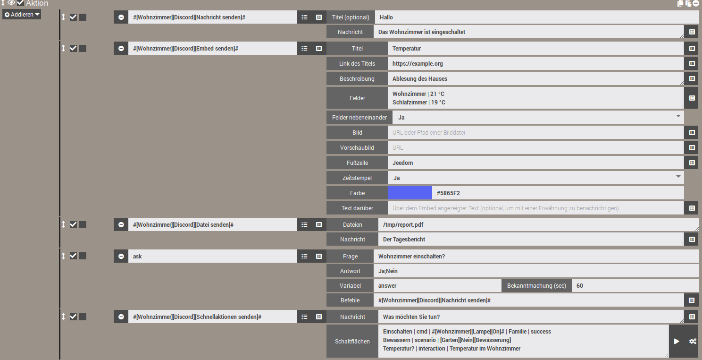
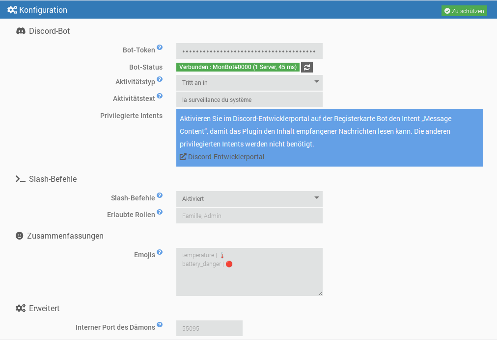
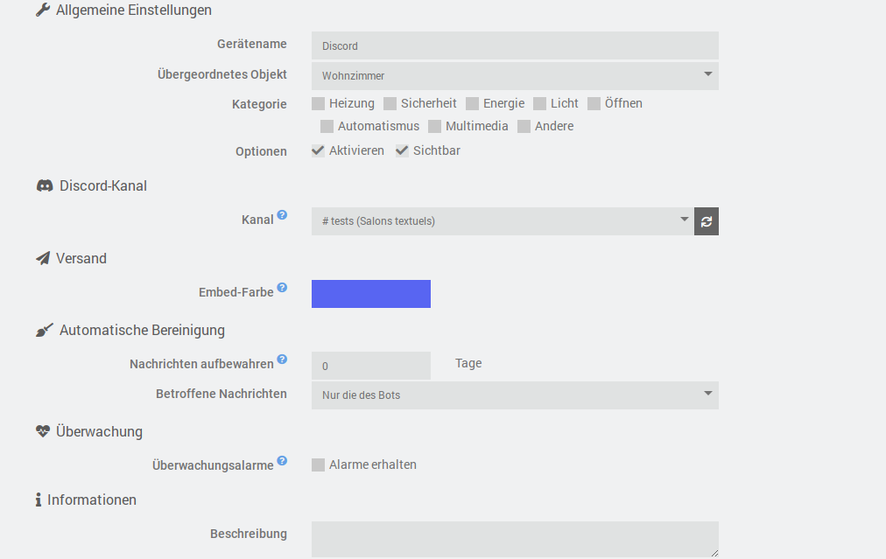
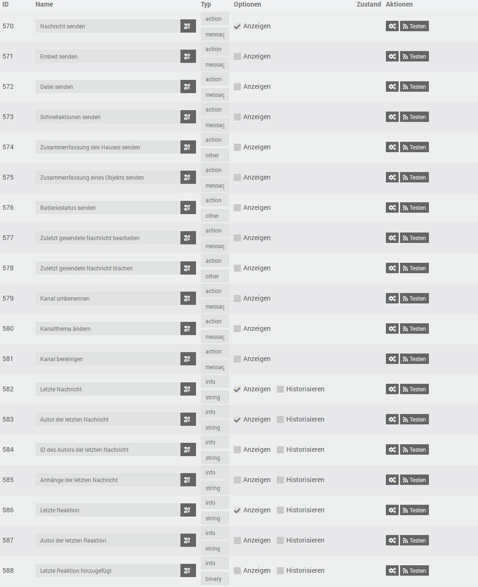
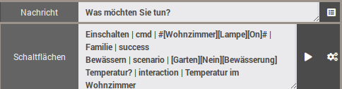

# Plugin JeeDiscord - BETA


> [!warning]  
> Der Bot benötigt den privilegierten Intent **Message Content** (Discord-Entwicklerportal), um den Inhalt von Nachrichten zu lesen. Ohne ihn verweigert Discord die Verbindung und der Dämon stoppt: siehe „Den Discord-Bot erstellen“.  


JeeDiscord verbindet Jeedom über einen Bot mit einem **[Discord](https://discord.com)**-Server. Jedes Gerät entspricht einem Kanal, und das Plugin ermöglicht:  

- **Senden** von Nachrichten, Embeds (formatierte Nachrichten) und Dateien aus Szenarien, mit Erwähnungen;
- **Fragen stellen** (Aktion „Ask“ der Szenarien) mit Schaltflächen oder einem Antwortmenü;
- **Empfangen** der Nachrichten und Emoji-Reaktionen des Kanals;
- **Schnellaktions-Schaltflächen** und **Slash-Befehle** (`/jeedom`, `/clean`), um Jeedom von Discord aus zu steuern;
- Nachrichten **bearbeiten oder löschen**, einen Kanal **bereinigen**, ihn **umbenennen** oder sein Thema ändern (ein Sprachkanal kann als Anzeige dienen);
- **Zusammenfassungen** (Haus, Objekt, Batterien) und **Überwachungsalarme** zu Dämonen und Abhängigkeiten senden.

Es basiert auf der Bibliothek [discord.js](https://discord.js.org/) v14 und der Discord-API v10.  

## Überblick  

  

# Voraussetzungen  

- Jeedom 4.4 mindestens
- Debian 12 mindestens
- Node.js: wird von Jeedom bei der Installation der Abhängigkeiten automatisch installiert

# Den Discord-Bot erstellen  

1. Öffnen Sie das [Discord-Entwicklerportal](https://discord.com/developers/applications) und klicken Sie auf **New Application**.
2. Klicken Sie im Tab **Bot** auf **Reset Token** und kopieren Sie den Token. Er wird danach nicht mehr angezeigt: bewahren Sie ihn sicher auf und teilen Sie ihn niemals.
3. Aktivieren Sie weiterhin im Tab **Bot**, im Abschnitt **Privileged Gateway Intents**, **Message Content Intent**. Die Intents **Presence** und **Server Members** sind nicht erforderlich.
4. Haken Sie im Tab **OAuth2 > URL Generator** die Scopes `bot` und `applications.commands` an, dann die nötigen Berechtigungen (siehe unten). Öffnen Sie die erzeugte URL, um den Bot auf Ihren Server einzuladen.

Empfohlene Berechtigungen für den Bot:

| Berechtigung | Verwendung |
|---|---|
| View Channels | Die überwachten Kanäle sehen |
| Send Messages | Nachrichten senden |
| Embed Links | Formatierte Nachrichten (Embeds) senden |
| Attach Files | Dateien und Schnappschüsse senden |
| Read Message History | Nachrichten finden, um sie zu bearbeiten oder zu löschen |
| Add Reactions | Auf Nachrichten reagieren |
| Manage Messages | Nachrichten löschen (Bereinigung) |
| Manage Channels | Einen Kanal umbenennen oder sein Thema ändern |

# Abhängigkeiten  

Der erste Schritt ist die Installation der Abhängigkeiten: Starten Sie nach der Aktivierung des Plugins ihre Installation auf der Konfigurationsseite des Plugins. Jeedom installiert Node.js selbst, dann die Bibliothek discord.js im Plugin-Ordner. Der Fortschritt steht im Log `jeediscord_packages`.  

# Allgemeine Konfiguration  

Sobald die Abhängigkeiten installiert sind, tragen Sie ein:

- **Bot-Token**: der in Schritt 2 der Bot-Erstellung kopierte Token. Er ist in der Jeedom-Datenbank verschlüsselt und in den Logs ausgeblendet.
- **Aktivitätstyp** und **Aktivitätstext**: Text, der in Discord unter dem Namen des Bots angezeigt wird (zum Beispiel „Benutzerdefiniert“ + „Überwacht das Haus“). Lassen Sie den Text leer, um nichts anzuzeigen.
- **Slash-Befehle** und **Erlaubte Rollen**: siehe „Slash-Befehle“ weiter unten.
- **Emojis**: Emojis der Zusammenfassungen und der Batterien, siehe „Zusammenfassungen“.
- **Interner Port des Dämons** (erweitert): lokaler Port zwischen Jeedom und dem Dämon. Ändern Sie ihn nur bei einem Konflikt mit einem anderen Plugin.

Der **Bot-Status** zeigt, ob der Dämon gestartet und mit Discord verbunden ist, mit dem Namen des Bots, der Anzahl der Server und der Latenz. Eine Änderung der Aktivität wird sofort übernommen, ohne den Dämon neu zu starten. Die Eingabe oder Änderung des Tokens startet den Dämon (neu), wenn die automatische Dämon-Verwaltung aktiviert ist, und der Status aktualisiert sich nach dem Speichern von selbst.



## Der Dämon  

Der Dämon ist ein einzelnes Node.js-Programm, das die Verbindung zu Discord aufrechterhält. Er ist so konzipiert, dass er schlank bleibt:

- er wird mit niedriger Priorität (`nice`) gestartet;
- er fragt Discord nur nach den für das Plugin nützlichen Ereignissen (Server, Nachrichten, Reaktionen);
- seine Caches sind begrenzt (aktuelle Nachrichten, Mitglieder) und werden regelmäßig geleert.

**Einhaltung der Discord-Limits**: Die Ratenbegrenzungen der API (pro Route und global) werden von discord.js verwaltet, das Anfragen in eine Warteschlange stellt, statt sie zu verlieren. Das Plugin fügt eine Warteschlange pro Kanal hinzu, die die Reihenfolge der Aktionen beibehält und wiederholte Aktualisierungen zusammenführt (zum Beispiel das Umbenennen eines Kanals: nur der letzte Wert wird gesendet).

**Verbindung**: Bei einem Netzausfall beim Start versucht der Dämon die Verbindung mit zunehmender Verzögerung erneut (von 15 Sekunden bis 5 Minuten). Nach dem Verbinden erfolgen Wiederverbindungen automatisch. Verweigert Discord die Verbindung (ungültiger Token, Intent „Message Content“ nicht aktiviert), stoppt der Dämon und wird nicht mehr automatisch neu gestartet, um das tägliche Verbindungskontingent von Discord nicht zu erschöpfen. Im Nachrichtenzentrum erscheint eine Meldung: beheben Sie das Problem und speichern Sie dann die Plugin-Konfiguration.

## Logs  

Das Plugin verwendet drei Logs:

- `jeediscord`: Aktionen auf Jeedom-Seite (Start des Dämons, empfangene Ereignisse, Fehler);
- `jeediscord_daemon`: Aktivität des Dämons und Austausch mit Discord;
- `jeediscord_packages`: Installation der Abhängigkeiten.

Auf der Stufe **Debug** protokolliert das Log des Dämons jede an Discord gesendete Anfrage (Methode, Route, Rückgabecode, verbleibendes Kontingent), erreichte Ratenbegrenzungen und den Austausch mit Jeedom. Sensible Informationen werden stets ausgeblendet (`***`): Bot-Token, Jeedom-API-Schlüssel, Interaktions- und Webhook-Token. Der Token erscheint weder in den Logs noch in der Prozessliste des Systems.

# Konfiguration eines Geräts  

Ein Gerät entspricht **einem Discord-Kanal**.

- **Kanal**: Liste der für den Bot sichtbaren Kanäle, nach Server gruppiert. Sie ist verfügbar, wenn der Dämon mit Discord verbunden ist, und aktualisiert sich automatisch, wenn ein Kanal erstellt, umbenannt oder gelöscht wird. Die Schaltfläche zum Aktualisieren erzwingt die Aktualisierung. Der Hinweis „unzureichende Rechte“ kennzeichnet einen Kanal, in dem der Bot keine Nachrichten senden kann.
- **Embed-Farbe**: Randfarbe der in diesem Kanal gesendeten formatierten Nachrichten, verwendet, wenn das Szenario keine angibt.
- **Überwachungsalarme**: Haken Sie „Alarme erhalten“ an, damit dieser Kanal die Störungsalarme erhält (siehe „Überwachung“).
- **Automatische Bereinigung**: Anzahl der Tage, die die Nachrichten des Kanals aufbewahrt werden (0: keine Bereinigung). Die ältesten werden einmal pro Stunde automatisch gelöscht, entweder nur die des Bots oder alle Nachrichten (der Bot braucht dann die Berechtigung „Manage Messages“). Siehe „Einen Kanal bereinigen“.



## Befehle  

Jedes Gerät verfügt über die folgenden, in Szenarien nutzbaren Befehle:

| Befehl | Typ | Funktion |
|---|---|---|
| Nachricht senden | Aktion / Nachricht | Sendet einen Text. Der Titel, falls ausgefüllt, wird in der ersten Zeile fett angezeigt. |
| Embed senden | Aktion / Nachricht | Sendet eine formatierte Nachricht (Titel, Link, Beschreibung, Felder, Bild, Farbe, Fußzeile, Zeitstempel). |
| Datei senden | Aktion / Nachricht | Sendet eine oder mehrere Dateien (lokaler Pfad oder Webadresse) mit optionalem Text. |
| Zusammenfassung des Hauses senden | Aktion / andere | Sendet ein Embed mit den globalen Zusammenfassungen von Jeedom (Temperatur, Luftfeuchtigkeit, Öffnungen...) und dem Batteriestatus. |
| Zusammenfassung eines Objekts senden | Aktion / Nachricht | Sendet die Zusammenfassungen eines Jeedom-Objekts, ausgewählt aus der Objektliste. |
| Batteriestatus senden | Aktion / andere | Sendet die Liste der Geräte mit schwacher Batterie und die Anzahl der guten Batterien. |
| Zuletzt gesendete Nachricht bearbeiten | Aktion / Nachricht | Ersetzt den Text der letzten vom Bot im Kanal gesendeten Nachricht. |
| Zuletzt gesendete Nachricht löschen | Aktion / andere | Löscht die letzte vom Bot im Kanal gesendete Nachricht (alle ihre Teile, falls sie aufgeteilt wurde). |
| Kanal umbenennen | Aktion / Nachricht | Ändert den Namen des Kanals. |
| Kanalthema ändern | Aktion / Nachricht | Ändert das Thema (die oben angezeigte Beschreibung) eines Textkanals. |
| Kanal bereinigen | Aktion / Nachricht | Löscht Nachrichten, die älter als ein bestimmtes Alter sind. |
| Schnellaktionen senden | Aktion / Nachricht | Sendet eine Nachricht mit Schaltflächen, die einen Jeedom-Befehl, ein Szenario oder eine Interaktion ausführen. |
| Letzte Nachricht | Info / andere | Inhalt der letzten im Kanal empfangenen Nachricht. |
| Autor der letzten Nachricht | Info / andere | Anzeigename des Autors (Spitzname auf dem Server, sonst Anzeigename). |
| ID des Autors der letzten Nachricht | Info / andere | Discord-Kennung des Autors, zuverlässig für Szenariobedingungen (ein Name kann sich ändern). |
| Anhänge der letzten Nachricht | Info / andere | Adressen der Anhänge, eine pro Zeile. |
| Letzte Reaktion | Info / andere | Emoji der zuletzt hinzugefügten oder entfernten Reaktion. |
| Autor der letzten Reaktion | Info / andere | Anzeigename der Person, die reagiert hat. |
| Letzte Reaktion hinzugefügt | Info / binär | 1, wenn die Reaktion hinzugefügt wurde, 0, wenn sie entfernt wurde. |



Die Sendebefehle werden in den **Aktionen der Szenarien** verwendet: Wählen Sie den Befehl in der Liste, das passende Formular wird angezeigt. Nur der Befehl „Nachricht senden“ wird standardmäßig im Dashboard angezeigt; die anderen sind ausgeblendet, was ihre Verwendung in Szenarien nicht verhindert (sie können im Tab Befehle des Geräts sichtbar gemacht werden).

# Szenarien  

## Eine Nachricht senden  

Texte von mehr als 2000 Zeichen (Discord-Limit) werden automatisch in mehrere Nachrichten aufgeteilt, bevorzugt an Zeilenumbrüchen.

Dieser Befehl akzeptiert auch von Jeedom übergebene Dateien: von der Aktion **Bericht** eines Szenarios erzeugte Berichte, von anderen Plugins gesendete Schnappschüsse usw.

### Erwähnungen  

In Texten können Sie erwähnen:

| Syntax | Ergebnis |
|---|---|
| `@{Spitzname}` | ein Mitglied, gesucht nach Benutzername, Anzeigename oder Spitzname auf dem Server |
| `@&{Rolle}` | eine Rolle, gesucht nach ihrem Namen |
| `#{Kanal}` | ein Link zu einem Kanal |

Die native Discord-Syntax (`<@id>`, `<@&id>`) funktioniert ebenfalls. Eine nicht gefundene Erwähnung bleibt als einfacher Text stehen. `@everyone` und `@here` benachrichtigen niemanden.

Die Suche nach Mitgliedern erfolgt über den Namen und benötigt den privilegierten Intent „Server Members“ nicht.

### Funktionsweise des Sendens  

Das Senden ist asynchron: Das Szenario läuft sofort weiter, und die Nachricht wird in die Warteschlange des Kanals gestellt. Die Nachrichten eines Kanals gehen immer in der richtigen Reihenfolge ab. Dateien werden beim Aufruf gelesen: Sie können eine temporäre Datei direkt nach dem Befehl löschen.

Vor dem Senden prüft das Plugin die Berechtigungen des Bots im Kanal (sehen, Nachrichten senden, Links einbetten, Dateien anhängen). Bei fehlender Berechtigung oder einem Fehlschlag wird ein Fehler im Log `jeediscord` protokolliert.

## Ein Embed senden  

In einem Szenario zeigt der Befehl ein eigenes Formular mit einem Feld pro Zeile. Die Schaltfläche am Zeilenende fügt den Wert eines Jeedom-Info-Befehls (zum Beispiel eine Temperatur) in die Textfelder ein:

- **Titel** und **Link des Titels**: der Link macht den Titel anklickbar;
- **Beschreibung**: Haupttext (maximal 4096 Zeichen);
- **Felder**: ein Feld pro Zeile in der Form `Name | Wert` (maximal 25 Felder). **Felder nebeneinander** (Ja oder Nein) zeigt sie in Spalten an;
- **Bild**: Webadresse eines Bildes oder Pfad einer Bilddatei auf Jeedom, die dann der Nachricht beigefügt wird. **Vorschaubild**: Webadresse eines kleinen Bildes, oben rechts angezeigt;
- **Fußzeile**; **Zeitstempel** (Ja: Datum und Uhrzeit des Sendens); **Farbe** (die Auswahl oder ein Code `#RRGGBB`, sonst die Farbe des Geräts);
- **Text darüber**: Text, der über dem Embed angezeigt wird. In einem Embed platzierte Erwähnungen lösen keine Benachrichtigung aus: setzen Sie sie hierher, um jemanden zu benachrichtigen.

Zu lange Texte werden gekürzt, um die Discord-Limits einzuhalten (insgesamt 6000 Zeichen pro Embed).

## Eine Datei senden  

Geben Sie den vollständigen Pfad einer Datei **oder ihre Webadresse** (`http://` oder `https://`) an, eine pro Zeile. Discord akzeptiert 10 Dateien pro Nachricht: darüber hinaus werden mehrere Nachrichten gesendet. Die maximale Dateigröße hängt von der Boost-Stufe des Servers ab (10 MB ohne Boost, 50 MB auf Stufe 2, 100 MB auf Stufe 3). Zu große Dateien werden ignoriert und im Log gemeldet.

**Webadressen**: Die Datei wird zunächst von Jeedom in seinen temporären Ordner (`/tmp/jeedom/jeediscord/download`) heruntergeladen, dann wie eine lokale Datei gesendet und direkt nach dem Senden gelöscht. Das Szenario wartet das Ende des Downloads ab, bevor es fortfährt. Die Datei heißt `sendDiscord`, gefolgt von einer aus dem Inhaltstyp abgeleiteten Endung (zum Beispiel `sendDiscord.png`), unabhängig vom Namen in der Adresse; Weiterleitungen werden verfolgt, und der Download ist auf 60 Sekunden und 100 MB begrenzt. Adressen im lokalen Netz (zum Beispiel das Bild einer Kamera) werden akzeptiert. Zugangsdaten und Parameter einer Adresse werden nie in die Logs geschrieben. Bei einem Fehlschlag wird eine Warnung im Log `jeediscord` protokolliert und die Datei ignoriert. Eine Adresse darf Kommas enthalten: nur der Zeilenumbruch trennt zwei Dateien.

Aus Sicherheitsgründen können die Konfigurationsdateien von Jeedom (`core/config`), Systemordner (`/etc`, `/root`...) und versteckte Dateien oder Ordner nicht gesendet werden.

Das Feld „Dateien“ akzeptiert auch Szenariovariablen und Tags. Beispiel mit einem von einem Webdienst erzeugten und in den Kanal gesendeten Diagramm:

<details markdown='1'>
<summary>Klicken Sie, um das Beispiel eines Codeblocks zu sehen</summary>

```php
// Beispiel: ein von quickchart.io (Drittdienst) erzeugtes Diagramm, anschließend in den Kanal gesendet
$werte = array(0, 0.2, 1.5, 0);                           // durch Ihre Messwerte ersetzen
$config = "{type:'bar',data:{labels:['1h','2h','3h','4h'],datasets:[{label:'mm',data:[" . implode(',', $werte) . "]}]}}";
$url = "https://quickchart.io/chart?format=png&c=" . urlencode($config);

// Speichert die Adresse in einer VARIABLE des Szenarios...
$scenario->setData("chartUrl", $url);
```

Geben Sie in der folgenden Aktion „Datei senden“ `variable(chartUrl)` in das Feld „Dateien“ ein. Achtung: `setData` erzeugt eine Variable, die mit `variable(...)` gelesen wird, während `tag(...)` die mit `$scenario->setTags(...)` gesetzten Tags liest.
</details>

## Eine Frage stellen (Aktion „Ask“ der Szenarien)  

Die Befehle „Nachricht senden“, „Embed senden“ und „Datei senden“ können in der Aktion **Ask** eines Szenarios gewählt werden (das Feld „Befehl“ der Aktion).

- **Mit möglichen Antworten** (zum Beispiel `Ja;Nein`): Unter der Frage wird eine Schaltfläche pro Antwort angezeigt. Ab 10 Antworten ersetzt sie ein Dropdown-Menü (maximal 25 Antworten).
- **Ohne vorgegebene Antwort** (`*`): Es wird keine Schaltfläche angezeigt; die Frage weist darauf hin, mit einer Nachricht zu antworten, und die nächste im Kanal geschriebene Nachricht ist die Antwort.

Sobald eine Antwort gegeben wird oder die Frist abläuft, werden die Schaltflächen deaktiviert und die Nachricht nennt, wer was geantwortet hat (oder „Keine Antwort“). Die Antwort wird in der Variable des Szenarios gespeichert, wie bei den anderen Messaging-Plugins. Jede Person, die im Kanal schreiben kann, darf antworten.

Eine Frage bleibt gültig, solange die Frist nicht abgelaufen ist und der Dämon nicht neu gestartet wurde: Nach einem Neustart werden ihre Schaltflächen beim nächsten Klick einfach deaktiviert.

## Zusammenfassungen  

Drei Befehle senden ein Zusammenfassungs-Embed, auszulösen aus einem Szenario (zum Beispiel ein zeitgesteuerter Auslöser am Morgen) oder über eine Schnellaktions-Schaltfläche:

- **Zusammenfassung des Hauses senden**: die in Jeedom definierten globalen Zusammenfassungen (Temperatur, Luftfeuchtigkeit, Helligkeit, Leistung, Öffnungen...), mit der Anzahl guter, schwacher und kritischer Batterien in der Fußzeile.
- **Zusammenfassung eines Objekts senden**: die Zusammenfassungen des Objekts, dessen Namen Sie im Feld „Objekt“ angeben. Die Schaltfläche am Zeilenende (Würfel-Symbol) öffnet die Liste der Jeedom-Objekte; Sie können den Namen auch von Hand oder eine Szenariovariable eingeben.
- **Batteriestatus senden**: die Geräte mit schwacher (orange) oder kritischer (rot) Batterie, von der schwächsten zur stärksten, mit den Schwellen von Jeedom (denen des Geräts, falls es welche definiert). Die Farbe des Embeds folgt dem niedrigsten Stand. Ist alles in Ordnung, sagt es die Nachricht.

> [!warning]  
> Wie in der Menüleiste von Jeedom zeigt die Zusammenfassung des Hauses nur die „hochgereichten“ Zusammenfassungen. Definieren Sie auf der Seite des Objekts (Werkzeuge > Objekte, Abschnitt Zusammenfassungen) den Befehl der Zusammenfassung und haken Sie dann für diese Zusammenfassung **Bis in der Gesamtübersicht** an (so heißt das Feld in der Jeedom-Oberfläche); ohne dieses Häkchen erscheint sie nur in „Zusammenfassung eines Objekts senden“. Wird keine Zusammenfassung hochgereicht, weist die Nachricht darauf hin.  

Die **Emojis** vor jeder Zusammenfassung und jedem Batteriestand lassen sich in der Plugin-Konfiguration anpassen: eine Zeile `Schlüssel | Emoji` pro Emoji (Schlüssel: `temperature`, `humidity`, `luminosity`, `power`, `motion`, `security`, `door`, `windows`, `shutter`, `light`, `outlet`, `battery_ok`, `battery_warning`, `battery_danger`, `alert`, `recovery`). Ein fehlender Schlüssel behält sein Standard-Emoji.

## Kamera-Schnappschüsse  

Es ist das **Kamera**-Plugin, das die Schnappschüsse aufnimmt und sendet: Sie setzen also **keinen** Kamerabefehl in JeeDiscord, sondern umgekehrt. Wählen Sie in einer Szenarioaktion den Befehl **„Enregistrer“** der Kamera (französisch für „Aufnehmen“, zum Beispiel `#[Wohnzimmer][Meine Kamera][Enregistrer]#`, im Dashboard ausgeblendet, aber in Szenarien verfügbar) und füllen Sie seine beiden Felder aus. Achtung: Der Befehl „Capture“ des Kamera-Plugins speichert nur eine Datei auf Jeedom: er sendet nichts.

- **Anzahl Schnappschüsse oder Optionen** (Feld „Nombre captures ou options“): die Anzahl der Schnappschüsse (zum Beispiel `1`) oder Optionen des Kamera-Plugins in der Form `nbSnap=3 delay=2` (Anzahl der Schnappschüsse und Sekunden zwischen zwei Schnappschüssen);
- **Befehl, der die Schnappschüsse sendet** (Feld „Commande message d'envoi des captures“): der JeeDiscord-Befehl, der die Bilder erhält, zum Beispiel **[Wohnzimmer][Discord][Nachricht senden]** (oder „Datei senden“). Verwenden Sie die Befehlsauswahl am Zeilenende.

Das Kamera-Plugin ruft dann diesen Befehl mit den Dateien der Schnappschüsse auf, die in den Kanal des Geräts gesendet werden. Das Feld „Dateien“ des JeeDiscord-Befehls wird in diesem Fall nicht verwendet: es dient für Dateien, deren Pfad Sie selbst angeben. Die Schnappschüsse werden beim Senden gelesen, wie die anderen Dateien (siehe „Eine Datei senden“ für Größenlimits und abgelehnte Ordner).

**Den Schnappschüssen beigefügter Text**: Der an JeeDiscord übergebene Text kommt vom Kamera-Plugin. Standardmäßig sendet es einen Text der Art „Alerte sur la caméra *Name* à *Datum*“ (auf Französisch). Um ihn zu ersetzen, fügen Sie `message=` im Optionsfeld hinzu, mit Anführungszeichen, wenn der Text Leerzeichen enthält: `nbSnap=1 message="Schnappschuss angefordert:"`. Der Parameter `title=` wird vom Kamera-Plugin nicht berücksichtigt. Mit „Nachricht senden“ als Ziel wird der Text über den Bildern angezeigt; mit „Datei senden“ begleitet er sie.

## Die letzte Nachricht bearbeiten oder löschen  

Die Befehle „Zuletzt gesendete Nachricht bearbeiten“ und „Zuletzt gesendete Nachricht löschen“ wirken auf die **letzte Sendung des Bots im Kanal** (Nachricht, Embed, Datei, Frage oder Schnellaktionen), auch wenn ein langer Text in mehrere Nachrichten aufgeteilt wurde (die Bearbeitung betrifft den letzten Teil, das Löschen alle). Sie werden nach den bereits wartenden Sendungen ausgeführt: Ein Szenario kann also senden und sofort danach bearbeiten oder löschen.

- Die Bearbeitung ersetzt den **Text** der Nachricht; Embeds, Dateien und Schaltflächen bleiben erhalten. Erwähnungen `@{Spitzname}` werden wie beim Senden aufgelöst.
- Die letzte Nachricht wird vom Dämon gespeichert: Nach einem Neustart des Dämons gibt es bis zur nächsten Sendung keine Nachricht mehr zu bearbeiten oder zu löschen (im Log wird dann ein Fehler protokolliert).

## Einen Kanal umbenennen, sein Thema ändern  

Die Befehle „Kanal umbenennen“ und „Kanalthema ändern“ ändern Namen und Thema des Kanals des Geräts. Der Bot muss die Berechtigung **Manage Channels** (oder die Administratorrolle) haben.

- Ein **Text**kanal ist immer kleingeschrieben, mit Bindestrichen statt Leerzeichen („Mein Haus“ wird zu `mein-haus`): das ist die Regel von Discord.
- Ein **Sprach**kanal akzeptiert Leerzeichen, Großbuchstaben und Emojis. Er kann daher als **Anzeige** dienen: Erstellen Sie ein mit einem Sprachkanal verknüpftes Gerät und aktualisieren Sie seinen Namen aus einem Szenario, zum Beispiel `🌡️ Wohnzimmer: #[Wohnzimmer][Sonde][Temperatur]# °C`. Der Name ist auf 100 Zeichen begrenzt, das Thema auf 1024 (und nur Textkanäle haben ein Thema).
- **Discord begrenzt diese Änderungen auf 2 alle 10 Minuten pro Kanal.** Um nicht zu blockieren, werden die während der Wartezeit eintreffenden Anfragen zusammengeführt: nur der letzte Wert wird gesendet. Es wird auch nichts gesendet, wenn Name oder Thema bereits die des Kanals sind. Rufen Sie diese Befehle also nicht bei jeder schnellen Änderung eines Wertes auf: Die Anzeige hinkt dann nur einige Minuten hinterher.

## Einen Kanal bereinigen  

Der Befehl „Kanal bereinigen“ löscht Nachrichten, die älter als ein bestimmtes Alter sind (in Stunden oder Tagen; 0 für alle), wahlweise **nur die des Bots** oder **alle Nachrichten** (Berechtigung „Manage Messages“ erforderlich). Angeheftete Nachrichten bleiben immer erhalten. Dieselbe Bereinigung läuft jede Stunde für die Geräte mit einer Aufbewahrungsdauer (siehe „Konfiguration eines Geräts“).

Discord erlaubt das Massenlöschen nur für Nachrichten, die jünger als 14 Tage sind. Ältere Nachrichten werden einzeln gelöscht, im von Discord vorgegebenen Tempo: höchstens 100 pro Durchlauf, der Rest wird beim nächsten Durchlauf erledigt (eine Zeile im Log `jeediscord` weist darauf hin). Jeder Durchlauf prüft höchstens 1000 Nachrichten. Die Anzahl der gelöschten Nachrichten wird im Log `jeediscord` protokolliert.

## Schnellaktionen  

Der Befehl „Schnellaktionen senden“ sendet eine Nachricht mit Schaltflächen, **die aktiv bleiben** (auch nach einem Neustart des Dämons). Er wird in einem Szenario verwendet: Fügen Sie eine Aktion hinzu und wählen Sie dann **[Objekt][Gerät][Schnellaktionen senden]** in der Befehlsliste. Tragen Sie ein:

- **Nachricht**: der über den Schaltflächen angezeigte Text;
- **Schaltflächen**: eine Schaltfläche pro Zeile im Format `Beschriftung | Typ | Ziel | erlaubte Rollen | Farbe`.

| Feld | Inhalt |
|---|---|
| Beschriftung | Text der Schaltfläche. |
| Typ | `cmd` (Aktionsbefehl), `scenario` oder `interaction`. |
| Ziel | Der Befehl (`#[Objekt][Gerät][Befehl]#`), das Szenario (ID oder vollständiger Name `[Gruppe][Objekt][Name]` mit `Nein`, falls das Szenario kein Objekt hat, zum Beispiel `[Garten][Nein][Bewässerung]`; `[Garten][Bewässerung]` wird ebenfalls akzeptiert) oder der Satz der Interaktion. |
| Erlaubte Rollen | Optional: Discord-Rollennamen oder -IDs, durch Kommas getrennt. Leer = jede Person im Kanal. |
| Farbe | Optional: `primary` (blau, Standard), `secondary`, `success` oder `danger`. |

Beispiel:

```
Wohnzimmer einschalten | cmd | #[Wohnzimmer][Lampe][On]# | Familie | success
Bewässerung starten | scenario | [Garten][Nein][Bewässerung] | Familie, Admin
Temperatur? | interaction | wie ist die Temperatur im Wohnzimmer
```

Das Ergebnis der Aktion wird nur der Person angezeigt, die geklickt hat (✅ ausgeführt, ⛔ Rolle nicht erlaubt, ❌ Fehler: die Ursache steht dann im Log `jeediscord`, ⚠️ Schaltfläche nicht mehr gültig, zum Beispiel weil das Gerät deaktiviert oder in einen anderen Kanal verschoben wurde). Bei einer Interaktion wird die Antwort der Interaktion angezeigt. Die Schaltfläche ▶ rechts vom Feld „Schaltflächen“ fügt ein aus der Liste gewähltes Szenario ein, die danebenliegende Schaltfläche einen Aktionsbefehl. Ein von einer Schaltfläche gestartetes Szenario erhält die Tags `#jeediscord_user#` (Name der Person) und `#jeediscord_channel#` (ID des Kanals). Maximum: 25 Schaltflächen pro Nachricht.



# Slash-Befehle  

Das Plugin registriert auf jedem Server des Bots (sofort verfügbar) zwei Befehle, die man in Discord mit `/` beginnend eingibt:

| Befehl | Funktion |
|---|---|
| `/jeedom interaction text` | Sendet einen Satz an die Interaktionen von Jeedom und zeigt die Antwort an. |
| `/jeedom scenario name [action]` | Startet (Standard), stoppt, aktiviert oder deaktiviert ein Szenario. Der Name wird automatisch vervollständigt. |
| `/jeedom cmd command [value]` | Führt einen Aktionsbefehl aus. Der Wert dient für Schieberegler-, Farb-, Listen- oder Nachrichtenbefehle. Der Name wird automatisch vervollständigt. |
| `/clean [days] [all]` | Löscht die Nachrichten des Kanals, die älter als die angegebene Anzahl Tage sind (0: alle), die des Bots oder, mit `all`, die aller. Gleiche Funktionsweise wie „Kanal bereinigen“. |

Die Antworten sind nur für die Person sichtbar, die den Befehl eingegeben hat. Die Namen der Befehle und Parameter sind auf Englisch (Regel von Discord für die Eingabe); ihre Beschreibungen werden in der Discord-Sprache des Benutzers angezeigt (Französisch, Englisch, Spanisch, Deutsch, Italienisch, Portugiesisch, Russisch).

> [!warning]  
> Ein Slash-Befehl kann das ganze Haus steuern. Er wird daher nur ausgeführt, wenn der Kanal mit einem **aktiven JeeDiscord-Gerät** verknüpft ist (anderswo antwortet der Bot, dass er nicht verfügbar ist) und wenn die Person **Serveradministrator** ist oder eine der **erlaubten Rollen** der Plugin-Konfiguration besitzt (Rollennamen oder -IDs, durch Kommas getrennt). Solange die Liste leer ist, können nur Administratoren die Befehle verwenden.  

Die Autovervollständigung der Szenarien und Befehle unterliegt denselben Rechten: Eine nicht berechtigte Person sieht keinen Vorschlag. Mit der Einstellung „Slash-Befehle“ der Konfiguration lassen sie sich deaktivieren: Sie werden dann von den Servern entfernt.

Wurde der Bot nicht mit dem Scope `applications.commands` eingeladen (siehe „Den Discord-Bot erstellen“), wird die Registrierung abgelehnt: Das Log `jeediscord_daemon` weist darauf hin, und es genügt, den Bot mit der korrigierten URL erneut einzuladen. Die Befehle `/jeedom` und `/clean` sind auch in den Servereinstellungen (Integrationen) sichtbar, wo Discord erlaubt, ihre Nutzung zusätzlich zu den Rechten des Plugins auf bestimmte Kanäle oder Rollen zu beschränken.

# Überwachung  

Alle 5 Minuten prüft das Plugin die aktiven Plugins: ein **gestoppter Dämon**, obwohl er laufen sollte (automatische Verwaltung aktiviert und Start möglich), oder **fehlerhafte Abhängigkeiten**. Die Kanäle der Geräte mit angehaktem „Alarme erhalten“ erhalten dann einen roten Alarm mit der Liste der Störungen und anschließend eine grüne Nachricht, sobald alles wieder in Ordnung ist.

Um Fehlalarme zu vermeiden, wird eine Störung nur gemeldet, wenn sie mindestens zwei Prüfungen lang andauert (Jeedom startet ausgefallene Dämonen selbst neu), und nur einmal. Der Dämon von JeeDiscord selbst wird nicht überwacht: Ist er gestoppt, kann er nicht auf Discord schreiben.

# Empfang von Nachrichten und Reaktionen  

Die Info-Befehle werden bei jeder im Kanal empfangenen Nachricht oder Reaktion aktualisiert, auch wenn sich der Wert nicht ändert: Dieselbe zweimal empfangene Nachricht oder dasselbe Emoji löst die Szenarien zweimal aus. Der Inhalt der Nachricht und das Emoji werden zuletzt aktualisiert: Ein durch **Letzte Nachricht** ausgelöstes Szenario liest also Autor und Anhänge derselben Nachricht (gleiches Prinzip für **Letzte Reaktion**).

Standard-Emojis werden unverändert übergeben (zum Beispiel 👍), die benutzerdefinierten Emojis des Servers in der Form `:name:`. Beispiel einer Szenariobedingung: `#[Haus][Discord][Letzte Reaktion]# == "👍"`.

Die Nachrichten des Bots selbst und die Systemnachrichten von Discord (Anheften, Beitritt eines Mitglieds...) werden ignoriert. Nachrichten anderer Bots und von Webhooks werden weitergegeben.

Die Adressen der Anhänge stammen von Discord und laufen nach etwa 24 Stunden ab: Verwenden Sie sie zügig.

Nur die Ereignisse der mit einem aktiven Gerät verknüpften Kanäle werden vom Dämon an Jeedom weitergegeben.

# Drittanbieter-Skripte  

JeeDiscord basiert auf der Bibliothek **discord.js** in Version *v14*.  
Den originalen GitHub-Code finden Sie hier: [discordjs/discord.js](https://github.com/discordjs/discord.js)  

Das Plugin wurde von **ddelec24** (Dirigent des Projekts) konzipiert und geleitet und mit **Claude** (Anthropic), Mitautor des Codes und der Dokumentation, entwickelt.  

# Zusätzliche Informationen  

 - Das Plugin wurde nicht in allen Konfigurationen von Discord-Servern, Rollen und Berechtigungen getestet.  
 Bitte erstellen Sie ein Issue auf [GitHub](https://github.com/ddelec24/jeediscord/issues) oder schreiben Sie eine Nachricht im Forum [Community Jeedom](https://community.jeedom.com/tag/plugin-jeediscord), wenn Sie eine Fehlfunktion feststellen.  

## Hilfe - FAQ  

### Der Dämon startet nicht, „Der Bot-Token ist nicht eingetragen“  
Tragen Sie den Token in der Plugin-Konfiguration ein und speichern Sie.  

### „Verbindung von Discord verweigert: Bot-Token ungültig“  
Der Token wurde zurückgesetzt oder falsch kopiert: Erzeugen Sie einen neuen (Entwicklerportal, Tab Bot) und speichern Sie die Konfiguration.  

### „Intent Message Content nicht aktiviert“  
Aktivieren Sie **Message Content Intent** im Tab Bot des Entwicklerportals und speichern Sie dann die Plugin-Konfiguration.  

### „Abhängigkeiten nicht installiert“  
Starten Sie die Installation der Abhängigkeiten auf der Plugin-Seite und prüfen Sie das Log `jeediscord_packages`.  

### Kein Kanal in der Liste des Geräts  
Der Dämon ist nicht verbunden, oder der Bot darf die Kanäle nicht sehen: Prüfen Sie den Bot-Status in der Konfiguration und die Berechtigungen „View Channels“.  

### Eine Nachricht wird nicht gesendet  
Prüfen Sie das Log `jeediscord`: Eine fehlende Berechtigung (Nachrichten senden, Links einbetten, Dateien anhängen) wird dort angezeigt.  

### Die Kamera-Schnappschüsse kommen nicht an  
Verwenden Sie den Befehl „Enregistrer“ **der Kamera** und tragen Sie den JeeDiscord-Befehl in ihr Zielfeld ein (siehe „Kamera-Schnappschüsse“). Prüfen Sie das Log `camera_record` des Kamera-Plugins und das Log `jeediscord`.  

### Meine per Webadresse gesendete Datei kommt nicht an, das Feld „Dateien“ ist leer  
Das Feld wird von Jeedom ausgewertet, bevor das Plugin aufgerufen wird: Prüfen Sie im Log des Szenarios die Option `files` in der Zeile der Befehlsausführung. Ist sie leer, existiert die Variable oder das Tag an dieser Stelle nicht: Eine mit `setData` gesetzte Variable wird mit `variable(Name)` gelesen, ein mit `setTags` gesetztes Tag mit `tag(Name)`. Ein Fehler in einem vorausgehenden Codeblock (zum Beispiel ein `array_merge()` auf einem `null`-Wert, was in PHP 8 ein fataler Fehler ist) verhindert das Setzen des Werts.  

### Die Slash-Befehle erscheinen nicht  
Laden Sie den Bot mit dem Scope `applications.commands` erneut ein und starten Sie dann den Dämon neu. Prüfen Sie, ob „Slash-Befehle“ in der Konfiguration aktiviert ist.  

### „Dieser Kanal ist keinem aktiven JeeDiscord-Gerät zugeordnet“  
Slash-Befehle und Schaltflächen funktionieren nur in den Kanälen eines aktiven Geräts.  

### Die Zusammenfassung des Hauses ist leer  
Haken Sie für die gewünschten Zusammenfassungen auf der Seite des Objekts „Bis in der Gesamtübersicht“ an (siehe „Zusammenfassungen“).  

### Mein Szenario startet, auch wenn die Nachricht meiner Bedingung nicht entspricht (Smiley, „?“)  
Bei einem Auslöser der Art `#[Wohnzimmer][Discord][Letzte Nachricht]# matches "/^\s*!temperatur\s*$/u"` setzt Jeedom den Wert nur in Anführungszeichen, wenn er einen Buchstaben oder ein Leerzeichen enthält oder leer ist. Eine nur aus Smileys oder Satzzeichen bestehende Nachricht ergibt also einen ungültigen Ausdruck: Jeedom betrachtet ihn dann als wahr und startet das Szenario. Das ist ein Verhalten des Jeedom-Kerns, nicht des Plugins. Um es zu vermeiden, setzen Sie diesen Codeblock als erste Aktion des Szenarios:

```php
$msg = cmd::byString('#[Wohnzimmer][Discord][Letzte Nachricht]#')->execCmd();
if (!preg_match('/^\s*!temperatur\s*$/u', (string) $msg)) {
  $scenario->setDo(false); // danach wird kein Block mehr ausgeführt
  return;
}
```

### Das Umbenennen eines Kanals hinkt hinterher  
Discord begrenzt Namensänderungen auf 2 alle 10 Minuten pro Kanal (siehe „Einen Kanal umbenennen, sein Thema ändern“).  

## Bekannte Probleme  

- Discord begrenzt das Umbenennen eines Kanals auf 2 Änderungen alle 10 Minuten: Eine sich sehr oft ändernde Anzeige hinkt einige Minuten hinterher.
- Die zuletzt gesendete Nachricht (zum Bearbeiten oder Löschen) und die wartenden Fragen werden vom Dämon gespeichert: Ein Neustart des Dämons lässt sie verloren gehen.
- Die Adressen empfangener Anhänge laufen nach etwa 24 Stunden ab.
- Ein Szenarioauslöser mit einem `matches`-Ausdruck startet fälschlich bei einer Nachricht ohne Buchstaben (siehe die FAQ oben).

---------------------------------------------------------------
Für alle weiteren Fragen prüfen Sie bitte, ob es bereits eine Antwort gibt, andernfalls fragen Sie in der [Jeedom-Community](https://community.jeedom.com)
