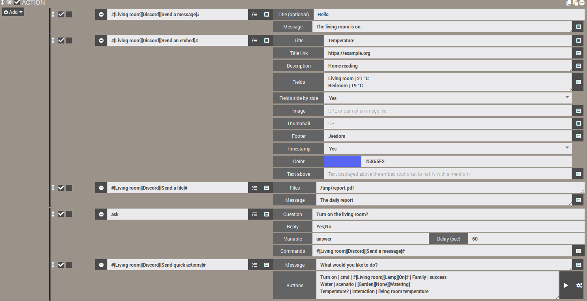
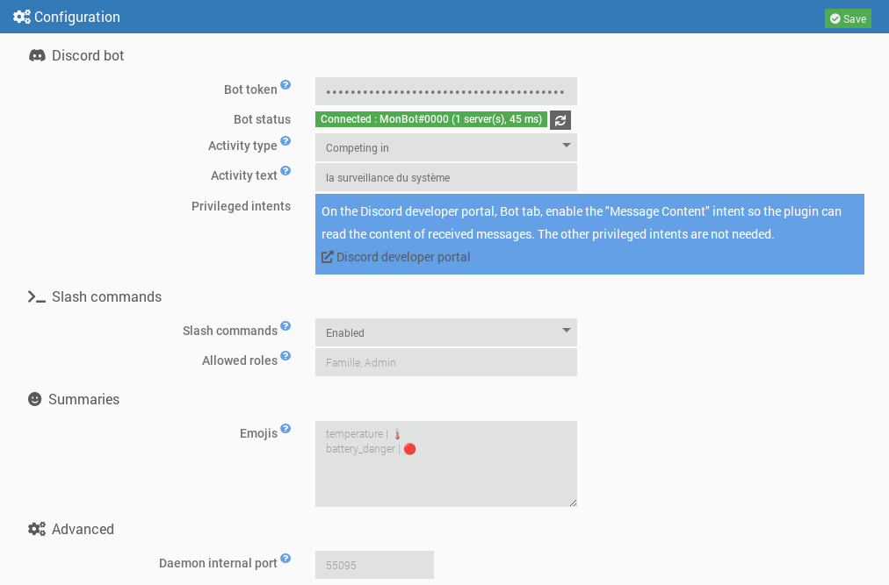
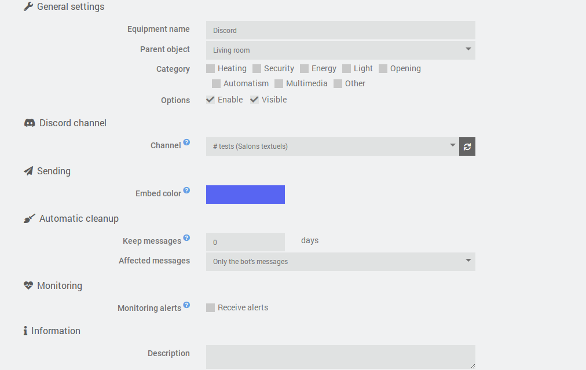
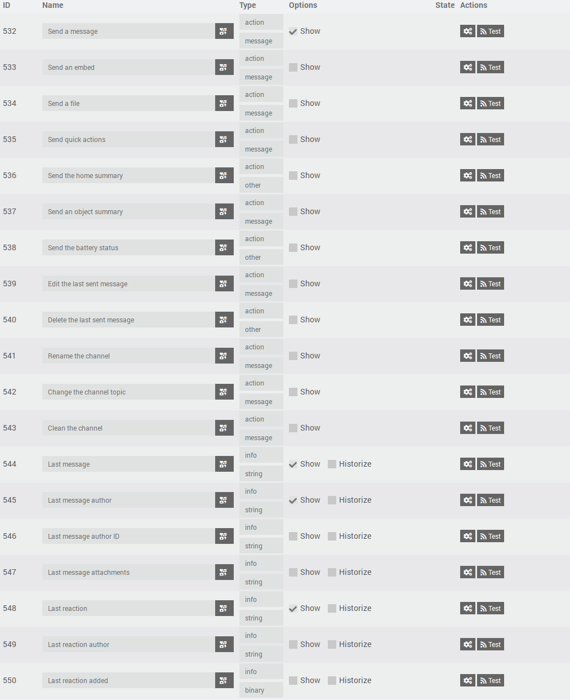
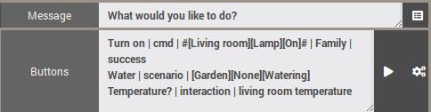

# JeeDiscord plugin - BETA


> [!warning]  
> The bot needs the privileged **Message Content** intent (Discord developer portal) to read the content of messages. Without it, Discord refuses the connection and the daemon stops: see "Create the Discord bot".  


JeeDiscord links Jeedom to a **[Discord](https://discord.com)** server through a bot. Each equipment matches one channel, and the plugin lets you:  

- **send** messages, embeds (rich messages) and files from scenarios, with mentions;
- **ask questions** (the scenarios "Ask" action) with buttons or a drop-down menu of answers;
- **receive** the channel's messages and emoji reactions;
- offer **quick action buttons** and **slash commands** (`/jeedom`, `/clean`) to control Jeedom from Discord;
- **edit or delete** messages, **clean** a channel, **rename** it or change its topic (a voice channel can be used as a display);
- send **summaries** (home, object, batteries) and **monitoring alerts** about daemons and dependencies.

It relies on the [discord.js](https://discord.js.org/) v14 library and on the Discord API v10.  

## Overview  

  

# Requirements  

- Jeedom 4.4 minimum
- Debian 12 minimum
- Node.js: installed automatically by Jeedom when the dependencies are installed

# Create the Discord bot  

1. Go to the [Discord developer portal](https://discord.com/developers/applications) and click **New Application**.
2. In the **Bot** tab, click **Reset Token** then copy the token. It will not be displayed again: keep it somewhere safe and never share it.
3. Still in the **Bot** tab, in the **Privileged Gateway Intents** section, enable **Message Content Intent**. The **Presence** and **Server Members** intents are not needed.
4. In the **OAuth2 > URL Generator** tab, tick the `bot` and `applications.commands` scopes, then the required permissions (see below). Open the generated URL to invite the bot to your server.

Recommended permissions for the bot:

| Permission | Usage |
|---|---|
| View Channels | See the monitored channels |
| Send Messages | Send messages |
| Embed Links | Send rich messages (embeds) |
| Attach Files | Send files and snapshots |
| Read Message History | Find messages to edit or delete them |
| Add Reactions | React to messages |
| Manage Messages | Delete messages (cleanup) |
| Manage Channels | Rename a channel or change its topic |

# Dependencies  

The first step is to install the dependencies: once the plugin is enabled, start their installation from the plugin configuration page. Jeedom installs Node.js itself, then the discord.js library in the plugin folder. Progress is shown in the `jeediscord_packages` log.  

# General configuration  

Once the dependencies are installed, fill in:

- **Bot token**: the token copied at step 2 of the bot creation. It is encrypted in the Jeedom database and hidden in the logs.
- **Activity type** and **Activity text**: text displayed under the bot's name in Discord (for example "Custom" + "Watching the house"). Leave the text empty to display nothing.
- **Slash commands** and **Allowed roles**: see "Slash commands" below.
- **Emojis**: emojis of the summaries and of the batteries, see "Summaries".
- **Daemon internal port** (advanced): local port used between Jeedom and the daemon. Only change it if it conflicts with another plugin.

The **bot status** tells whether the daemon is started and connected to Discord, with the bot's name, the number of servers and the latency. A change of activity is applied immediately, without restarting the daemon. Entering or changing the token starts or restarts the daemon (if the automatic daemon management is enabled), and the status updates by itself after saving.



## The daemon  

The daemon is a single Node.js program that keeps the connection with Discord. It is designed to stay light:

- it is started with a low priority (`nice`);
- it only asks Discord for the events useful to the plugin (servers, messages, reactions);
- its caches are limited (recent messages, members) and purged regularly.

**Respecting Discord's limits**: the API rate limits (per route and global) are handled by discord.js, which queues requests instead of losing them. The plugin adds one queue per channel, which keeps the order of the actions and merges repetitive updates (for example a channel rename: only the last value is sent).

**Connection**: after a network outage at startup, the daemon retries the connection with an increasing delay (from 15 seconds to 5 minutes). Once connected, reconnections are automatic. If Discord refuses the connection (invalid token, "Message Content" intent not enabled), the daemon stops and is no longer restarted automatically, so as not to exhaust Discord's daily connection quota. A message appears in the message center: fix the problem then save the plugin configuration.

## Logs  

The plugin uses three logs:

- `jeediscord`: Jeedom-side actions (daemon start, received events, errors);
- `jeediscord_daemon`: daemon activity and exchanges with Discord;
- `jeediscord_packages`: dependency installation.

At the **Debug** level, the daemon log details each request sent to Discord (method, route, return code, remaining quota), the rate limits reached and the exchanges with Jeedom. Sensitive information is always hidden (`***`): bot token, Jeedom API key, interaction and webhook tokens. The token appears neither in the logs nor in the system process list.

# Equipment configuration  

An equipment matches **one Discord channel**.

- **Channel**: list of the channels visible to the bot, grouped by server. It is available when the daemon is connected to Discord and updates automatically when a channel is created, renamed or deleted. The refresh button forces the update. The "insufficient permissions" mention flags a channel where the bot cannot send messages.
- **Embed color**: border color of the rich messages sent to this channel, used when the scenario does not specify one.
- **Monitoring alerts**: tick "Receive alerts" so that this channel receives the failure alerts (see "Monitoring").
- **Automatic cleanup**: number of days the channel's messages are kept (0: no cleanup). The oldest ones are deleted automatically, once an hour, either only the bot's or all messages (the bot then needs the "Manage Messages" permission). See "Clean a channel".



## Commands  

Each equipment has the following commands, usable in scenarios:

| Command | Type | Role |
|---|---|---|
| Send a message | action / message | Sends a text. The title, if filled in, is shown in bold on the first line. |
| Send an embed | action / message | Sends a rich message (title, link, description, fields, image, color, footer, timestamp). |
| Send a file | action / message | Sends one or more files (local path or web address), with an optional text. |
| Send the home summary | action / other | Sends an embed with Jeedom's global summaries (temperature, humidity, openings...) and the battery status. |
| Send an object summary | action / message | Sends the summaries of a Jeedom object, chosen from the list of objects. |
| Send the battery status | action / other | Sends the list of equipments whose battery is low, with the number of good batteries. |
| Edit the last sent message | action / message | Replaces the text of the last message sent by the bot in the channel. |
| Delete the last sent message | action / other | Deletes the last message sent by the bot in the channel (all its parts if it was split). |
| Rename the channel | action / message | Changes the channel name. |
| Change the channel topic | action / message | Changes the topic (the description displayed at the top) of a text channel. |
| Clean the channel | action / message | Deletes messages older than a given age. |
| Send quick actions | action / message | Sends a message with buttons that run a Jeedom command, scenario or interaction. |
| Last message | info / other | Content of the last message received in the channel. |
| Last message author | info / other | Display name of its author (nickname on the server, otherwise display name). |
| Last message author ID | info / other | Discord ID of the author, reliable for scenario conditions (a name can change). |
| Last message attachments | info / other | Addresses of the attachments, one per line. |
| Last reaction | info / other | Emoji of the last reaction added or removed. |
| Last reaction author | info / other | Display name of the person who reacted. |
| Last reaction added | info / binary | 1 if the reaction was added, 0 if it was removed. |



The sending commands are used in **scenario actions**: choose the command in the list and the matching form is displayed. Only the "Send a message" command is displayed by default on the dashboard; the others are hidden, which does not prevent using them in scenarios (they can be made visible in the equipment's Commands tab).

# Scenarios  

## Send a message  

Texts longer than 2000 characters (Discord's limit) are automatically split into several messages, preferably at line breaks.

This command also accepts the files provided by Jeedom: reports generated by a scenario's **Report** action, snapshots sent by other plugins, etc.

### Mentions  

In texts, you can mention:

| Syntax | Result |
|---|---|
| `@{nickname}` | a member, searched by user name, display name or nickname on the server |
| `@&{role}` | a role, searched by its name |
| `#{channel}` | a link to a channel |

Discord's native syntax (`<@id>`, `<@&id>`) also works. A mention that cannot be found stays displayed as plain text. `@everyone` and `@here` notify nobody.

Members are searched by name and this does not require the privileged "Server Members" intent.

### How sending works  

Sending is asynchronous: the scenario goes on immediately, and the message is placed in the channel's queue. Messages of the same channel always leave in order. Files are read when the command is called: you can delete a temporary file right after the command.

Before sending, the plugin checks the bot's permissions in the channel (view, send messages, embed links, attach files). If a permission is missing or if sending fails, an error is written in the `jeediscord` log.

## Send an embed  

In a scenario, the command displays a dedicated form, with one field per line. The button at the end of the line inserts the value of a Jeedom info command (for example a temperature) into the text fields:

- **Title** and **Title link**: the link makes the title clickable;
- **Description**: main text (4096 characters maximum);
- **Fields**: one field per line, as `Name | Value` (25 fields maximum). **Fields side by side** (Yes or No) shows them in columns;
- **Image**: web address of an image, or path of an image file on Jeedom, which is then attached to the message. **Thumbnail**: web address of a small image displayed at the top right;
- **Footer**; **Timestamp** (Yes: date and time of sending); **Color** (the picker or a `#RRGGBB` code, otherwise the equipment's color);
- **Text above**: text displayed above the embed. Mentions placed in an embed do not trigger a notification: put them here to notify someone.

Texts that are too long are shortened to respect Discord's limits (6000 characters in total per embed).

## Send a file  

Enter the full path of a file, **or its web address** (`http://` or `https://`), one per line. Discord accepts 10 files per message: beyond that, several messages are sent. The maximum size of a file depends on the server's boost level (10 MB without boost, 50 MB at level 2, 100 MB at level 3). Files that are too large are ignored and reported in the log.

**Web addresses**: the file is first downloaded by Jeedom into its temporary folder (`/tmp/jeedom/jeediscord/download`), then sent like a local file, and deleted right after sending. The scenario waits for the download to finish before going on. The file is named `sendDiscord` followed by an extension deduced from the content type (for example `sendDiscord.png`), whatever the name in the address; redirections are followed, and the download is limited to 60 seconds and 100 MB. Local network addresses (for example a camera's image) are accepted. Credentials and parameters of an address are never written in the logs. On failure, a warning is written in the `jeediscord` log and the file is ignored. An address may contain commas: only the line break separates two files.

For safety, Jeedom's configuration files (`core/config`), system folders (`/etc`, `/root`...) and hidden files or folders cannot be sent.

The "Files" field also accepts scenario variables and tags. Example, with a chart generated by a web service and sent to the channel:

<details markdown='1'>
<summary>Click to see the code block example</summary>

```php
// Example: a chart built by quickchart.io (third-party service), then sent to the channel
$values = array(0, 0.2, 1.5, 0);                          // replace with your measurements
$config = "{type:'bar',data:{labels:['1h','2h','3h','4h'],datasets:[{label:'mm',data:[" . implode(',', $values) . "]}]}}";
$url = "https://quickchart.io/chart?format=png&c=" . urlencode($config);

// Stores the address in a scenario VARIABLE...
$scenario->setData("chartUrl", $url);
```

In the following "Send a file" action, enter `variable(chartUrl)` in the "Files" field. Careful: `setData` creates a variable, read with `variable(...)`, whereas `tag(...)` reads the tags set with `$scenario->setTags(...)`.
</details>

## Ask a question (the scenarios "Ask" action)  

The "Send a message", "Send an embed" and "Send a file" commands can be chosen in a scenario's **Ask** action (the action's "Command" field).

- **With possible answers** (for example `Yes;No`): one button per answer is displayed under the question. Beyond 10 answers, a drop-down menu replaces them (25 answers maximum).
- **With no imposed answer** (`*`): no button is displayed; the question tells to answer by writing a message, and the next message written in the channel is the answer.

As soon as an answer is given, or when the timeout expires, the buttons are disabled and the message says who answered and what (or "No answer"). The answer is stored in the scenario's variable, as with the other messaging plugins. Anyone who can write in the channel can answer.

A question remains valid as long as the timeout has not expired and the daemon has not been restarted: after a restart, its buttons are simply disabled on the next click.

## Summaries  

Three commands send a summary embed, to be run from a scenario (for example a scheduled trigger in the morning) or from a quick action button:

- **Send the home summary**: the global summaries defined in Jeedom (temperature, humidity, luminosity, power, openings...), with the number of good, low and critical batteries in the footer.
- **Send an object summary**: the summaries of the object whose name you enter in the "Object" field. The button at the end of the line (cube icon) opens the list of Jeedom objects; you can also type the name by hand, or a scenario variable.
- **Send the battery status**: the equipments whose battery is low (orange) or critical (red), from the weakest to the strongest, with Jeedom's thresholds (the equipment's own if it defines some). The embed's color follows the lowest level. If everything is fine, the message says so.

> [!warning]  
> As in Jeedom's menu bar, the home summary only shows the summaries that are "reported". In the object's page (Tools > Objects, Summaries section), define the summary's command, then tick **Report in global summary** for this summary; without this box, it only appears in "Send an object summary". If no summary is reported, the message says so.  

The **emojis** in front of each summary and each battery level can be customized in the plugin configuration: one `key | emoji` line per emoji (keys: `temperature`, `humidity`, `luminosity`, `power`, `motion`, `security`, `door`, `windows`, `shutter`, `light`, `outlet`, `battery_ok`, `battery_warning`, `battery_danger`, `alert`, `recovery`). A missing key keeps its default emoji.

## Camera snapshots  

It is the **Camera** plugin that takes the snapshots and sends them: so you do **not** put a camera command in JeeDiscord, but the other way round. In a scenario action, choose the camera's **"Record"** command (called "Enregistrer" in the French interface, for example `#[Living room][My camera][Record]#`, hidden from the dashboard but available in scenarios) and fill in its two fields. Careful, the Camera plugin's "Capture" command only saves a file on Jeedom: it sends nothing.

- **Number of snapshots or options**: the number of snapshots (for example `1`), or Camera plugin options such as `nbSnap=3 delay=2` (number of snapshots and seconds between two snapshots);
- **Command that sends the snapshots**: the JeeDiscord command that will receive the images, for example **[Living room][Discord][Send a message]** (or "Send a file"). Use the command selector at the end of the line.

The Camera plugin then calls this command with the snapshot files, which are sent to the equipment's channel. The "Files" field of the JeeDiscord command is not used in this case: it is for files whose path you give yourself. Snapshots are read when sending, like the other files (see "Send a file" for size limits and refused folders).

**Text attached to the snapshots**: it is the Camera plugin that provides the text passed to JeeDiscord. By default, it sends a text like "Alert on camera *name* at *date*" (in French). To replace it, add `message=` in the "Number of snapshots or options" field, with quotes if the text contains spaces: `nbSnap=1 message="Snapshot requested:"`. The `title=` parameter is ignored by the Camera plugin. With "Send a message" as destination, the text is displayed above the images; with "Send a file", it goes with them.

## Edit or delete the last message  

The "Edit the last sent message" and "Delete the last sent message" commands act on the **bot's last sending in the channel** (message, embed, file, question or quick actions), including when a long text was split into several messages (editing applies to the last part, deletion to all of them). They run after the sendings already waiting: a scenario can therefore send then edit or delete right away.

- Editing replaces the message's **text**; embeds, files and buttons are kept. `@{nickname}` mentions are resolved as when sending.
- The last message is remembered by the daemon: after a daemon restart, there is no message to edit or delete until the next sending (an error is then written in the log).

## Rename a channel, change its topic  

The "Rename the channel" and "Change the channel topic" commands change the name and the topic of the equipment's channel. The bot must have the **Manage Channels** permission (or the administrator role).

- A **text** channel is always lowercase, with hyphens instead of spaces ("My House" becomes `my-house`): this is Discord's rule.
- A **voice** channel accepts spaces, capital letters and emojis. It can therefore be used as a **display**: create an equipment linked to a voice channel, and update its name from a scenario, for example `🌡️ Living room: #[Living room][Probe][Temperature]# °C`. The name is limited to 100 characters, the topic to 1024 (and only text channels have a topic).
- **Discord limits these changes to 2 every 10 minutes per channel.** So as not to block, the requests arriving during the wait are merged: only the last value is sent. Nothing is sent either when the name or topic is already the channel's. So do not call these commands at every quick variation of a value: the display will simply be a few minutes late.

## Clean a channel  

The "Clean the channel" command deletes messages older than an age (in hours or days; 0 for all), either **only the bot's** or **all messages** ("Manage Messages" permission required). Pinned messages are always kept. The same cleanup runs every hour for the equipments that have a retention period (see "Equipment configuration").

Discord only allows bulk deletion for messages less than 14 days old. Older messages are deleted one by one, at the pace imposed by Discord: 100 at most per run, the rest is handled on the next run (a line in the `jeediscord` log says so). Each run examines at most 1000 messages. The number of deleted messages is written in the `jeediscord` log.

## Quick actions  

The "Send quick actions" command sends a message with buttons that **stay active** (even after a daemon restart). It is used in a scenario: add an action, then choose **[Object][Equipment][Send quick actions]** in the command list. Fill in:

- **Message**: the text displayed above the buttons;
- **Buttons**: one button per line, formatted as `Label | type | target | allowed roles | color`.

| Field | Content |
|---|---|
| Label | Button text. |
| Type | `cmd` (action command), `scenario` or `interaction`. |
| Target | The command (`#[Object][Equipment][Command]#`), the scenario (ID, or full name `[Group][Object][Name]` with `None` if the scenario has no object, for example `[Garden][None][Watering]`; `[Garden][Watering]` is also accepted) or the interaction's sentence. |
| Allowed roles | Optional: Discord role names or IDs separated by commas. Empty = anyone in the channel. |
| Color | Optional: `primary` (blue, default), `secondary`, `success` or `danger`. |

Example:

```
Light the room | cmd | #[Living room][Lamp][On]# | Family | success
Start watering | scenario | [Garden][None][Watering] | Family, Admin
Temperature? | interaction | what is the living room temperature
```

The result of the action is displayed only to the person who clicked (✅ done, ⛔ role not allowed, ❌ error: the cause is then in the `jeediscord` log, ⚠️ button no longer valid, for example because the equipment was disabled or moved to another channel). For an interaction, the interaction's answer is displayed. The ▶ button on the right of the "Buttons" field inserts a scenario chosen from the list, the button next to it inserts an action command. A scenario started by a button receives the tags `#jeediscord_user#` (the person's name) and `#jeediscord_channel#` (the channel's ID). Maximum: 25 buttons per message.



# Slash commands  

The plugin registers on each of the bot's servers (available immediately) two commands that you type in Discord starting with `/`:

| Command | Role |
|---|---|
| `/jeedom interaction text` | Sends a sentence to Jeedom's interactions and displays the answer. |
| `/jeedom scenario name [action]` | Starts (default), stops, enables or disables a scenario. The name is completed automatically. |
| `/jeedom cmd command [value]` | Runs an action command. The value is for slider, color, list or message commands. The name is completed automatically. |
| `/clean [days] [all]` | Deletes the channel's messages older than the given number of days (0: all), the bot's or, with `all`, everyone's. Same behavior as "Clean the channel". |

Answers are only visible to the person who typed the command. The names of the commands and parameters are in English (Discord's rule for typing); their descriptions are displayed in the user's Discord language (French, English, Spanish, German, Italian, Portuguese, Russian).

> [!warning]  
> A slash command can control the whole house. It is therefore only run if the channel is linked to an **active JeeDiscord equipment** (elsewhere, the bot answers that it is not available), and if the person is a **server administrator** or has one of the **allowed roles** of the plugin configuration (role names or IDs separated by commas). As long as the list is empty, only administrators can use the commands.  

Autocompletion of scenarios and commands follows the same rights: an unauthorized person sees no suggestion. The "Slash commands" setting of the configuration allows disabling them: they are then removed from the servers.

If the bot was not invited with the `applications.commands` scope (see "Create the Discord bot"), registration is refused: the `jeediscord_daemon` log says so, and you just need to invite the bot again with the corrected URL. The `/jeedom` and `/clean` commands are also visible in the server settings (Integrations), where Discord lets you restrict their use to some channels or roles on top of the plugin's rights.

# Monitoring  

Every 5 minutes, the plugin checks the active plugins: a **daemon stopped** when it should be running (automatic management enabled and start possible), or **dependencies in error**. The channels of the equipments with "Receive alerts" ticked then receive a red alert listing the failures, then a green message once everything is back to normal.

To avoid false alerts, a failure is only reported if it lasts at least two checks (Jeedom restarts failed daemons itself), and only once. JeeDiscord's own daemon is not monitored: if it is stopped, it cannot write to Discord.

# Receiving messages and reactions  

The info commands are updated at each message or reaction received in the channel, even when the value does not change: the same message or the same emoji received twice triggers scenarios twice. The message content and the emoji are updated last: a scenario triggered by **Last message** therefore reads the author and attachments of that same message (same principle for **Last reaction**).

Standard emojis are passed as is (for example 👍), the server's custom emojis as `:name:`. Example of a scenario condition: `#[Home][Discord][Last reaction]# == "👍"`.

The bot's own messages and Discord's system messages (pinning, member joining...) are ignored. Messages from other bots and webhooks are passed on.

The attachment addresses are provided by Discord and expire after about 24 hours: use them quickly.

Only the events of the channels linked to an active equipment are passed by the daemon to Jeedom.

# Third-party scripts  

JeeDiscord relies on the **discord.js** library, version *v14*.  
You can find the original github code here: [discordjs/discord.js](https://github.com/discordjs/discord.js)  

The plugin is designed and directed by **ddelec24** (project conductor) and developed with **Claude** (Anthropic), co-author of the code and of the documentation.  

# Additional information  

 - The plugin has not been tested in all Discord server, role and permission configurations.  
 Please open an Issue on [GitHub](https://github.com/ddelec24/jeediscord/issues) or post a message on the [Jeedom Community](https://community.jeedom.com/tag/plugin-jeediscord) forum if you notice a malfunction.  

## Help - FAQ  

### The daemon does not start, "The bot token is not filled in"  
Enter the token in the plugin configuration then save.  

### "Connection refused by Discord: invalid bot token"  
The token was reset or badly copied: generate a new one (developer portal, Bot tab) and save the configuration.  

### "Message Content intent not enabled"  
Enable **Message Content Intent** in the Bot tab of the developer portal, then save the plugin configuration.  

### "Dependencies not installed"  
Start the dependency installation from the plugin page and check the `jeediscord_packages` log.  

### No channel in the equipment's list  
The daemon is not connected, or the bot is not allowed to see the channels: check the bot status in the configuration and the "View Channels" permissions.  

### A message is not sent  
Check the `jeediscord` log: a missing permission (send messages, embed links, attach files) is indicated there.  

### The camera snapshots do not arrive  
Use the **camera's** "Record" command and enter the JeeDiscord command in its destination field (see "Camera snapshots"). Check the Camera plugin's `camera_record` log and the `jeediscord` log.  

### My file sent by web address does not arrive, the "Files" field is empty  
The field is evaluated by Jeedom before the plugin is called: check the `files` option on the "Execution of the command" line of the scenario log. If it is empty, the variable or tag does not exist at that point: a variable set with `setData` is read with `variable(name)`, a tag set with `setTags` with `tag(name)`. An error in a preceding code block (for example an `array_merge()` on a `null` value, which is a fatal error in PHP 8) prevents the value from being set.  

### The slash commands do not appear  
Invite the bot again with the `applications.commands` scope, then restart the daemon. Check that "Slash commands" is enabled in the configuration.  

### "This channel is not linked to any active JeeDiscord equipment"  
Slash commands and buttons only work in the channels of an active equipment.  

### The home summary is empty  
Tick "Report in global summary" for the wanted summaries in the object's page (see "Summaries").  

### My scenario starts even when the message does not match my condition (smiley, "?")  
With a trigger like `#[Living room][Discord][Last message]# matches "/^\s*!temperature\s*$/u"`, Jeedom only puts the value between quotes if it contains a letter, a space, or if it is empty. A message made only of smileys or punctuation therefore gives an invalid expression: Jeedom then considers it true and starts the scenario. This is a behavior of Jeedom's core, not of the plugin. To avoid it, put this code block as the scenario's first action:

```php
$msg = cmd::byString('#[Living room][Discord][Last message]#')->execCmd();
if (!preg_match('/^\s*!temperature\s*$/u', (string) $msg)) {
  $scenario->setDo(false); // no further block is run
  return;
}
```

### A channel rename is late  
Discord limits name changes to 2 every 10 minutes per channel (see "Rename a channel, change its topic").  

## Known issues  

- Discord limits channel renaming to 2 changes every 10 minutes: a display that changes very often will be a few minutes late.
- The last message sent (to edit or delete it) and the pending questions are remembered by the daemon: a daemon restart makes them lost.
- The addresses of received attachments expire after about 24 hours.
- A scenario trigger with a `matches` expression starts wrongly for a message without letters (see the FAQ above).

---------------------------------------------------------------
For any other question, please check whether an answer already exists, otherwise ask on the [Jeedom community](https://community.jeedom.com)
