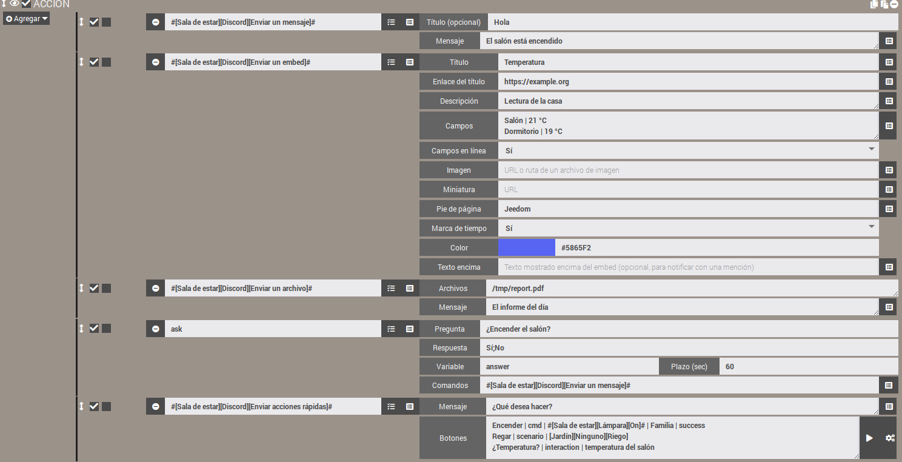
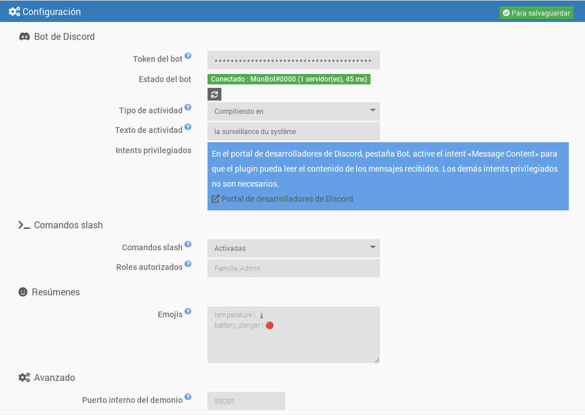
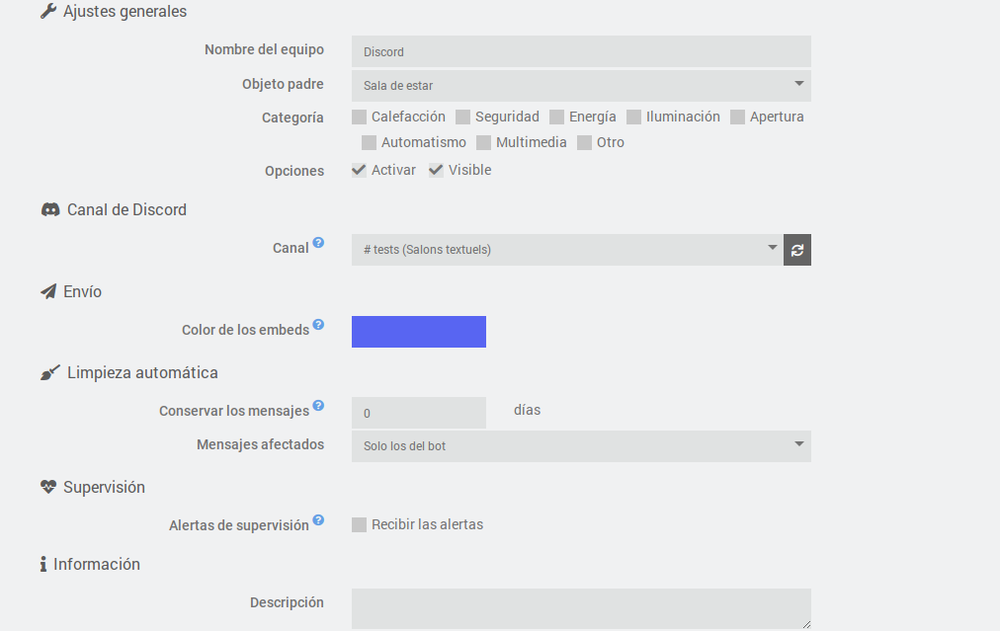
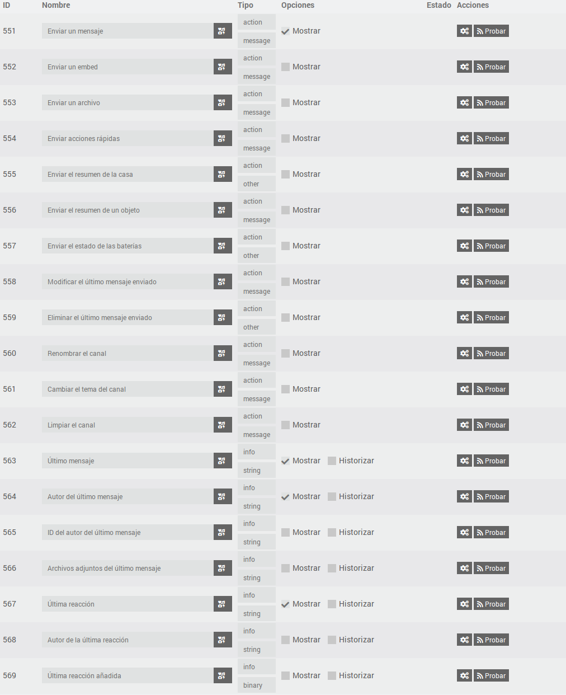
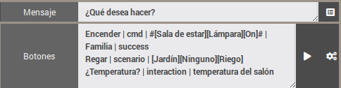

# Plugin JeeDiscord - BETA


> [!warning]  
> El bot necesita el intent privilegiado **Message Content** (portal de desarrolladores de Discord) para leer el contenido de los mensajes. Sin él, Discord rechaza la conexión y el demonio se detiene: ver «Crear el bot de Discord».  


JeeDiscord conecta Jeedom con un servidor de **[Discord](https://discord.com)** mediante un bot. Cada equipo corresponde a un canal, y el plugin permite:  

- **enviar** mensajes, embeds (mensajes enriquecidos) y archivos desde los escenarios, con menciones;
- **hacer preguntas** (acción «Ask» de los escenarios) con botones o un menú de respuestas;
- **recibir** los mensajes y las reacciones emoji del canal;
- ofrecer **botones de acción rápida** y **comandos slash** (`/jeedom`, `/clean`) para controlar Jeedom desde Discord;
- **modificar o eliminar** mensajes, **limpiar** un canal, **renombrarlo** o cambiar su tema (un canal de voz puede servir de pantalla);
- enviar **resúmenes** (casa, objeto, baterías) y **alertas de supervisión** de los demonios y las dependencias.

Se basa en la biblioteca [discord.js](https://discord.js.org/) v14 y en la API de Discord v10.  

## Vista general  

  

# Requisitos previos  

- Jeedom 4.4 como mínimo
- Debian 12 como mínimo
- Node.js: instalado automáticamente por Jeedom al instalar las dependencias

# Crear el bot de Discord  

1. Vaya al [portal de desarrolladores de Discord](https://discord.com/developers/applications) y haga clic en **New Application**.
2. En la pestaña **Bot**, haga clic en **Reset Token** y copie el token. No se volverá a mostrar: guárdelo en un lugar seguro y no lo comparta nunca.
3. Todavía en la pestaña **Bot**, sección **Privileged Gateway Intents**, active **Message Content Intent**. Los intents **Presence** y **Server Members** no son necesarios.
4. En la pestaña **OAuth2 > URL Generator**, marque los scopes `bot` y `applications.commands`, y luego los permisos necesarios (ver más abajo). Abra la URL generada para invitar al bot a su servidor.

Permisos recomendados para el bot:

| Permiso | Uso |
|---|---|
| View Channels | Ver los canales supervisados |
| Send Messages | Enviar mensajes |
| Embed Links | Enviar mensajes enriquecidos (embeds) |
| Attach Files | Enviar archivos y capturas |
| Read Message History | Encontrar mensajes para modificarlos o eliminarlos |
| Add Reactions | Reaccionar a los mensajes |
| Manage Messages | Eliminar mensajes (limpieza) |
| Manage Channels | Renombrar un canal o cambiar su tema |

# Dependencias  

El primer paso es instalar las dependencias: una vez activado el plugin, inicie su instalación desde la página de configuración del plugin. Jeedom instala por sí mismo Node.js y después la biblioteca discord.js en la carpeta del plugin. El seguimiento se hace en el log `jeediscord_packages`.  

# Configuración general  

Una vez instaladas las dependencias, rellene:

- **Token del bot**: el token copiado en el paso 2 de la creación del bot. Está cifrado en la base de datos de Jeedom y oculto en los logs.
- **Tipo de actividad** y **Texto de actividad**: texto mostrado bajo el nombre del bot en Discord (por ejemplo «Personalizado» + «Vigilando la casa»). Deje el texto vacío para no mostrar nada.
- **Comandos slash** y **Roles autorizados**: ver «Comandos slash» más abajo.
- **Emojis**: emojis de los resúmenes y de las baterías, ver «Resúmenes».
- **Puerto interno del demonio** (avanzado): puerto local utilizado entre Jeedom y el demonio. Modifíquelo solo si entra en conflicto con otro plugin.

El **estado del bot** indica si el demonio está iniciado y conectado a Discord, con el nombre del bot, el número de servidores y la latencia. El cambio de actividad se aplica inmediatamente, sin reiniciar el demonio. Introducir o modificar el token inicia o reinicia el demonio (si la gestión automática del demonio está activada), y el estado se actualiza solo tras guardar.



## El demonio  

El demonio es un único programa Node.js que mantiene la conexión con Discord. Está diseñado para ser ligero:

- se inicia con baja prioridad (`nice`);
- solo pide a Discord los eventos útiles para el plugin (servidores, mensajes, reacciones);
- sus cachés son limitadas (mensajes recientes, miembros) y se purgan regularmente.

**Respeto de los límites de Discord**: los límites de frecuencia de la API (por ruta y global) los gestiona discord.js, que pone las peticiones en cola en lugar de perderlas. El plugin añade una cola por canal, que conserva el orden de las acciones y fusiona las actualizaciones repetitivas (por ejemplo, el cambio de nombre de un canal: solo se envía el último valor).

**Conexión**: ante un corte de red al arrancar, el demonio reintenta la conexión con un retraso creciente (de 15 segundos a 5 minutos). Una vez conectado, las reconexiones son automáticas. Si Discord rechaza la conexión (token no válido, intent «Message Content» no activado), el demonio se detiene y ya no se reinicia automáticamente, para no agotar la cuota diaria de conexiones de Discord. Aparece un mensaje en el centro de mensajes: corrija el problema y luego guarde la configuración del plugin.

## Logs  

El plugin utiliza tres logs:

- `jeediscord`: acciones del lado de Jeedom (inicio del demonio, eventos recibidos, errores);
- `jeediscord_daemon`: actividad del demonio e intercambios con Discord;
- `jeediscord_packages`: instalación de las dependencias.

En nivel **Debug**, el log del demonio detalla cada petición enviada a Discord (método, ruta, código de retorno, cuota restante), los límites de frecuencia alcanzados y los intercambios con Jeedom. La información sensible se oculta siempre (`***`): token del bot, clave API de Jeedom, tokens de interacción y de webhook. El token no aparece ni en los logs ni en la lista de procesos del sistema.

# Configuración de un equipo  

Un equipo corresponde a **un canal de Discord**.

- **Canal**: lista de los canales visibles para el bot, agrupados por servidor. Está disponible cuando el demonio está conectado a Discord y se actualiza automáticamente cuando se crea, renombra o elimina un canal. El botón de actualización fuerza la actualización. La mención «permisos insuficientes» señala un canal donde el bot no puede enviar mensajes.
- **Color de los embeds**: color del borde de los mensajes enriquecidos enviados a este canal, utilizado cuando el escenario no indica ninguno.
- **Alertas de supervisión**: marque «Recibir las alertas» para que este canal reciba las alertas de avería (ver «Supervisión»).
- **Limpieza automática**: número de días que se conservan los mensajes del canal (0: sin limpieza). Los más antiguos se eliminan automáticamente, una vez por hora, ya sean solo los del bot o todos los mensajes (el bot necesita entonces el permiso «Manage Messages»). Ver «Limpiar un canal».



## Comandos  

Cada equipo dispone de los siguientes comandos, utilizables en los escenarios:

| Comando | Tipo | Función |
|---|---|---|
| Enviar un mensaje | acción / mensaje | Envía un texto. El título, si se indica, se muestra en negrita en la primera línea. |
| Enviar un embed | acción / mensaje | Envía un mensaje enriquecido (título, enlace, descripción, campos, imagen, color, pie de página, marca de tiempo). |
| Enviar un archivo | acción / mensaje | Envía uno o varios archivos (ruta local o dirección web), con un texto opcional. |
| Enviar el resumen de la casa | acción / otro | Envía un embed con los resúmenes globales de Jeedom (temperatura, humedad, aberturas...) y el estado de las baterías. |
| Enviar el resumen de un objeto | acción / mensaje | Envía los resúmenes de un objeto de Jeedom, elegido en la lista de objetos. |
| Enviar el estado de las baterías | acción / otro | Envía la lista de los equipos con la batería baja, con el número de baterías en buen estado. |
| Modificar el último mensaje enviado | acción / mensaje | Sustituye el texto del último mensaje enviado por el bot en el canal. |
| Eliminar el último mensaje enviado | acción / otro | Elimina el último mensaje enviado por el bot en el canal (todas sus partes si se dividió). |
| Renombrar el canal | acción / mensaje | Cambia el nombre del canal. |
| Cambiar el tema del canal | acción / mensaje | Cambia el tema (la descripción mostrada arriba) de un canal de texto. |
| Limpiar el canal | acción / mensaje | Elimina los mensajes más antiguos que una edad dada. |
| Enviar acciones rápidas | acción / mensaje | Envía un mensaje con botones que ejecutan un comando, un escenario o una interacción de Jeedom. |
| Último mensaje | info / otro | Contenido del último mensaje recibido en el canal. |
| Autor del último mensaje | info / otro | Nombre mostrado de su autor (apodo en el servidor, si no nombre de pantalla). |
| ID del autor del último mensaje | info / otro | Identificador de Discord del autor, fiable para las condiciones de escenario (un nombre puede cambiar). |
| Archivos adjuntos del último mensaje | info / otro | Direcciones de los archivos adjuntos, una por línea. |
| Última reacción | info / otro | Emoji de la última reacción añadida o retirada. |
| Autor de la última reacción | info / otro | Nombre mostrado de la persona que ha reaccionado. |
| Última reacción añadida | info / binario | 1 si la reacción se ha añadido, 0 si se ha retirado. |



Los comandos de envío se utilizan en las **acciones de los escenarios**: elija el comando en la lista y se muestra el formulario correspondiente. Solo el comando «Enviar un mensaje» se muestra por defecto en el dashboard; los demás están ocultos, lo que no impide utilizarlos en los escenarios (pueden hacerse visibles en la pestaña Comandos del equipo).

# Escenarios  

## Enviar un mensaje  

Los textos de más de 2000 caracteres (límite de Discord) se dividen automáticamente en varios mensajes, preferiblemente en los saltos de línea.

Este comando acepta también los archivos transmitidos por Jeedom: informes generados por la acción **Reporte** de un escenario, capturas enviadas por otros plugins, etc.

### Menciones  

En los textos, puede mencionar:

| Sintaxis | Resultado |
|---|---|
| `@{apodo}` | un miembro, buscado por su nombre de usuario, su nombre de pantalla o su apodo en el servidor |
| `@&{rol}` | un rol, buscado por su nombre |
| `#{canal}` | un enlace a un canal |

La sintaxis nativa de Discord (`<@id>`, `<@&id>`) también funciona. Una mención no encontrada se muestra como texto simple. `@everyone` y `@here` no notifican a nadie.

La búsqueda de miembros se hace por nombre y no requiere el intent privilegiado «Server Members».

### Funcionamiento del envío  

El envío es asíncrono: el escenario continúa inmediatamente y el mensaje se coloca en la cola del canal. Los mensajes de un mismo canal salen siempre en orden. Los archivos se leen en el momento de la llamada: puede eliminar un archivo temporal justo después del comando.

Antes de enviar, el plugin comprueba los permisos del bot en el canal (ver, enviar mensajes, insertar enlaces, adjuntar archivos). Si falta un permiso o el envío falla, se registra un error en el log `jeediscord`.

## Enviar un embed  

En un escenario, el comando muestra un formulario específico, con un campo por línea. El botón al final de la línea permite insertar el valor de un comando info de Jeedom (por ejemplo una temperatura) en los campos de texto:

- **Título** y **Enlace del título**: el enlace hace que el título sea clicable;
- **Descripción**: texto principal (4096 caracteres como máximo);
- **Campos**: un campo por línea, con la forma `Nombre | Valor` (25 campos como máximo). **Campos en línea** (Sí o No) los muestra en columnas;
- **Imagen**: dirección web de una imagen, o ruta de un archivo de imagen en Jeedom, que se adjunta entonces al mensaje. **Miniatura**: dirección web de una imagen pequeña mostrada arriba a la derecha;
- **Pie de página**; **Marca de tiempo** (Sí: fecha y hora de envío); **Color** (el selector o un código `#RRGGBB`, si no el color del equipo);
- **Texto encima**: texto mostrado encima del embed. Las menciones colocadas en un embed no activan notificación: colóquelas aquí para avisar a alguien.

Los textos demasiado largos se acortan para respetar los límites de Discord (6000 caracteres en total por embed).

## Enviar un archivo  

Indique la ruta completa de un archivo, **o su dirección web** (`http://` o `https://`), uno por línea. Discord acepta 10 archivos por mensaje: más allá, se envían varios mensajes. El tamaño máximo de un archivo depende del nivel de boost del servidor (10 MB sin boost, 50 MB en el nivel 2, 100 MB en el nivel 3). Los archivos demasiado grandes se ignoran y se señalan en el log.

**Direcciones web**: el archivo se descarga primero en Jeedom, en su carpeta temporal (`/tmp/jeedom/jeediscord/download`), después se envía como un archivo local y se elimina justo tras el envío. El escenario espera el fin de la descarga antes de continuar. El archivo se llama `sendDiscord` seguido de una extensión deducida del tipo de contenido (por ejemplo `sendDiscord.png`), sea cual sea el nombre en la dirección; se siguen las redirecciones, y la descarga se limita a 60 segundos y 100 MB. Se aceptan las direcciones de la red local (por ejemplo la imagen de una cámara). Las credenciales y los parámetros de una dirección no se escriben nunca en los logs. En caso de fallo, se registra una advertencia en el log `jeediscord` y el archivo se ignora. Una dirección puede contener comas: solo el salto de línea separa dos archivos.

Por seguridad, los archivos de configuración de Jeedom (`core/config`), las carpetas del sistema (`/etc`, `/root`...) y los archivos o carpetas ocultos no se pueden enviar.

El campo «Archivos» acepta también variables y tags de escenario. Ejemplo, con un gráfico generado por un servicio web y enviado al canal:

<details markdown='1'>
<summary>Haga clic para ver el ejemplo de bloque de código</summary>

```php
// Ejemplo: un gráfico construido por quickchart.io (servicio de terceros), enviado después al canal
$valores = array(0, 0.2, 1.5, 0);                         // sustituya por sus mediciones
$config = "{type:'bar',data:{labels:['1h','2h','3h','4h'],datasets:[{label:'mm',data:[" . implode(',', $valores) . "]}]}}";
$url = "https://quickchart.io/chart?format=png&c=" . urlencode($config);

// Guarda la dirección en una VARIABLE del escenario...
$scenario->setData("chartUrl", $url);
```

En la acción «Enviar un archivo» siguiente, introduzca `variable(chartUrl)` en el campo «Archivos». Atención: `setData` crea una variable, que se lee con `variable(...)`, mientras que `tag(...)` lee los tags definidos con `$scenario->setTags(...)`.
</details>

## Hacer una pregunta (acción «Ask» de los escenarios)  

Los comandos «Enviar un mensaje», «Enviar un embed» y «Enviar un archivo» pueden elegirse en la acción **Ask** de un escenario (el campo «Comando» de la acción).

- **Con respuestas posibles** (por ejemplo `Sí;No`): se muestra un botón por respuesta bajo la pregunta. A partir de 10 respuestas, un menú desplegable las sustituye (25 respuestas como máximo).
- **Sin respuesta impuesta** (`*`): no se muestra ningún botón; la pregunta indica que hay que responder escribiendo un mensaje, y el siguiente mensaje escrito en el canal es la respuesta.

En cuanto se da una respuesta, o al terminar el plazo, los botones se desactivan y el mensaje indica quién ha respondido y qué (o «Sin respuesta»). La respuesta se guarda en la variable del escenario, como con los demás plugins de mensajería. Cualquier persona que pueda escribir en el canal puede responder.

Una pregunta sigue siendo válida mientras no haya terminado el plazo y no se haya reiniciado el demonio: tras un reinicio, sus botones simplemente se desactivan en el siguiente clic.

## Resúmenes  

Tres comandos envían un embed de síntesis, para lanzar desde un escenario (por ejemplo un disparo programado por la mañana) o desde un botón de acción rápida:

- **Enviar el resumen de la casa**: los resúmenes globales definidos en Jeedom (temperatura, humedad, luminosidad, potencia, aberturas...), con en el pie de página el número de baterías buenas, bajas y críticas.
- **Enviar el resumen de un objeto**: los resúmenes del objeto cuyo nombre indique en el campo «Objeto». El botón al final de la línea (icono de cubo) abre la lista de objetos de Jeedom; también puede escribir el nombre a mano, o una variable de escenario.
- **Enviar el estado de las baterías**: los equipos con batería baja (en naranja) o crítica (en rojo), de la más débil a la más fuerte, con los umbrales de Jeedom (los del equipo si define alguno). El color del embed sigue el nivel más bajo. Si todo está bien, el mensaje lo dice.

> [!warning]  
> Como en la barra de menú de Jeedom, el resumen de la casa solo muestra los resúmenes «exportados». En la página del objeto (Herramientas > Objetos, sección Resúmenes), defina el comando del resumen y marque después **Exportar al Resumen general** para ese resumen; sin esta casilla, solo aparece en «Enviar el resumen de un objeto». Si no se exporta ningún resumen, el mensaje lo indica.  

Los **emojis** delante de cada resumen y de cada nivel de batería se personalizan en la configuración del plugin: una línea `clave | emoji` por emoji (claves: `temperature`, `humidity`, `luminosity`, `power`, `motion`, `security`, `door`, `windows`, `shutter`, `light`, `outlet`, `battery_ok`, `battery_warning`, `battery_danger`, `alert`, `recovery`). Una clave ausente conserva su emoji por defecto.

## Capturas de las cámaras  

Es el plugin **Cámara** el que toma las capturas y las envía: **no** se pone, pues, un comando de cámara en JeeDiscord, sino al revés. En una acción de escenario, elija el comando **«Enregistrer»** de la cámara («Grabar», por ejemplo `#[Salón][Mi cámara][Enregistrer]#`, oculto del dashboard pero disponible en los escenarios) y rellene sus dos campos. Atención: el comando «Capture» del plugin Cámara solo guarda un archivo en Jeedom: no envía nada.

- **Número de capturas u opciones** (campo «Nombre captures ou options»): el número de capturas (por ejemplo `1`), u opciones del plugin Cámara con la forma `nbSnap=3 delay=2` (número de capturas y segundos entre dos capturas);
- **Comando que envía las capturas** (campo «Commande message d'envoi des captures»): el comando de JeeDiscord que recibirá las imágenes, por ejemplo **[Salón][Discord][Enviar un mensaje]** (o «Enviar un archivo»). Utilice el selector de comandos al final de la línea.

El plugin Cámara llama entonces a este comando con los archivos de las capturas, que se envían al canal del equipo. El campo «Archivos» del comando de JeeDiscord no se utiliza en este caso: sirve para los archivos cuya ruta usted mismo indica. Las capturas se leen en el momento del envío, como los demás archivos (ver «Enviar un archivo» para los límites de tamaño y las carpetas rechazadas).

**Texto adjunto a las capturas**: es el plugin Cámara el que proporciona el texto transmitido a JeeDiscord. Por defecto, envía un texto del tipo «Alerte sur la caméra *nombre* à *fecha*» (en francés). Para sustituirlo, añada `message=` en el campo de opciones, con comillas si el texto contiene espacios: `nbSnap=1 message="Captura solicitada:"`. El parámetro `title=` no es tenido en cuenta por el plugin Cámara. Con «Enviar un mensaje» como destino, el texto se muestra encima de las imágenes; con «Enviar un archivo», las acompaña.

## Modificar o eliminar el último mensaje  

Los comandos «Modificar el último mensaje enviado» y «Eliminar el último mensaje enviado» actúan sobre el **último envío del bot en el canal** (mensaje, embed, archivo, pregunta o acciones rápidas), incluso cuando un texto largo se dividió en varios mensajes (la modificación afecta a la última parte, la eliminación a todas). Se ejecutan después de los envíos ya en espera: un escenario puede, pues, enviar y luego modificar o eliminar enseguida.

- La modificación sustituye el **texto** del mensaje; los embeds, archivos y botones se conservan. Las menciones `@{apodo}` se resuelven como en el envío.
- El último mensaje lo memoriza el demonio: tras un reinicio del demonio, ya no hay mensaje que modificar o eliminar hasta el siguiente envío (se registra entonces un error en el log).

## Renombrar un canal, cambiar su tema  

Los comandos «Renombrar el canal» y «Cambiar el tema del canal» cambian el nombre y el tema del canal del equipo. El bot debe tener el permiso **Manage Channels** (o el rol de administrador).

- Un canal **de texto** está siempre en minúsculas, con guiones en lugar de espacios («Mi Casa» pasa a ser `mi-casa`): es la regla de Discord.
- Un canal **de voz** acepta espacios, mayúsculas y emojis. Puede servir, pues, de **pantalla**: cree un equipo vinculado a un canal de voz y actualice su nombre desde un escenario, por ejemplo `🌡️ Salón: #[Salón][Sonda][Temperatura]# °C`. El nombre está limitado a 100 caracteres y el tema a 1024 (y solo los canales de texto tienen tema).
- **Discord limita estos cambios a 2 cada 10 minutos por canal.** Para no bloquearse, las peticiones que llegan durante la espera se fusionan: solo se envía el último valor. Tampoco se envía nada cuando el nombre o el tema ya es el del canal. No llame, pues, a estos comandos en cada variación rápida de un valor: la visualización simplemente irá unos minutos con retraso.

## Limpiar un canal  

El comando «Limpiar el canal» elimina los mensajes más antiguos que una edad (en horas o días; 0 para todos), a elección **solo los del bot** o **todos los mensajes** (permiso «Manage Messages» necesario). Los mensajes fijados se conservan siempre. La misma limpieza se lanza cada hora para los equipos que tienen una duración de conservación (ver «Configuración de un equipo»).

Discord solo permite la eliminación en masa para los mensajes de menos de 14 días. Los mensajes más antiguos se eliminan uno a uno, al ritmo impuesto por Discord: 100 como máximo por pasada, el resto se trata en la pasada siguiente (una línea del log `jeediscord` lo señala). Cada pasada examina como máximo 1000 mensajes. El número de mensajes eliminados se registra en el log `jeediscord`.

## Acciones rápidas  

El comando «Enviar acciones rápidas» envía un mensaje con botones **que siguen activos** (incluso tras un reinicio del demonio). Se utiliza en un escenario: añada una acción y elija **[Objeto][Equipo][Enviar acciones rápidas]** en la lista de comandos. Rellene:

- **Mensaje**: el texto mostrado encima de los botones;
- **Botones**: un botón por línea, con el formato `Etiqueta | tipo | destino | roles autorizados | color`.

| Campo | Contenido |
|---|---|
| Etiqueta | Texto del botón. |
| Tipo | `cmd` (comando de acción), `scenario` o `interaction`. |
| Destino | El comando (`#[Objeto][Equipo][Comando]#`), el escenario (ID, o nombre completo `[Grupo][Objeto][Nombre]` con `Ninguno` si el escenario no tiene objeto, por ejemplo `[Jardín][Ninguno][Riego]`; `[Jardín][Riego]` también se acepta) o la frase de la interacción. |
| Roles autorizados | Opcional: nombres o IDs de roles de Discord separados por comas. Vacío = cualquier persona del canal. |
| Color | Opcional: `primary` (azul, por defecto), `secondary`, `success` o `danger`. |

Ejemplo:

```
Encender el salón | cmd | #[Salón][Lámpara][On]# | Familia | success
Lanzar el riego | scenario | [Jardín][Ninguno][Riego] | Familia, Admin
¿Temperatura? | interaction | cuál es la temperatura del salón
```

El resultado de la acción se muestra únicamente a la persona que ha hecho clic (✅ ejecutado, ⛔ rol no autorizado, ❌ error: la causa está entonces en el log `jeediscord`, ⚠️ botón que ya no es válido, por ejemplo porque el equipo se ha desactivado o movido a otro canal). Para una interacción, se muestra la respuesta de la interacción. El botón ▶ a la derecha del campo «Botones» inserta un escenario elegido de la lista, el botón contiguo inserta un comando de acción. Un escenario lanzado por un botón recibe los tags `#jeediscord_user#` (nombre de la persona) y `#jeediscord_channel#` (ID del canal). Máximo: 25 botones por mensaje.



# Comandos slash  

El plugin registra en cada servidor del bot (disponibles enseguida) dos comandos que se escriben en Discord empezando por `/`:

| Comando | Función |
|---|---|
| `/jeedom interaction text` | Envía una frase a las interacciones de Jeedom y muestra la respuesta. |
| `/jeedom scenario name [action]` | Inicia (por defecto), detiene, activa o desactiva un escenario. El nombre se completa automáticamente. |
| `/jeedom cmd command [value]` | Ejecuta un comando de tipo acción. El valor sirve para los comandos deslizador, color, lista o mensaje. El nombre se completa automáticamente. |
| `/clean [days] [all]` | Elimina los mensajes del canal más antiguos que el número de días indicado (0: todos), los del bot o, con `all`, los de todo el mundo. Mismo funcionamiento que «Limpiar el canal». |

Las respuestas solo las ve la persona que ha escrito el comando. Los nombres de los comandos y de los parámetros están en inglés (regla de Discord para la escritura); sus descripciones se muestran en el idioma de Discord del usuario (francés, inglés, español, alemán, italiano, portugués, ruso).

> [!warning]  
> Un comando slash puede controlar toda la casa. Por eso solo se ejecuta si el canal está vinculado a un **equipo JeeDiscord activo** (en otro lugar, el bot responde que no está disponible), y si la persona es **administradora del servidor** o tiene uno de los **roles autorizados** de la configuración del plugin (nombres o IDs de roles separados por comas). Mientras la lista esté vacía, solo los administradores pueden utilizar los comandos.  

El autocompletado de los escenarios y de los comandos está sujeto a los mismos derechos: una persona no autorizada no ve ninguna sugerencia. El ajuste «Comandos slash» de la configuración permite desactivarlos: se retiran entonces de los servidores.

Si el bot no se invitó con el scope `applications.commands` (ver «Crear el bot de Discord»), el registro se rechaza: el log `jeediscord_daemon` lo indica, y basta con invitar de nuevo al bot con la URL corregida. Los comandos `/jeedom` y `/clean` también son visibles en los ajustes del servidor (Integraciones), donde Discord permite restringir su uso a ciertos canales o roles además de los derechos del plugin.

# Supervisión  

Cada 5 minutos, el plugin comprueba los plugins activos: un **demonio detenido** cuando debería estar funcionando (gestión automática activada e inicio posible), o **dependencias con error**. Los canales de los equipos que han marcado «Recibir las alertas» reciben entonces una alerta roja con la lista de las averías, y después un mensaje verde cuando todo vuelve a la normalidad.

Para evitar falsas alertas, una avería solo se señala si dura al menos dos comprobaciones (Jeedom reinicia por sí mismo los demonios averiados), y una sola vez. El demonio de JeeDiscord en sí no se supervisa: si está detenido, no puede escribir en Discord.

# Recepción de mensajes y reacciones  

Los comandos info se actualizan con cada mensaje o reacción recibida en el canal, incluso cuando el valor no cambia: un mismo mensaje o un mismo emoji recibido dos veces activa dos veces los escenarios. El contenido del mensaje y el emoji se actualizan en último lugar: un escenario activado por **Último mensaje** lee, pues, el autor y los archivos adjuntos de ese mismo mensaje (mismo principio para **Última reacción**).

Los emojis estándar se transmiten tal cual (por ejemplo 👍), los emojis personalizados del servidor con la forma `:nombre:`. Ejemplo de condición de escenario: `#[Casa][Discord][Última reacción]# == "👍"`.

Los mensajes del propio bot y los mensajes del sistema de Discord (fijado, llegada de un miembro...) se ignoran. Los mensajes de otros bots y de webhooks se transmiten.

Las direcciones de los archivos adjuntos las proporciona Discord y caducan al cabo de unas 24 horas: utilícelas rápidamente.

Solo los eventos de los canales vinculados a un equipo activo son transmitidos por el demonio a Jeedom.

# Scripts de terceros  

JeeDiscord se basa en la biblioteca **discord.js** en versión *v14*.  
Puede encontrar el código github original aquí: [discordjs/discord.js](https://github.com/discordjs/discord.js)  

El plugin ha sido concebido y dirigido por **ddelec24** (director de orquesta del proyecto) y desarrollado con **Claude** (Anthropic), coautor del código y de la documentación.  

# Información adicional  

 - El plugin no se ha probado en todas las configuraciones de servidores Discord, de roles y de permisos.  
 Por favor, abra un Issue en [GitHub](https://github.com/ddelec24/jeediscord/issues) o escriba un mensaje en el foro [Community Jeedom](https://community.jeedom.com/tag/plugin-jeediscord) si observa un mal funcionamiento.  

## Ayuda - FAQ  

### El demonio no arranca, «El token del bot no está indicado»  
Introduzca el token en la configuración del plugin y guarde.  

### «Conexión rechazada por Discord: token del bot no válido»  
El token se ha restablecido o se ha copiado mal: genere uno nuevo (portal de desarrolladores, pestaña Bot) y guarde la configuración.  

### «Intent Message Content no activado»  
Active **Message Content Intent** en la pestaña Bot del portal de desarrolladores y guarde después la configuración del plugin.  

### «Dependencias no instaladas»  
Inicie la instalación de las dependencias desde la página del plugin y consulte el log `jeediscord_packages`.  

### Ningún canal en la lista del equipo  
El demonio no está conectado, o el bot no tiene permiso para ver los canales: compruebe el estado del bot en la configuración y los permisos «View Channels».  

### Un mensaje no se envía  
Consulte el log `jeediscord`: allí se indica un permiso que falta (enviar mensajes, insertar enlaces, adjuntar archivos).  

### Las capturas de la cámara no llegan  
Utilice el comando «Enregistrer» **de la cámara** e indique el comando de JeeDiscord en su campo de destino (ver «Capturas de las cámaras»). Consulte el log `camera_record` del plugin Cámara y el log `jeediscord`.  

### Mi archivo enviado por dirección web no llega, el campo «Archivos» está vacío  
El campo lo evalúa Jeedom antes de llamar al plugin: compruebe en el log del escenario la opción `files` de la línea de ejecución del comando. Si está vacía, la variable o el tag no existe en ese punto: una variable definida con `setData` se lee con `variable(nombre)`, un tag definido con `setTags` con `tag(nombre)`. Un error en un bloque de código anterior (por ejemplo un `array_merge()` sobre un valor `null`, que es un error fatal en PHP 8) impide definir el valor.  

### Los comandos slash no aparecen  
Invite de nuevo al bot con el scope `applications.commands` y reinicie después el demonio. Compruebe que «Comandos slash» está activado en la configuración.  

### «Este canal no está vinculado a ningún equipo JeeDiscord activo»  
Los comandos slash y los botones solo funcionan en los canales de un equipo activo.  

### El resumen de la casa está vacío  
Marque «Exportar al Resumen general» para los resúmenes deseados en la página del objeto (ver «Resúmenes»).  

### Mi escenario se inicia aunque el mensaje no cumpla mi condición (emoji, «?»)  
Con un disparador del tipo `#[Salón][Discord][Último mensaje]# matches "/^\s*!temperatura\s*$/u"`, Jeedom solo pone el valor entre comillas si contiene una letra, un espacio, o si está vacío. Un mensaje formado solo por emojis o puntuación da, pues, una expresión no válida: Jeedom la considera entonces verdadera e inicia el escenario. Es un comportamiento del núcleo de Jeedom, no del plugin. Para evitarlo, ponga este bloque de código como primera acción del escenario:

```php
$msg = cmd::byString('#[Salón][Discord][Último mensaje]#')->execCmd();
if (!preg_match('/^\s*!temperatura\s*$/u', (string) $msg)) {
  $scenario->setDo(false); // ya no se ejecuta ningún bloque después
  return;
}
```

### El cambio de nombre de un canal llega con retraso  
Discord limita los cambios de nombre a 2 cada 10 minutos por canal (ver «Renombrar un canal, cambiar su tema»).  

## Problemas conocidos  

- Discord limita el cambio de nombre de un canal a 2 cambios cada 10 minutos: una pantalla que cambia muy a menudo irá unos minutos con retraso.
- El último mensaje enviado (para modificarlo o eliminarlo) y las preguntas en espera los memoriza el demonio: un reinicio del demonio los hace perder.
- Las direcciones de los archivos adjuntos recibidos caducan al cabo de unas 24 horas.
- Un disparador de escenario con una expresión `matches` se inicia por error con un mensaje sin letras (ver la FAQ anterior).

---------------------------------------------------------------
Para cualquier otra pregunta, compruebe por favor si ya existe una respuesta a su duda; si no, pregunte en la [community jeedom](https://community.jeedom.com)
