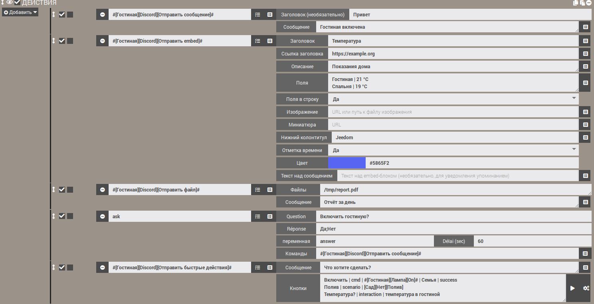
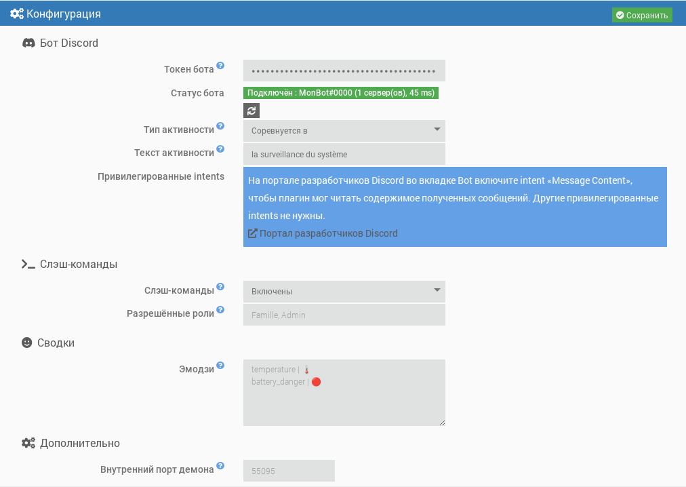
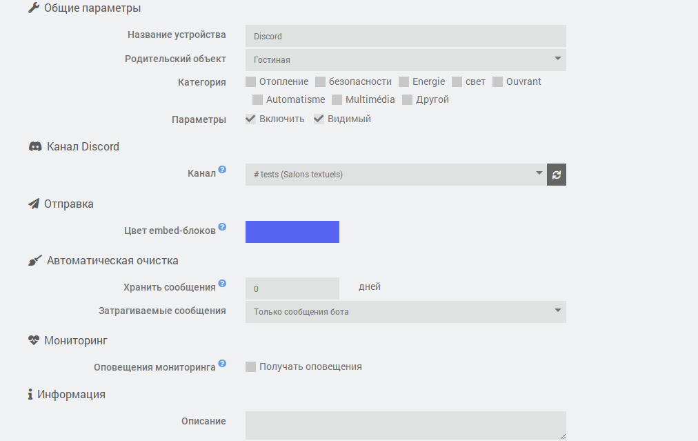
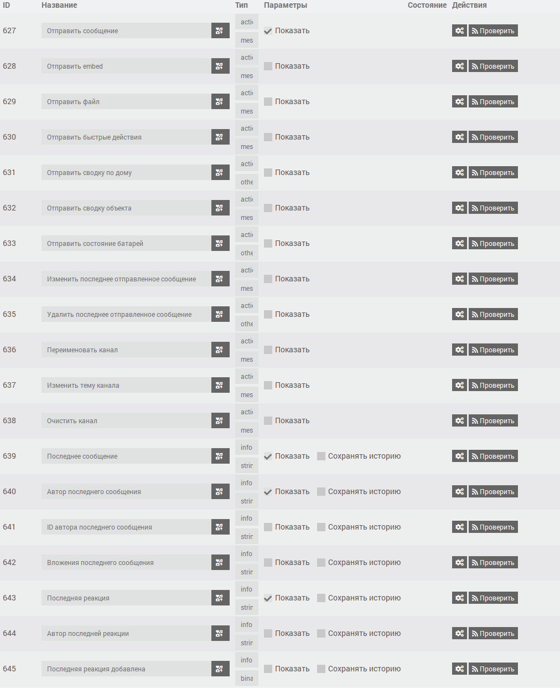
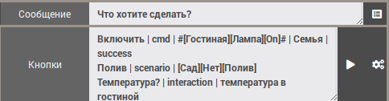

# Плагин JeeDiscord - BETA


> [!warning]  
> Боту нужен привилегированный intent **Message Content** (портал разработчиков Discord), чтобы читать содержимое сообщений. Без него Discord отказывает в подключении, и демон останавливается: см. «Создание бота Discord».  


JeeDiscord связывает Jeedom с сервером **[Discord](https://discord.com)** с помощью бота. Каждое устройство соответствует одному каналу, и плагин позволяет:  

- **отправлять** сообщения, embed-блоки (форматированные сообщения) и файлы из сценариев, с упоминаниями;
- **задавать вопросы** (действие «Ask» сценариев) с кнопками или меню ответов;
- **получать** сообщения и реакции-эмодзи канала;
- использовать **кнопки быстрых действий** и **слэш-команды** (`/jeedom`, `/clean`) для управления Jeedom из Discord;
- **изменять или удалять** сообщения, **очищать** канал, **переименовывать** его или менять тему (голосовой канал может служить дисплеем);
- отправлять **сводки** (дом, объект, батареи) и **оповещения мониторинга** о демонах и зависимостях.

Он основан на библиотеке [discord.js](https://discord.js.org/) v14 и API Discord v10.  

## Обзор  

  

# Требования  

- Jeedom 4.4 минимум
- Debian 12 минимум
- Node.js: устанавливается Jeedom автоматически при установке зависимостей

# Создание бота Discord  

1. Откройте [портал разработчиков Discord](https://discord.com/developers/applications) и нажмите **New Application**.
2. На вкладке **Bot** нажмите **Reset Token** и скопируйте токен. Он больше не будет показан: храните его в надёжном месте и никому не передавайте.
3. Там же, на вкладке **Bot**, в разделе **Privileged Gateway Intents** включите **Message Content Intent**. Intents **Presence** и **Server Members** не нужны.
4. На вкладке **OAuth2 > URL Generator** отметьте scopes `bot` и `applications.commands`, затем нужные разрешения (см. ниже). Откройте сгенерированный URL, чтобы пригласить бота на ваш сервер.

Рекомендуемые разрешения для бота:

| Разрешение | Назначение |
|---|---|
| View Channels | Видеть отслеживаемые каналы |
| Send Messages | Отправлять сообщения |
| Embed Links | Отправлять форматированные сообщения (embed) |
| Attach Files | Отправлять файлы и снимки |
| Read Message History | Находить сообщения, чтобы изменять или удалять их |
| Add Reactions | Реагировать на сообщения |
| Manage Messages | Удалять сообщения (очистка) |
| Manage Channels | Переименовывать канал или менять его тему |

# Зависимости  

Первый шаг — установить зависимости: после включения плагина запустите их установку на странице конфигурации плагина. Jeedom сам устанавливает Node.js, затем библиотеку discord.js в папку плагина. Ход установки отображается в логе `jeediscord_packages`.  

# Общая конфигурация  

После установки зависимостей заполните:

- **Токен бота**: токен, скопированный на шаге 2 создания бота. Он зашифрован в базе данных Jeedom и скрыт в логах.
- **Тип активности** и **Текст активности**: текст, отображаемый под именем бота в Discord (например, «Пользовательская» + «Следит за домом»). Оставьте текст пустым, чтобы ничего не отображать.
- **Слэш-команды** и **Разрешённые роли**: см. «Слэш-команды» ниже.
- **Эмодзи**: эмодзи сводок и батарей, см. «Сводки».
- **Внутренний порт демона** (дополнительно): локальный порт между Jeedom и демоном. Меняйте его только при конфликте с другим плагином.

**Статус бота** показывает, запущен ли демон и подключён ли он к Discord, с именем бота, числом серверов и задержкой. Изменение активности применяется сразу, без перезапуска демона. Ввод или изменение токена запускает или перезапускает демон (если включено автоматическое управление демоном), а статус обновляется сам после сохранения.



## Демон  

Демон — единая программа Node.js, поддерживающая соединение с Discord. Он спроектирован лёгким:

- запускается с низким приоритетом (`nice`);
- запрашивает у Discord только нужные плагину события (серверы, сообщения, реакции);
- его кэши ограничены (недавние сообщения, участники) и регулярно очищаются.

**Соблюдение ограничений Discord**: ограничения частоты запросов API (по маршруту и глобальные) обрабатывает discord.js, который ставит запросы в очередь, а не теряет их. Плагин добавляет очередь на каждый канал, сохраняющую порядок действий и объединяющую повторяющиеся обновления (например, переименование канала: отправляется только последнее значение).

**Подключение**: при сбое сети на старте демон повторяет подключение с увеличивающейся задержкой (от 15 секунд до 5 минут). После подключения переподключения происходят автоматически. Если Discord отказывает в подключении (недействительный токен, не включён intent «Message Content»), демон останавливается и больше не перезапускается автоматически, чтобы не исчерпать суточную квоту подключений Discord. В центре сообщений появляется сообщение: устраните проблему, затем сохраните конфигурацию плагина.

## Логи  

Плагин использует три лога:

- `jeediscord`: действия со стороны Jeedom (запуск демона, полученные события, ошибки);
- `jeediscord_daemon`: активность демона и обмен с Discord;
- `jeediscord_packages`: установка зависимостей.

На уровне **Debug** лог демона подробно показывает каждый запрос к Discord (метод, маршрут, код ответа, оставшаяся квота), достигнутые ограничения частоты и обмен с Jeedom. Конфиденциальная информация всегда скрывается (`***`): токен бота, ключ API Jeedom, токены взаимодействий и вебхуков. Токен не появляется ни в логах, ни в списке процессов системы.

# Конфигурация устройства  

Устройство соответствует **одному каналу Discord**.

- **Канал**: список каналов, видимых боту, сгруппированный по серверам. Он доступен, когда демон подключён к Discord, и обновляется автоматически при создании, переименовании или удалении канала. Кнопка обновления принудительно обновляет список. Пометка «недостаточно прав» указывает канал, где бот не может отправлять сообщения.
- **Цвет embed-блоков**: цвет рамки форматированных сообщений, отправляемых в этот канал, используется, если сценарий не задаёт свой.
- **Оповещения мониторинга**: отметьте «Получать оповещения», чтобы этот канал получал оповещения о сбоях (см. «Мониторинг»).
- **Автоматическая очистка**: количество дней хранения сообщений канала (0: без очистки). Самые старые удаляются автоматически раз в час: либо только сообщения бота, либо все сообщения (тогда у бота должно быть право «Manage Messages»). См. «Очистка канала».



## Команды  

У каждого устройства есть следующие команды, используемые в сценариях:

| Команда | Тип | Назначение |
|---|---|---|
| Отправить сообщение | действие / сообщение | Отправляет текст. Заголовок, если заполнен, выводится жирным на первой строке. |
| Отправить embed | действие / сообщение | Отправляет форматированное сообщение (заголовок, ссылка, описание, поля, изображение, цвет, нижний колонтитул, отметка времени). |
| Отправить файл | действие / сообщение | Отправляет один или несколько файлов (локальный путь или веб-адрес) с необязательным текстом. |
| Отправить сводку по дому | действие / другое | Отправляет embed с глобальными сводками Jeedom (температура, влажность, проёмы...) и состоянием батарей. |
| Отправить сводку объекта | действие / сообщение | Отправляет сводки объекта Jeedom, выбранного из списка объектов. |
| Отправить состояние батарей | действие / другое | Отправляет список устройств с разряженной батареей и число исправных батарей. |
| Изменить последнее отправленное сообщение | действие / сообщение | Заменяет текст последнего сообщения, отправленного ботом в канал. |
| Удалить последнее отправленное сообщение | действие / другое | Удаляет последнее сообщение, отправленное ботом в канал (все его части, если оно было разбито). |
| Переименовать канал | действие / сообщение | Изменяет название канала. |
| Изменить тему канала | действие / сообщение | Изменяет тему (описание, отображаемое вверху) текстового канала. |
| Очистить канал | действие / сообщение | Удаляет сообщения старше заданного возраста. |
| Отправить быстрые действия | действие / сообщение | Отправляет сообщение с кнопками, запускающими команду, сценарий или интеракцию Jeedom. |
| Последнее сообщение | информация / другое | Содержимое последнего сообщения, полученного в канале. |
| Автор последнего сообщения | информация / другое | Отображаемое имя автора (псевдоним на сервере, иначе отображаемое имя). |
| ID автора последнего сообщения | информация / другое | Идентификатор Discord автора, надёжный для условий сценариев (имя может измениться). |
| Вложения последнего сообщения | информация / другое | Адреса вложений, по одному на строку. |
| Последняя реакция | информация / другое | Эмодзи последней добавленной или удалённой реакции. |
| Автор последней реакции | информация / другое | Отображаемое имя человека, поставившего реакцию. |
| Последняя реакция добавлена | информация / бинарная | 1, если реакция добавлена, 0, если удалена. |



Команды отправки используются в **действиях сценариев**: выберите команду в списке, и отобразится соответствующая форма. По умолчанию на дашборде отображается только команда «Отправить сообщение»; остальные скрыты, что не мешает использовать их в сценариях (их можно сделать видимыми на вкладке «Команды» устройства).

# Сценарии  

## Отправка сообщения  

Тексты длиннее 2000 символов (ограничение Discord) автоматически разбиваются на несколько сообщений, предпочтительно по переносам строк.

Эта команда принимает также файлы, передаваемые Jeedom: отчёты, создаваемые действием **Отчёт** сценария, снимки, отправляемые другими плагинами, и т. д.

### Упоминания  

В текстах можно упоминать:

| Синтаксис | Результат |
|---|---|
| `@{псевдоним}` | участник; ищется по имени пользователя, отображаемому имени или псевдониму на сервере |
| `@&{роль}` | роль; ищется по названию |
| `#{канал}` | ссылка на канал |

Нативный синтаксис Discord (`<@id>`, `<@&id>`) тоже работает. Ненайденное упоминание остаётся обычным текстом. `@everyone` и `@here` никого не уведомляют.

Поиск участников выполняется по имени и не требует привилегированного intent «Server Members».

### Как работает отправка  

Отправка асинхронная: сценарий продолжается сразу, а сообщение ставится в очередь канала. Сообщения одного канала всегда уходят по порядку. Файлы читаются в момент вызова: временный файл можно удалить сразу после команды.

Перед отправкой плагин проверяет права бота в канале (просмотр, отправка сообщений, встраивание ссылок, прикрепление файлов). При нехватке права или сбое ошибка записывается в лог `jeediscord`.

## Отправка embed  

В сценарии команда показывает отдельную форму с одним полем на строку. Кнопка в конце строки вставляет в текстовые поля значение информационной команды Jeedom (например, температуру):

- **Заголовок** и **Ссылка заголовка**: ссылка делает заголовок кликабельным;
- **Описание**: основной текст (максимум 4096 символов);
- **Поля**: одно поле на строку в виде `Название | Значение` (максимум 25 полей). **Поля в строку** (Да или Нет) выводит их колонками;
- **Изображение**: веб-адрес изображения или путь к файлу изображения на Jeedom, который тогда прикрепляется к сообщению. **Миниатюра**: веб-адрес небольшого изображения, отображаемого вверху справа;
- **Нижний колонтитул**; **Отметка времени** (Да: дата и время отправки); **Цвет** (палитра или код `#RRGGBB`, иначе цвет устройства);
- **Текст над сообщением**: текст, отображаемый над embed. Упоминания внутри embed не вызывают уведомлений: помещайте их сюда, чтобы кого-то уведомить.

Слишком длинные тексты сокращаются в соответствии с ограничениями Discord (всего 6000 символов на embed).

## Отправка файла  

Укажите полный путь к файлу **или его веб-адрес** (`http://` или `https://`), по одному на строку. Discord принимает 10 файлов в сообщении: сверх этого отправляется несколько сообщений. Максимальный размер файла зависит от уровня буста сервера (10 МБ без буста, 50 МБ на уровне 2, 100 МБ на уровне 3). Слишком большие файлы игнорируются и отмечаются в логе.

**Веб-адреса**: файл сначала скачивается Jeedom во временную папку (`/tmp/jeedom/jeediscord/download`), затем отправляется как локальный и удаляется сразу после отправки. Сценарий ждёт окончания загрузки, прежде чем продолжить. Файл называется `sendDiscord` с расширением, определяемым по типу содержимого (например, `sendDiscord.png`), независимо от имени в адресе; перенаправления выполняются, загрузка ограничена 60 секундами и 100 МБ. Адреса локальной сети (например, изображение камеры) принимаются. Учётные данные и параметры адреса никогда не записываются в логи. При сбое предупреждение записывается в лог `jeediscord`, а файл игнорируется. Адрес может содержать запятые: два файла разделяет только перенос строки.

В целях безопасности файлы конфигурации Jeedom (`core/config`), системные папки (`/etc`, `/root`...) и скрытые файлы или папки отправлять нельзя.

Поле «Файлы» принимает также переменные и теги сценария. Пример с графиком, созданным веб-сервисом и отправленным в канал:

<details markdown='1'>
<summary>Нажмите, чтобы увидеть пример блока кода</summary>

```php
// Пример: график, построенный quickchart.io (сторонний сервис), затем отправленный в канал
$values = array(0, 0.2, 1.5, 0);                          // замените вашими измерениями
$config = "{type:'bar',data:{labels:['1h','2h','3h','4h'],datasets:[{label:'mm',data:[" . implode(',', $values) . "]}]}}";
$url = "https://quickchart.io/chart?format=png&c=" . urlencode($config);

// Сохраняет адрес в ПЕРЕМЕННОЙ сценария...
$scenario->setData("chartUrl", $url);
```

В следующем действии «Отправить файл» введите `variable(chartUrl)` в поле «Файлы». Внимание: `setData` создаёт переменную, читаемую через `variable(...)`, тогда как `tag(...)` читает теги, заданные через `$scenario->setTags(...)`.
</details>

## Вопрос пользователям (действие «Ask» сценариев)  

Команды «Отправить сообщение», «Отправить embed» и «Отправить файл» можно выбирать в действии **Ask** сценария (поле «Команда» действия).

- **С возможными ответами** (например, `Да;Нет`): под вопросом выводится по кнопке на каждый ответ. При более чем 10 ответах их заменяет выпадающее меню (максимум 25 ответов).
- **Без заданного ответа** (`*`): кнопки не выводятся; вопрос предлагает ответить сообщением, и ответом становится следующее сообщение, написанное в канале.

Как только дан ответ или истёк срок, кнопки отключаются, а сообщение указывает, кто и что ответил (или «Нет ответа»). Ответ сохраняется в переменной сценария, как и в других плагинах обмена сообщениями. Ответить может любой, кто может писать в канале.

Вопрос остаётся действительным, пока не истёк срок и демон не был перезапущен: после перезапуска его кнопки просто отключаются при следующем нажатии.

## Сводки  

Три команды отправляют сводный embed; их запускают из сценария (например, по расписанию утром) или с кнопки быстрого действия:

- **Отправить сводку по дому**: глобальные сводки, заданные в Jeedom (температура, влажность, освещённость, мощность, проёмы...), с числом исправных, разряженных и критических батарей в нижнем колонтитуле.
- **Отправить сводку объекта**: сводки объекта, название которого вы укажете в поле «Объект». Кнопка в конце строки (значок куба) открывает список объектов Jeedom; можно также ввести название вручную или переменную сценария.
- **Отправить состояние батарей**: устройства с разряженной (оранжевый) или критической (красный) батареей, от самой слабой к самой сильной, с порогами Jeedom (порогами устройства, если оно их задаёт). Цвет embed соответствует самому низкому уровню. Если всё в порядке, сообщение об этом говорит.

> [!warning]  
> Как и в строке меню Jeedom, сводка по дому показывает только «поднятые» сводки. На странице объекта (инструменты > Объекты, раздел «Сводки») задайте команду сводки, затем отметьте для этой сводки **Up в общем резюме** (так называется поле в интерфейсе Jeedom); без этой отметки она появляется только в «Отправить сводку объекта». Если ни одна сводка не поднята, сообщение это уточняет.  

**Эмодзи** перед каждой сводкой и каждым уровнем батареи настраиваются в конфигурации плагина: одна строка `ключ | эмодзи` на эмодзи (ключи: `temperature`, `humidity`, `luminosity`, `power`, `motion`, `security`, `door`, `windows`, `shutter`, `light`, `outlet`, `battery_ok`, `battery_warning`, `battery_danger`, `alert`, `recovery`). Отсутствующий ключ сохраняет эмодзи по умолчанию.

## Снимки камер  

Снимки делает и отправляет плагин **Камера**: поэтому команда камеры в JeeDiscord **не** указывается, а наоборот. В действии сценария выберите команду камеры **«Enregistrer»** (по-французски «Записать», например `#[Гостиная][Моя камера][Enregistrer]#`, скрыта с дашборда, но доступна в сценариях) и заполните два её поля. Внимание: команда «Capture» плагина Камера лишь сохраняет файл на Jeedom: она ничего не отправляет.

- **Число снимков или параметры** (поле «Nombre captures ou options»): число снимков (например, `1`) или параметры плагина Камера в виде `nbSnap=3 delay=2` (число снимков и секунд между двумя снимками);
- **Команда, отправляющая снимки** (поле «Commande message d'envoi des captures»): команда JeeDiscord, которая получит изображения, например **[Гостиная][Discord][Отправить сообщение]** (или «Отправить файл»). Используйте выбор команды в конце строки.

Плагин Камера затем вызывает эту команду с файлами снимков, которые отправляются в канал устройства. Поле «Файлы» команды JeeDiscord в этом случае не используется: оно предназначено для файлов, путь к которым вы указываете сами. Снимки читаются в момент отправки, как и другие файлы (см. «Отправка файла» об ограничениях размера и отклоняемых папках).

**Текст, прикрепляемый к снимкам**: текст, передаваемый в JeeDiscord, предоставляет плагин Камера. По умолчанию он отправляет текст вида «Alerte sur la caméra *название* à *дата*» (по-французски). Чтобы заменить его, добавьте `message=` в поле параметров, с кавычками, если в тексте есть пробелы: `nbSnap=1 message="Снимок запрошен:"`. Параметр `title=` плагином Камера не учитывается. Если получатель — «Отправить сообщение», текст отображается над изображениями; если «Отправить файл» — сопровождает их.

## Изменение или удаление последнего сообщения  

Команды «Изменить последнее отправленное сообщение» и «Удалить последнее отправленное сообщение» действуют на **последнюю отправку бота в канале** (сообщение, embed, файл, вопрос или быстрые действия), в том числе когда длинный текст был разбит на несколько сообщений (изменение касается последней части, удаление — всех). Они выполняются после уже ожидающих отправок: сценарий может, таким образом, отправить, а затем сразу изменить или удалить.

- Изменение заменяет **текст** сообщения; embed, файлы и кнопки сохраняются. Упоминания `@{псевдоним}` разрешаются так же, как при отправке.
- Последнее сообщение запоминает демон: после перезапуска демона до следующей отправки нечего изменять или удалять (в логе тогда записывается ошибка).

## Переименование канала, изменение его темы  

Команды «Переименовать канал» и «Изменить тему канала» меняют название и тему канала устройства. У бота должно быть право **Manage Channels** (или роль администратора).

- **Текстовый** канал всегда пишется строчными буквами, с дефисами вместо пробелов («Мой Дом» становится `мой-дом`): это правило Discord.
- **Голосовой** канал допускает пробелы, заглавные буквы и эмодзи. Поэтому он может служить **дисплеем**: создайте устройство, связанное с голосовым каналом, и обновляйте его название из сценария, например `🌡️ Гостиная: #[Гостиная][Датчик][Температура]# °C`. Название ограничено 100 символами, тема — 1024 (и тема есть только у текстовых каналов).
- **Discord ограничивает эти изменения до 2 раз в 10 минут на канал.** Чтобы не блокироваться, запросы, поступающие во время ожидания, объединяются: отправляется только последнее значение. Ничего не отправляется и тогда, когда название или тема уже совпадают с текущими. Поэтому не вызывайте эти команды при каждом быстром изменении значения: отображение просто будет отставать на несколько минут.

## Очистка канала  

Команда «Очистить канал» удаляет сообщения старше заданного возраста (в часах или днях; 0 — все) на выбор: **только сообщения бота** или **все сообщения** (требуется право «Manage Messages»). Закреплённые сообщения всегда сохраняются. Такая же очистка запускается каждый час для устройств, у которых задан срок хранения (см. «Конфигурация устройства»).

Discord позволяет массовое удаление только для сообщений младше 14 дней. Более старые сообщения удаляются по одному, в темпе, заданном Discord: не более 100 за проход, остальное обрабатывается при следующем проходе (строка в логе `jeediscord` это отмечает). Каждый проход просматривает не более 1000 сообщений. Количество удалённых сообщений записывается в лог `jeediscord`.

## Быстрые действия  

Команда «Отправить быстрые действия» отправляет сообщение с кнопками, **остающимися активными** (даже после перезапуска демона). Она используется в сценарии: добавьте действие, затем выберите **[Объект][Устройство][Отправить быстрые действия]** в списке команд. Заполните:

- **Сообщение**: текст, отображаемый над кнопками;
- **Кнопки**: одна кнопка на строку в формате `Подпись | тип | цель | разрешённые роли | цвет`.

| Поле | Содержимое |
|---|---|
| Подпись | Текст кнопки. |
| Тип | `cmd` (команда-действие), `scenario` или `interaction`. |
| Цель | Команда (`#[Объект][Устройство][Команда]#`), сценарий (ID или полное имя `[Группа][Объект][Название]` со значением `Нет`, если у сценария нет объекта, например `[Сад][Нет][Полив]`; `[Сад][Полив]` тоже принимается) или фраза интеракции. |
| Разрешённые роли | Необязательно: названия или ID ролей Discord через запятую. Пусто = любой участник канала. |
| Цвет | Необязательно: `primary` (синий, по умолчанию), `secondary`, `success` или `danger`. |

Пример:

```
Включить гостиную | cmd | #[Гостиная][Лампа][On]# | Семья | success
Запустить полив | scenario | [Сад][Нет][Полив] | Семья, Admin
Температура? | interaction | какая температура в гостиной
```

Результат действия показывается только нажавшему человеку (✅ выполнено, ⛔ роль не разрешена, ❌ ошибка: причина тогда в логе `jeediscord`, ⚠️ кнопка больше недействительна, например потому, что устройство отключено или перенесено в другой канал). Для интеракции показывается ответ интеракции. Кнопка ▶ справа от поля «Кнопки» вставляет сценарий, выбранный из списка, соседняя кнопка вставляет команду-действие. Сценарий, запущенный кнопкой, получает теги `#jeediscord_user#` (имя человека) и `#jeediscord_channel#` (ID канала). Максимум: 25 кнопок в сообщении.



# Слэш-команды  

Плагин регистрирует на каждом сервере бота (доступны сразу) две команды, которые вводятся в Discord, начиная с `/`:

| Команда | Назначение |
|---|---|
| `/jeedom interaction text` | Отправляет фразу в интеракции Jeedom и показывает ответ. |
| `/jeedom scenario name [action]` | Запускает (по умолчанию), останавливает, включает или отключает сценарий. Название дополняется автоматически. |
| `/jeedom cmd command [value]` | Выполняет команду типа «действие». Значение служит для команд ползунка, цвета, списка или сообщения. Название дополняется автоматически. |
| `/clean [days] [all]` | Удаляет сообщения канала старше указанного числа дней (0: все), сообщения бота или, с `all`, всех. Работает так же, как «Очистить канал». |

Ответы видны только человеку, который ввёл команду. Названия команд и параметров — на английском (правило Discord для ввода); их описания отображаются на языке Discord пользователя (французский, английский, испанский, немецкий, итальянский, португальский, русский).

> [!warning]  
> Слэш-команда может управлять всем домом. Поэтому она выполняется, только если канал связан с **активным устройством JeeDiscord** (в других местах бот отвечает, что она недоступна) и если человек — **администратор сервера** или обладает одной из **разрешённых ролей** конфигурации плагина (названия или ID ролей через запятую). Пока список пуст, пользоваться командами могут только администраторы.  

Автодополнение сценариев и команд подчиняется тем же правам: неуполномоченный человек не видит никаких подсказок. Параметр «Слэш-команды» конфигурации позволяет их отключить: тогда они удаляются с серверов.

Если бот был приглашён без scope `applications.commands` (см. «Создание бота Discord»), регистрация отклоняется: это указано в логе `jeediscord_daemon`, и достаточно снова пригласить бота по исправленному URL. Команды `/jeedom` и `/clean` видны и в настройках сервера (Интеграции), где Discord позволяет дополнительно ограничить их использование определёнными каналами или ролями сверх прав плагина.

# Мониторинг  

Каждые 5 минут плагин проверяет активные плагины: **остановленный демон**, когда он должен работать (включено автоматическое управление и запуск возможен), или **зависимости с ошибкой**. Каналы устройств, у которых отмечено «Получать оповещения», получают тогда красное оповещение со списком сбоев, а затем зелёное сообщение, когда всё вернулось в норму.

Чтобы избежать ложных тревог, сбой отмечается, только если он длится не менее двух проверок (Jeedom сам перезапускает вышедшие из строя демоны), и только один раз. Демон самого JeeDiscord не отслеживается: если он остановлен, он не может писать в Discord.

# Получение сообщений и реакций  

Информационные команды обновляются при каждом сообщении или реакции, полученных в канале, в том числе когда значение не меняется: одно и то же сообщение или эмодзи, полученные дважды, дважды запускают сценарии. Содержимое сообщения и эмодзи обновляются последними: сценарий, запущенный по **Последнее сообщение**, поэтому читает автора и вложения этого же сообщения (тот же принцип для **Последняя реакция**).

Стандартные эмодзи передаются как есть (например, 👍), пользовательские эмодзи сервера — в виде `:название:`. Пример условия сценария: `#[Дом][Discord][Последняя реакция]# == "👍"`.

Сообщения самого бота и системные сообщения Discord (закрепление, присоединение участника...) игнорируются. Сообщения других ботов и вебхуков передаются.

Адреса вложений предоставляет Discord, и они истекают примерно через 24 часа: используйте их быстро.

Демон передаёт в Jeedom только события каналов, связанных с активным устройством.

# Сторонние скрипты  

JeeDiscord основан на библиотеке **discord.js** версии *v14*.  
Оригинальный код на github можно найти здесь: [discordjs/discord.js](https://github.com/discordjs/discord.js)  

Плагин задуман и возглавлен **ddelec24** (дирижёр проекта) и разработан совместно с **Claude** (Anthropic), соавтором кода и документации.  

# Дополнительная информация  

 - Плагин не тестировался во всех конфигурациях серверов Discord, ролей и прав.  
 Пожалуйста, создайте Issue на [GitHub](https://github.com/ddelec24/jeediscord/issues) или напишите на форуме [Community Jeedom](https://community.jeedom.com/tag/plugin-jeediscord), если заметите сбой.  

## Помощь - FAQ  

### Демон не запускается, «Токен бота не указан»  
Введите токен в конфигурации плагина и сохраните.  

### «Подключение отклонено Discord: недействительный токен бота»  
Токен был сброшен или неверно скопирован: сгенерируйте новый (портал разработчиков, вкладка Bot) и сохраните конфигурацию.  

### «Intent Message Content не включён»  
Включите **Message Content Intent** на вкладке Bot портала разработчиков, затем сохраните конфигурацию плагина.  

### «Зависимости не установлены»  
Запустите установку зависимостей на странице плагина и проверьте лог `jeediscord_packages`.  

### В списке устройства нет каналов  
Демон не подключён, либо у бота нет права видеть каналы: проверьте статус бота в конфигурации и разрешения «View Channels».  

### Сообщение не отправляется  
Проверьте лог `jeediscord`: отсутствующее право (отправка сообщений, встраивание ссылок, прикрепление файлов) указано там.  

### Снимки камеры не приходят  
Используйте команду «Enregistrer» **камеры** и укажите команду JeeDiscord в её поле назначения (см. «Снимки камер»). Проверьте лог `camera_record` плагина Камера и лог `jeediscord`.  

### Мой файл, отправляемый по веб-адресу, не приходит, поле «Файлы» пусто  
Поле вычисляется Jeedom до вызова плагина: проверьте в логе сценария опцию `files` в строке выполнения команды. Если она пуста, переменной или тега в этом месте не существует: переменная, заданная через `setData`, читается через `variable(имя)`, тег, заданный через `setTags`, — через `tag(имя)`. Ошибка в предшествующем блоке кода (например, `array_merge()` для значения `null`, что в PHP 8 является фатальной ошибкой) мешает задать значение.  

### Слэш-команды не появляются  
Снова пригласите бота со scope `applications.commands`, затем перезапустите демон. Проверьте, что «Слэш-команды» включены в конфигурации.  

### «Этот канал не связан ни с одним активным устройством JeeDiscord»  
Слэш-команды и кнопки работают только в каналах активного устройства.  

### Сводка по дому пуста  
Отметьте «Up в общем резюме» для нужных сводок на странице объекта (см. «Сводки»).  

### Мой сценарий запускается, даже когда сообщение не соответствует моему условию (смайлик, «?»)  
При триггере вида `#[Гостиная][Discord][Последнее сообщение]# matches "/^\s*!температура\s*$/u"` Jeedom заключает значение в кавычки, только если оно содержит латинскую букву или пробел, либо пусто. Сообщение, состоящее лишь из смайликов или знаков препинания, даёт недействительное выражение: тогда Jeedom считает его истинным и запускает сценарий. Это поведение ядра Jeedom, а не плагина. Чтобы этого избежать, поместите этот блок кода первым действием сценария:

```php
$msg = cmd::byString('#[Гостиная][Discord][Последнее сообщение]#')->execCmd();
if (!preg_match('/^\s*!температура\s*$/u', (string) $msg)) {
  $scenario->setDo(false); // после этого ни один блок не выполняется
  return;
}
```

### Переименование канала запаздывает  
Discord ограничивает изменение названия до 2 раз в 10 минут на канал (см. «Переименование канала, изменение его темы»).  

## Известные проблемы  

- Discord ограничивает переименование канала до 2 изменений в 10 минут: очень часто меняющийся дисплей будет отставать на несколько минут.
- Последнее отправленное сообщение (для изменения или удаления) и ожидающие вопросы запоминает демон: перезапуск демона приводит к их потере.
- Адреса полученных вложений истекают примерно через 24 часа.
- Триггер сценария с выражением `matches` ошибочно запускается для сообщения без букв (см. FAQ выше).

---------------------------------------------------------------
По любым другим вопросам проверьте, нет ли уже ответа на ваш вопрос, иначе спросите в [сообществе jeedom](https://community.jeedom.com)
