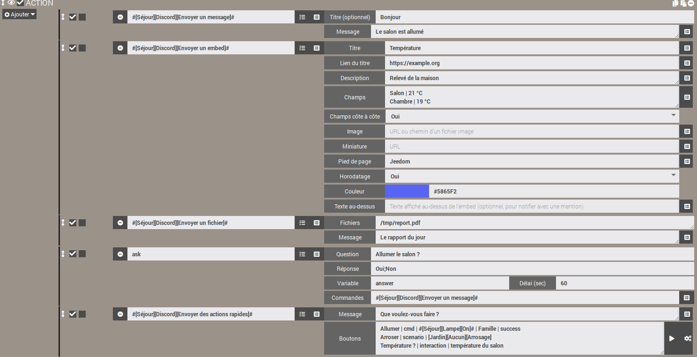
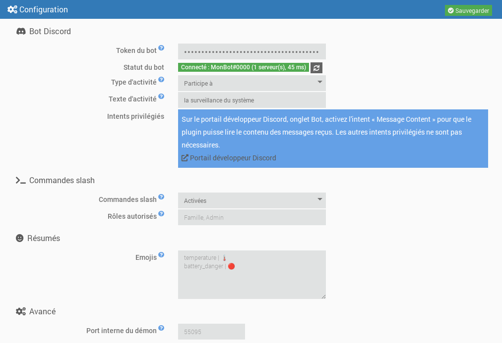
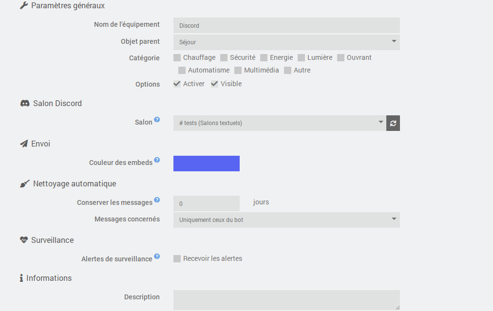
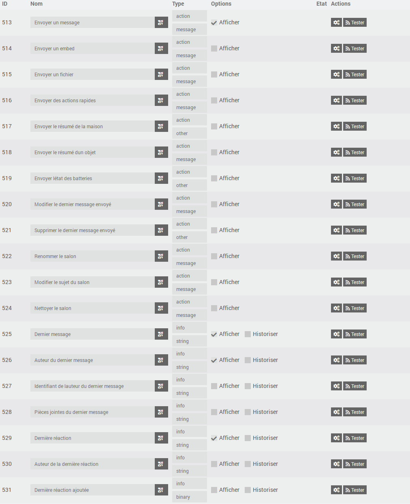
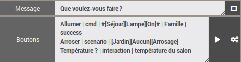

# Plugin JeeDiscord - BETA


> [!warning]  
> Le bot a besoin de l'intent privilégié **Message Content** (portail développeur Discord) pour lire le contenu des messages. Sans lui, Discord refuse la connexion et le démon s'arrête : voir « Créer le bot Discord ».  


JeeDiscord relie Jeedom à un serveur **[Discord](https://discord.com)** grâce à un bot. Chaque équipement correspond à un salon, et le plugin permet de :  

- **envoyer** des messages, des embeds (messages enrichis) et des fichiers depuis les scénarios, avec mentions ;
- **poser des questions** (action « Demander » des scénarios) avec des boutons ou un menu de réponses ;
- **recevoir** les messages et les réactions emoji du salon ;
- proposer des **boutons d'action rapide** et des **commandes slash** (`/jeedom`, `/clean`) pour piloter Jeedom depuis Discord ;
- **modifier ou supprimer** des messages, **nettoyer** un salon, le **renommer** ou changer son sujet (un salon vocal peut servir d'afficheur) ;
- envoyer des **résumés** (maison, objet, batteries) et des **alertes de surveillance** des démons et dépendances.

Il s'appuie sur la bibliothèque [discord.js](https://discord.js.org/) v14 et sur l'API Discord v10.  

## Aperçu  

  

# Prérequis  

- Jeedom 4.4 minimum
- Debian 12 minimum
- Node.js : installé automatiquement par Jeedom lors de l'installation des dépendances

# Créer le bot Discord  

1. Rendez-vous sur le [portail développeur Discord](https://discord.com/developers/applications) et cliquez sur **New Application**.
2. Dans l'onglet **Bot**, cliquez sur **Reset Token** puis copiez le token. Il ne sera plus affiché ensuite : conservez-le en lieu sûr et ne le partagez jamais.
3. Toujours dans l'onglet **Bot**, section **Privileged Gateway Intents**, activez **Message Content Intent**. Les intents **Presence** et **Server Members** ne sont pas nécessaires.
4. Dans l'onglet **OAuth2 > URL Generator**, cochez les scopes `bot` et `applications.commands`, puis les permissions nécessaires (voir ci-dessous). Ouvrez l'URL générée pour inviter le bot sur votre serveur.

Permissions recommandées pour le bot :

| Permission | Utilisation |
|---|---|
| View Channels | Voir les salons surveillés |
| Send Messages | Envoyer des messages |
| Embed Links | Envoyer des messages enrichis (embeds) |
| Attach Files | Envoyer des fichiers et des captures |
| Read Message History | Retrouver les messages pour les modifier ou les supprimer |
| Add Reactions | Réagir aux messages |
| Manage Messages | Supprimer les messages (nettoyage) |
| Manage Channels | Renommer un salon ou modifier son sujet |

# Dépendances  

La première étape est d'installer les dépendances : après l'activation du plugin, lancez leur installation depuis la page de configuration du plugin. Jeedom installe lui-même Node.js, puis la bibliothèque discord.js dans le dossier du plugin. Le suivi se fait dans le log `jeediscord_packages`.  

# Configuration générale  

Une fois les dépendances installées, renseignez :

- **Token du bot** : le token copié à l'étape 2 de la création du bot. Il est chiffré dans la base Jeedom et masqué dans les logs.
- **Type d'activité** et **Texte d'activité** : texte affiché sous le nom du bot dans Discord (par exemple « Personnalisé » + « Surveille la maison »). Laissez le texte vide pour ne rien afficher.
- **Commandes slash** et **Rôles autorisés** : voir « Commandes slash » plus bas.
- **Emojis** : emojis des résumés et des batteries, voir « Résumés ».
- **Port interne du démon** (avancé) : port local utilisé entre Jeedom et le démon. Ne le modifiez qu'en cas de conflit avec un autre plugin.

Le **statut du bot** indique si le démon est démarré et connecté à Discord, avec le nom du bot, le nombre de serveurs et la latence. La modification de l'activité est appliquée immédiatement, sans redémarrer le démon. La saisie ou la modification du token démarre ou redémarre le démon (si la gestion automatique du démon est activée), et le statut se met à jour tout seul après la sauvegarde.



## Le démon  

Le démon est un programme Node.js unique qui maintient la connexion avec Discord. Il est conçu pour rester léger :

- il est lancé avec une priorité basse (`nice`) ;
- il ne demande à Discord que les événements utiles au plugin (serveurs, messages, réactions) ;
- ses caches sont limités (messages récents, membres) et purgés régulièrement.

**Respect des limites de Discord** : les limites de débit de l'API (par route et globale) sont gérées par discord.js, qui met les requêtes en attente au lieu de les perdre. Le plugin ajoute une file par salon, qui conserve l'ordre des actions et fusionne les mises à jour répétitives (par exemple un renommage de salon : seule la dernière valeur est envoyée).

**Connexion** : en cas de coupure réseau au démarrage, le démon retente la connexion avec un délai croissant (de 15 secondes à 5 minutes). Une fois connecté, les reconnexions sont automatiques. Si Discord refuse la connexion (token invalide, intent « Message Content » non activé), le démon s'arrête et n'est plus relancé automatiquement, afin de ne pas épuiser le quota de connexions journalier de Discord. Un message s'affiche dans le centre de messages : corrigez le problème puis sauvegardez la configuration du plugin.

## Logs  

Le plugin utilise trois logs :

- `jeediscord` : actions côté Jeedom (démarrage du démon, événements reçus, erreurs) ;
- `jeediscord_daemon` : activité du démon et échanges avec Discord ;
- `jeediscord_packages` : installation des dépendances.

En niveau **Debug**, le log du démon détaille chaque requête envoyée à Discord (méthode, route, code de retour, quota restant), les limites de débit atteintes et les échanges avec Jeedom. Les informations sensibles sont systématiquement masquées (`***`) : token du bot, clé API Jeedom, jetons d'interaction et de webhook. Le token n'apparaît ni dans les logs ni dans la liste des processus du système.

# Configuration d'un équipement  

Un équipement correspond à **un salon Discord**.

- **Salon** : liste des salons visibles par le bot, groupés par serveur. Elle est disponible quand le démon est connecté à Discord et se met à jour automatiquement quand un salon est créé, renommé ou supprimé. Le bouton d'actualisation force la mise à jour. La mention « droits insuffisants » signale un salon où le bot ne peut pas envoyer de messages.
- **Couleur des embeds** : couleur de la bordure des messages enrichis envoyés dans ce salon, utilisée quand le scénario n'en précise pas.
- **Alertes de surveillance** : cochez « Recevoir les alertes » pour que ce salon reçoive les alertes de panne (voir « Surveillance »).
- **Nettoyage automatique** : nombre de jours pendant lesquels les messages du salon sont conservés (0 : aucun nettoyage). Les plus anciens sont supprimés automatiquement, une fois par heure, soit uniquement ceux du bot, soit tous les messages (le bot doit alors avoir le droit « Gérer les messages »). Voir « Nettoyer un salon ».



## Commandes  

Chaque équipement dispose des commandes suivantes, utilisables dans les scénarios :

| Commande | Type | Rôle |
|---|---|---|
| Envoyer un message | action / message | Envoie un texte. Le titre, s'il est renseigné, est affiché en gras sur la première ligne. |
| Envoyer un embed | action / message | Envoie un message enrichi (titre, lien, description, champs, image, couleur, pied de page, horodatage). |
| Envoyer un fichier | action / message | Envoie un ou plusieurs fichiers (chemin local ou adresse web), avec un texte optionnel. |
| Envoyer le résumé de la maison | action / autre | Envoie un embed avec les résumés globaux de Jeedom (température, humidité, ouvertures...) et l'état des batteries. |
| Envoyer le résumé d'un objet | action / message | Envoie les résumés d'un objet Jeedom, choisi dans la liste des objets. |
| Envoyer l'état des batteries | action / autre | Envoie la liste des équipements dont la batterie est faible, avec le nombre de batteries bonnes. |
| Modifier le dernier message envoyé | action / message | Remplace le texte du dernier message envoyé par le bot dans le salon. |
| Supprimer le dernier message envoyé | action / autre | Supprime le dernier message envoyé par le bot dans le salon (toutes ses parties s'il a été découpé). |
| Renommer le salon | action / message | Change le nom du salon. |
| Modifier le sujet du salon | action / message | Change le sujet (la description affichée en haut) d'un salon textuel. |
| Nettoyer le salon | action / message | Supprime les messages plus anciens qu'un âge donné. |
| Envoyer des actions rapides | action / message | Envoie un message sous lequel se trouvent des boutons qui lancent une commande, un scénario ou une interaction Jeedom. |
| Dernier message | info / autre | Contenu du dernier message reçu dans le salon. |
| Auteur du dernier message | info / autre | Nom affiché de son auteur (surnom sur le serveur, sinon nom d'affichage). |
| Identifiant de l'auteur du dernier message | info / autre | Identifiant Discord de l'auteur, fiable pour les conditions de scénario (un nom peut changer). |
| Pièces jointes du dernier message | info / autre | Adresses des pièces jointes, une par ligne. |
| Dernière réaction | info / autre | Emoji de la dernière réaction ajoutée ou retirée. |
| Auteur de la dernière réaction | info / autre | Nom affiché de la personne qui a réagi. |
| Dernière réaction ajoutée | info / binaire | 1 si la réaction a été ajoutée, 0 si elle a été retirée. |



Les commandes d'envoi sont utilisées dans les **actions des scénarios** : choisissez la commande dans la liste, le formulaire correspondant s'affiche. Seule la commande « Envoyer un message » est affichée par défaut sur le dashboard ; les autres sont masquées, ce qui n'empêche pas de les utiliser dans les scénarios (elles peuvent être rendues visibles dans l'onglet Commandes de l'équipement).

# Scénarios  

## Envoyer un message  

Les textes de plus de 2000 caractères (limite de Discord) sont découpés automatiquement en plusieurs messages, de préférence aux retours à la ligne.

Cette commande accepte aussi les fichiers transmis par Jeedom : rapports générés par l'action **Rapport** d'un scénario, captures envoyées par d'autres plugins, etc.

### Mentions  

Dans les textes, vous pouvez mentionner :

| Syntaxe | Résultat |
|---|---|
| `@{pseudo}` | un membre, recherché par son nom d'utilisateur, son nom d'affichage ou son surnom sur le serveur |
| `@&{rôle}` | un rôle, recherché par son nom |
| `#{salon}` | un lien vers un salon |

La syntaxe native de Discord (`<@identifiant>`, `<@&identifiant>`) fonctionne aussi. Une mention introuvable reste affichée en texte simple. `@everyone` et `@here` ne notifient personne.

La recherche des membres se fait par nom et ne nécessite pas l'intent privilégié « Server Members ».

### Fonctionnement de l'envoi  

L'envoi est asynchrone : le scénario continue immédiatement, et le message est placé dans la file d'attente du salon. Les messages d'un même salon partent toujours dans l'ordre. Les fichiers sont lus au moment de l'appel : vous pouvez supprimer un fichier temporaire juste après la commande.

Avant d'envoyer, le plugin vérifie les droits du bot dans le salon (voir, envoyer des messages, intégrer des liens, joindre des fichiers). En cas de droit manquant ou d'échec, une erreur est inscrite dans le log `jeediscord`.

## Envoyer un embed  

Dans un scénario, la commande affiche un formulaire dédié, avec un champ par ligne. Le bouton en bout de ligne permet d'insérer la valeur d'une commande info de Jeedom (par exemple une température) dans les champs de texte :

- **Titre** et **Lien du titre** : le lien rend le titre cliquable ;
- **Description** : texte principal (4096 caractères maximum) ;
- **Champs** : un champ par ligne, sous la forme `Nom | Valeur` (25 champs maximum). **Champs côte à côte** (Oui ou Non) les affiche en colonnes ;
- **Image** : adresse web d'une image, ou chemin d'un fichier image sur Jeedom, qui est alors joint au message. **Miniature** : adresse web d'une petite image affichée en haut à droite ;
- **Pied de page** ; **Horodatage** (Oui : date et heure d'envoi) ; **Couleur** (le sélecteur ou un code `#RRGGBB`, sinon la couleur de l'équipement) ;
- **Texte au-dessus** : texte affiché au-dessus de l'embed. Les mentions placées dans un embed ne déclenchent pas de notification : placez-les ici pour prévenir quelqu'un.

Les textes trop longs sont raccourcis pour respecter les limites de Discord (6000 caractères au total par embed).

## Envoyer un fichier  

Indiquez le chemin complet d'un fichier, **ou son adresse web** (`http://` ou `https://`), un par ligne. Discord accepte 10 fichiers par message : au-delà, plusieurs messages sont envoyés. La taille maximale d'un fichier dépend du niveau de boost du serveur (10 Mo sans boost, 50 Mo au niveau 2, 100 Mo au niveau 3). Les fichiers trop volumineux sont ignorés et signalés dans le log.

**Adresses web** : le fichier est d'abord téléchargé par Jeedom dans son dossier temporaire (`/tmp/jeedom/jeediscord/download`), puis envoyé comme un fichier local, et supprimé aussitôt après l'envoi. Le scénario attend la fin du téléchargement avant de continuer. Le fichier est nommé `sendDiscord` suivi d'une extension déduite du type du contenu (par exemple `sendDiscord.png`), quel que soit le nom dans l'adresse ; les redirections sont suivies, et le téléchargement est limité à 60 secondes et 100 Mo. Les adresses du réseau local (par exemple l'image d'une caméra) sont acceptées. Les identifiants et paramètres d'une adresse ne sont jamais écrits dans les logs. En cas d'échec, une alerte est inscrite dans le log `jeediscord` et le fichier est ignoré. Une adresse peut contenir des virgules : seul le retour à la ligne sépare deux fichiers.

Par sécurité, les fichiers de configuration de Jeedom (`core/config`), les dossiers système (`/etc`, `/root`...) et les fichiers ou dossiers cachés ne peuvent pas être envoyés.

Le champ « Fichiers » accepte aussi les variables et tags de scénario. Exemple, avec un graphique généré par un service web et envoyé dans le salon :

<details markdown='1'>
<summary>Cliquez pour voir l'exemple de bloc code</summary>

```php
// Exemple : un graphique construit par quickchart.io (service tiers), envoyé ensuite dans le salon
$valeurs = array(0, 0.2, 1.5, 0);                         // à remplacer par vos mesures
$config = "{type:'bar',data:{labels:['1h','2h','3h','4h'],datasets:[{label:'mm',data:[" . implode(',', $valeurs) . "]}]}}";
$url = "https://quickchart.io/chart?format=png&c=" . urlencode($config);

// Enregistre l'adresse dans une VARIABLE du scénario...
$scenario->setData("graphiqueUrl", $url);
```

Dans l'action « Envoyer un fichier » qui suit, saisissez `variable(graphiqueUrl)` dans le champ « Fichiers ». Attention : `setData` crée une variable, lue avec `variable(...)`, alors que `tag(...)` lit les tags posés avec `$scenario->setTags(...)`.
</details>

## Poser une question (action « Demander » des scénarios)  

Les commandes « Envoyer un message », « Envoyer un embed » et « Envoyer un fichier » peuvent être choisies dans l'action **Demander** d'un scénario (le champ « Commande » de l'action).

- **Avec des réponses possibles** (par exemple `Oui;Non`) : un bouton par réponse est affiché sous la question. Au-delà de 10 réponses, un menu déroulant les remplace (25 réponses au maximum).
- **Sans réponse imposée** (`*`) : aucun bouton n'est affiché ; la question indique de répondre en écrivant un message, et le prochain message écrit dans le salon est la réponse.

Dès qu'une réponse est donnée, ou à la fin du délai, les boutons sont désactivés et le message indique qui a répondu et quoi (ou « Aucune réponse »). La réponse est enregistrée dans la variable du scénario, comme avec les autres plugins de messagerie. N'importe quelle personne pouvant écrire dans le salon peut répondre.

Une question reste valable tant que le délai n'est pas écoulé et que le démon n'est pas redémarré : après un redémarrage, ses boutons sont simplement désactivés au prochain clic.

## Résumés  

Trois commandes envoient un embed de synthèse, à lancer depuis un scénario (par exemple un déclenchement programmé le matin) ou depuis un bouton d'action rapide :

- **Envoyer le résumé de la maison** : les résumés globaux définis dans Jeedom (température, humidité, luminosité, puissance, ouvertures...), avec en pied de page le nombre de batteries bonnes, faibles et critiques.
- **Envoyer le résumé d'un objet** : les résumés de l'objet dont vous indiquez le nom dans le champ « Objet ». Le bouton en bout de ligne (icône cube) ouvre la liste des objets de Jeedom ; vous pouvez aussi saisir le nom à la main, ou une variable de scénario.
- **Envoyer l'état des batteries** : les équipements dont la batterie est faible (en orange) ou critique (en rouge), du plus faible au plus fort, avec les seuils de Jeedom (ceux de l'équipement s'il en définit). La couleur de l'embed suit le niveau le plus bas. Si tout est bon, le message le dit.

> [!warning]  
> Comme dans la barre de menu de Jeedom, le résumé de la maison n'affiche que les résumés « remontés ». Dans la page de l'objet (Outils > Objets, section Résumés), définissez la commande du résumé, puis cochez **Remonter dans le résumé global** pour ce résumé ; sans cette case, il n'apparaît que dans « Envoyer le résumé d'un objet ». Si aucun résumé n'est remonté, le message le précise.  

Les **emojis** devant chaque résumé et chaque niveau de batterie se personnalisent dans la configuration du plugin : une ligne `clé | emoji` par emoji (clés : `temperature`, `humidity`, `luminosity`, `power`, `motion`, `security`, `door`, `windows`, `shutter`, `light`, `outlet`, `battery_ok`, `battery_warning`, `battery_danger`, `alert`, `recovery`). Une clé absente garde son emoji par défaut.

## Captures des caméras  

C'est le plugin **Caméra** qui prend les captures et les envoie : on ne met donc **pas** de commande de caméra dans JeeDiscord, mais l'inverse. Dans une action de scénario, choisissez la commande **« Enregistrer »** de la caméra (par exemple `#[Salon][Ma caméra][Enregistrer]#`, masquée du dashboard mais disponible dans les scénarios) et renseignez ses deux champs. Attention, la commande « Capture » du plugin Caméra ne fait qu'enregistrer un fichier sur Jeedom : elle n'envoie rien.

- **Nombre captures ou options** : le nombre de captures (par exemple `1`), ou des options du plugin Caméra sous la forme `nbSnap=3 delay=2` (nombre de captures et secondes entre deux captures) ;
- **Commande message d'envoi des captures** : la commande JeeDiscord qui recevra les images, par exemple **[Salon][Discord][Envoyer un message]** (ou « Envoyer un fichier »). Utilisez le sélecteur de commandes en bout de ligne.

Le plugin Caméra appelle alors cette commande avec les fichiers des captures, qui sont envoyés dans le salon de l'équipement. Le champ « Fichiers » de la commande JeeDiscord n'est pas utilisé dans ce cas : il sert aux fichiers dont vous donnez vous-même le chemin. Les captures sont lues au moment de l'envoi, comme les autres fichiers (voir « Envoyer un fichier » pour les limites de taille et les dossiers refusés).

**Texte joint aux captures** : c'est le plugin Caméra qui fournit le texte transmis à JeeDiscord. Par défaut, il envoie un texte du type « Alerte sur la caméra *nom* à *date* ». Pour le remplacer, ajoutez `message=` dans le champ « Nombre captures ou options », avec des guillemets si le texte contient des espaces : `nbSnap=1 message="Capture demandée :"`. Le paramètre `title=` n'est pas pris en compte par le plugin Caméra. Avec « Envoyer un message » comme destination, le texte est affiché au-dessus des images ; avec « Envoyer un fichier », il les accompagne.

## Modifier ou supprimer le dernier message  

Les commandes « Modifier le dernier message envoyé » et « Supprimer le dernier message envoyé » agissent sur le **dernier envoi du bot dans le salon** (message, embed, fichier, question ou actions rapides), y compris quand un long texte a été découpé en plusieurs messages (la modification porte sur la dernière partie, la suppression sur toutes). Elles sont exécutées après les envois déjà en attente : un scénario peut donc envoyer puis modifier ou supprimer aussitôt.

- La modification remplace le **texte** du message ; les embeds, fichiers et boutons sont conservés. Les mentions `@{pseudo}` sont résolues comme à l'envoi.
- Le dernier message est mémorisé par le démon : après un redémarrage du démon, il n'y a plus de message à modifier ou supprimer jusqu'au prochain envoi (une erreur est alors inscrite dans le log).

## Renommer un salon, modifier son sujet  

Les commandes « Renommer le salon » et « Modifier le sujet du salon » changent le nom et le sujet du salon de l'équipement. Le bot doit avoir le droit **Gérer les salons** (ou le rôle administrateur).

- Un salon **textuel** est toujours en minuscules, avec des tirets à la place des espaces (« Ma Maison » devient `ma-maison`) : c'est la règle de Discord.
- Un salon **vocal** accepte les espaces, les majuscules et les emojis. Il peut donc servir d'**afficheur** : créez un équipement lié à un salon vocal, et mettez à jour son nom depuis un scénario, par exemple `🌡️ Salon : #[Salon][Sonde][Température]# °C`. Le nom est limité à 100 caractères, le sujet à 1024 (et seuls les salons textuels ont un sujet).
- **Discord limite ces changements à 2 toutes les 10 minutes par salon.** Pour ne pas bloquer, les demandes qui arrivent pendant l'attente sont fusionnées : seule la dernière valeur est envoyée. Rien n'est envoyé non plus quand le nom ou le sujet est déjà celui du salon. N'appelez donc pas ces commandes à chaque variation rapide d'une valeur : l'affichage sera simplement en retard de quelques minutes.

## Nettoyer un salon  

La commande « Nettoyer le salon » supprime les messages plus anciens qu'un âge (en heures ou en jours ; 0 pour tous), au choix **uniquement ceux du bot** ou **tous les messages** (droit « Gérer les messages » requis). Les messages épinglés sont toujours conservés. Le même nettoyage est lancé chaque heure pour les équipements qui ont une durée de conservation (voir « Configuration d'un équipement »).

Discord ne permet la suppression en masse que pour les messages de moins de 14 jours. Les messages plus anciens sont supprimés un par un, à la cadence imposée par Discord : 100 au maximum par passage, le reste est traité au passage suivant (une ligne du log `jeediscord` le signale). Chaque passage examine au plus 1000 messages. Le nombre de messages supprimés est inscrit dans le log `jeediscord`.

## Actions rapides  

La commande « Envoyer des actions rapides » envoie un message avec des boutons **qui restent actifs** (même après un redémarrage du démon). Elle s'utilise dans un scénario : ajoutez une action, puis choisissez **[Objet][Équipement][Envoyer des actions rapides]** dans la liste des commandes. Renseignez :

- **Message** : le texte affiché au-dessus des boutons ;
- **Boutons** : un bouton par ligne, au format `Libellé | type | cible | rôles autorisés | couleur`.

| Champ | Contenu |
|---|---|
| Libellé | Texte du bouton. |
| Type | `cmd` (commande action), `scenario` ou `interaction`. |
| Cible | La commande (`#[Objet][Équipement][Commande]#`), le scénario (identifiant, ou nom complet `[Groupe][Objet][Nom]` avec `Aucun` si le scénario n'a pas d'objet, par exemple `[Jardin][Aucun][Arrosage]` ; `[Jardin][Arrosage]` est aussi accepté) ou la phrase de l'interaction. |
| Rôles autorisés | Facultatif : noms ou identifiants de rôles Discord séparés par des virgules. Vide = toute personne du salon. |
| Couleur | Facultatif : `primary` (bleu, par défaut), `secondary`, `success` ou `danger`. |

Exemple :

```
Allumer le salon | cmd | #[Salon][Lampe][On]# | Famille | success
Lancer l'arrosage | scenario | [Jardin][Aucun][Arrosage] | Famille, Admin
Température ? | interaction | quelle est la température du salon
```

Le résultat de l'action est affiché uniquement à la personne qui a cliqué (✅ exécuté, ⛔ rôle non autorisé, ❌ erreur : la cause est alors dans le log `jeediscord`, ⚠️ bouton qui n'est plus valide, par exemple parce que l'équipement a été désactivé ou déplacé dans un autre salon). Pour une interaction, la réponse de l'interaction est affichée. Le bouton ▶ à droite du champ « Boutons » insère un scénario choisi dans la liste, le bouton à côté insère une commande action. Un scénario lancé par un bouton reçoit les tags `#jeediscord_user#` (nom de la personne) et `#jeediscord_channel#` (identifiant du salon). Maximum : 25 boutons par message.



# Commandes slash  

Le plugin enregistre sur chaque serveur du bot (disponibles aussitôt) deux commandes que l'on tape dans Discord en commençant par `/` :

| Commande | Rôle |
|---|---|
| `/jeedom interaction text` | Envoie une phrase aux interactions de Jeedom et affiche la réponse. |
| `/jeedom scenario name [action]` | Lance (par défaut), arrête, active ou désactive un scénario. Le nom se complète automatiquement. |
| `/jeedom cmd command [value]` | Exécute une commande de type action. La valeur sert aux commandes curseur, couleur, liste ou message. Le nom se complète automatiquement. |
| `/clean [days] [all]` | Supprime les messages du salon plus anciens que le nombre de jours donné (0 : tous), ceux du bot ou, avec `all`, ceux de tout le monde. Même fonctionnement que « Nettoyer le salon ». |

Les réponses ne sont visibles que par la personne qui a tapé la commande. Les noms des commandes et des paramètres sont en anglais (règle de Discord pour la saisie) ; leurs descriptions s'affichent dans la langue de Discord de l'utilisateur (français, anglais, espagnol, allemand, italien, portugais, russe).

> [!warning]  
> Une commande slash peut piloter toute la maison. Elle n'est donc exécutée que si le salon est associé à un **équipement JeeDiscord actif** (ailleurs, le bot répond qu'elle n'est pas disponible), et si la personne est **administrateur du serveur** ou possède un des **rôles autorisés** de la configuration du plugin (noms ou identifiants de rôles séparés par des virgules). Tant que la liste est vide, seuls les administrateurs peuvent utiliser les commandes.  

L'autocomplétion des scénarios et des commandes est soumise aux mêmes droits : une personne non autorisée ne voit aucune proposition. Le réglage « Commandes slash » de la configuration permet de les désactiver : elles sont alors retirées des serveurs.

Si le bot n'a pas été invité avec le scope `applications.commands` (voir « Créer le bot Discord »), l'enregistrement est refusé : le log `jeediscord_daemon` l'indique, et il suffit de réinviter le bot avec l'URL corrigée. Les commandes `/jeedom` et `/clean` sont aussi visibles dans les paramètres du serveur (Intégrations), où Discord permet d'en restreindre l'usage à certains salons ou rôles en plus des droits du plugin.

# Surveillance  

Toutes les 5 minutes, le plugin vérifie les plugins actifs : un **démon arrêté** alors qu'il devrait tourner (gestion automatique activée et démarrage possible), ou des **dépendances en erreur**. Les salons des équipements qui ont coché « Recevoir les alertes » reçoivent alors une alerte rouge listant les pannes, puis un message vert quand tout est rentré dans l'ordre.

Pour éviter les fausses alertes, une panne n'est signalée que si elle dure au moins deux vérifications (Jeedom relance lui-même les démons en panne), et une seule fois. Le démon de JeeDiscord lui-même n'est pas surveillé : s'il est arrêté, il ne peut pas écrire sur Discord.

# Réception des messages et des réactions  

Les commandes info sont mises à jour à chaque message ou réaction reçu dans le salon, y compris quand la valeur ne change pas : un même message ou un même emoji reçu deux fois déclenche deux fois les scénarios. Le contenu du message et l'emoji sont mis à jour en dernier : un scénario déclenché par **Dernier message** lit donc l'auteur et les pièces jointes de ce même message (même principe pour **Dernière réaction**).

Les emojis standards sont transmis tels quels (par exemple 👍), les emojis personnalisés du serveur sous la forme `:nom:`. Exemple de condition de scénario : `#[Maison][Discord][Dernière réaction]# == "👍"`.

Les messages du bot lui-même et les messages système de Discord (épinglage, arrivée d'un membre...) sont ignorés. Les messages des autres bots et des webhooks sont transmis.

Les adresses des pièces jointes sont fournies par Discord et expirent au bout de 24 heures environ : utilisez-les rapidement.

Seuls les événements des salons associés à un équipement actif sont transmis par le démon à Jeedom.

# Scripts Tiers  

JeeDiscord repose sur la bibliothèque **discord.js** en version *v14*.  
Vous pouvez trouver le code github original ici : [discordjs/discord.js](https://github.com/discordjs/discord.js)  

Le plugin est conçu et dirigé par **ddelec24** (chef d'orchestre du projet) et développé avec **Claude** (Anthropic), co-auteur du code et de la documentation.  

# Informations complémentaires  

 - Le plugin n'a pas été testé dans toutes les configurations de serveurs Discord, de rôles et de permissions.  
 Merci de faire un Issue sur [GitHub](https://github.com/ddelec24/jeediscord/issues) ou un message sur le forum [Community Jeedom](https://community.jeedom.com/tag/plugin-jeediscord) si jamais vous constatez un dysfonctionnement.  

## Aide - FAQ  

### Le démon ne démarre pas, « Le token du bot n'est pas renseigné »  
Saisissez le token dans la configuration du plugin puis sauvegardez.  

### « Connexion refusée par Discord : token du bot invalide »  
Le token a été réinitialisé ou mal copié : générez-en un nouveau (portail développeur, onglet Bot) et sauvegardez la configuration.  

### « Intent Message Content non activé »  
Activez **Message Content Intent** dans l'onglet Bot du portail développeur, puis sauvegardez la configuration du plugin.  

### « Dépendances non installées »  
Lancez l'installation des dépendances depuis la page du plugin et consultez le log `jeediscord_packages`.  

### Aucun salon dans la liste de l'équipement  
Le démon n'est pas connecté, ou le bot n'a pas le droit de voir les salons : vérifiez le statut du bot dans la configuration et les permissions « View Channels ».  

### Un message n'est pas envoyé  
Consultez le log `jeediscord` : un droit manquant (envoyer des messages, intégrer des liens, joindre des fichiers) y est indiqué.  

### Les captures de la caméra n'arrivent pas  
Utilisez la commande « Enregistrer » **de la caméra** et indiquez la commande JeeDiscord dans son champ de destination (voir « Captures des caméras »). Consultez le log `camera_record` du plugin Caméra et le log `jeediscord`.  

### Mon fichier envoyé par adresse web n'arrive pas, le champ « Fichiers » est vide  
Le champ est évalué par Jeedom avant l'appel du plugin : vérifiez dans le log du scénario l'option `files` de la ligne « Exécution de la commande ». Si elle est vide, la variable ou le tag n'existe pas à cet endroit : une variable posée avec `setData` se lit avec `variable(nom)`, un tag posé avec `setTags` avec `tag(nom)`. Une erreur dans un bloc code qui précède (par exemple un `array_merge()` sur une valeur `null`, qui est une erreur fatale en PHP 8) empêche de poser la valeur.  

### Les commandes slash n'apparaissent pas  
Réinvitez le bot avec le scope `applications.commands`, puis redémarrez le démon. Vérifiez que « Commandes slash » est activé dans la configuration.  

### « Ce salon n'est associé à aucun équipement JeeDiscord actif »  
Les commandes slash et les boutons ne fonctionnent que dans les salons d'un équipement actif.  

### Le résumé de la maison est vide  
Cochez « Remonter dans le résumé global » pour les résumés voulus dans la page de l'objet (voir « Résumés »).  

### Mon scénario se lance même quand le message ne correspond pas à ma condition (smiley, « ? »)  
Avec un déclencheur du type `#[Salon][Discord][Dernier message]# matches "/^\s*!temp(é|e)rature\s*$/u"`, Jeedom ne met la valeur entre guillemets que si elle contient une lettre, un espace, ou si elle est vide. Un message fait uniquement de smileys ou de ponctuation donne donc une expression invalide : Jeedom la considère alors comme vraie et lance le scénario. C'est un comportement du cœur de Jeedom, pas du plugin. Pour l'éviter, placez ce bloc code en première action du scénario :

```php
$msg = cmd::byString('#[Salon][Discord][Dernier message]#')->execCmd();
if (!preg_match('/^\s*!temp(é|e)rature\s*$/u', (string) $msg)) {
  $scenario->setDo(false); // plus aucun bloc n'est exécuté ensuite
  return;
}
```

### Le renommage d'un salon est en retard  
Discord limite les changements de nom à 2 toutes les 10 minutes par salon (voir « Renommer un salon, modifier son sujet »).  

## Problèmes connus  

- Discord limite le renommage d'un salon à 2 changements toutes les 10 minutes : un afficheur qui change très souvent aura quelques minutes de retard.
- Le dernier message envoyé (pour le modifier ou le supprimer) et les questions en attente sont mémorisés par le démon : un redémarrage du démon les fait perdre.
- Les adresses des pièces jointes reçues expirent au bout de 24 heures environ.
- Un déclencheur de scénario avec une expression `matches` se lance à tort pour un message sans lettre (voir la FAQ ci-dessus).

---------------------------------------------------------------
Pour toutes autres questions, merci de regarder si il n'y a pas déjà une réponse à votre interrogation, sinon demandez sur le [community jeedom](https://community.jeedom.com)
