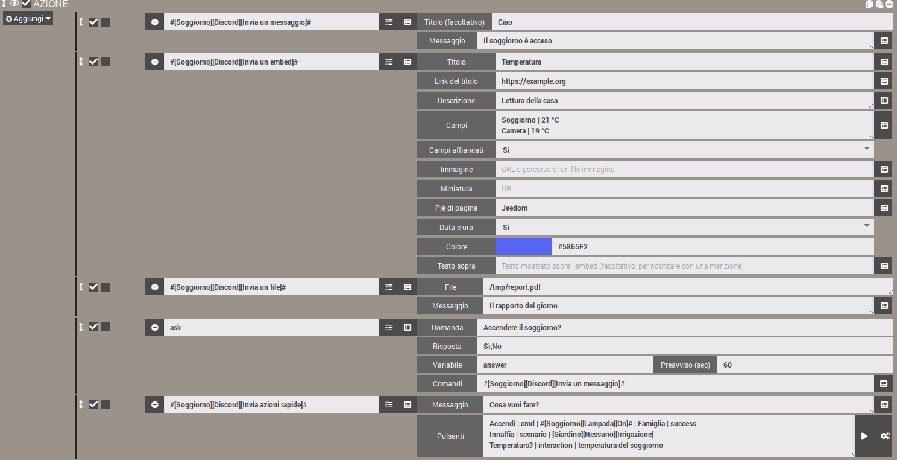
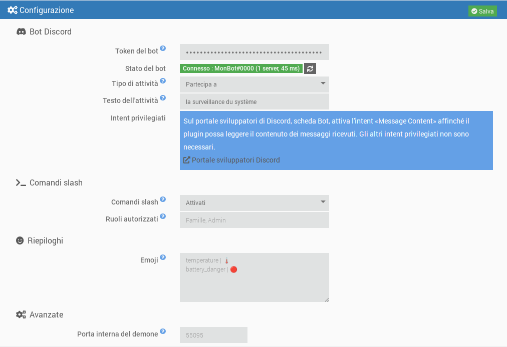
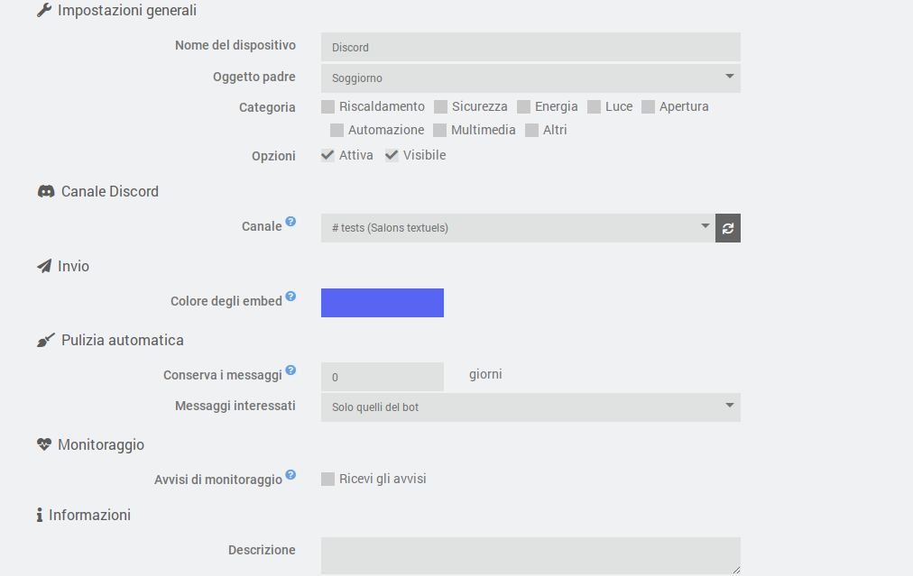
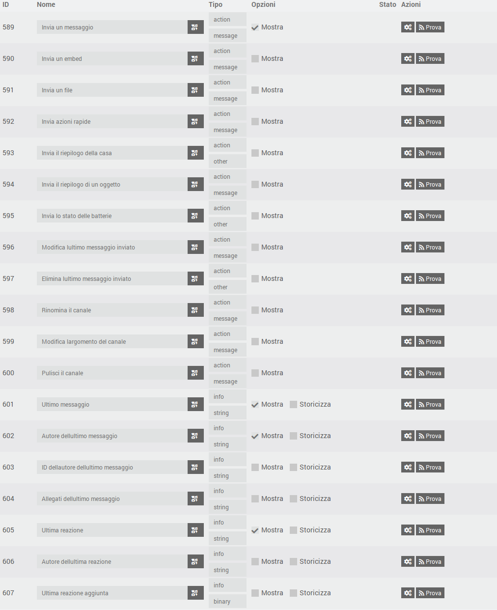
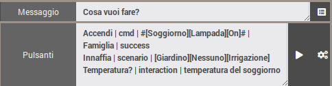

# Plugin JeeDiscord - BETA


> [!warning]  
> Il bot ha bisogno dell'intent privilegiato **Message Content** (portale sviluppatori di Discord) per leggere il contenuto dei messaggi. Senza di esso, Discord rifiuta la connessione e il demone si ferma: vedere «Creare il bot Discord».  


JeeDiscord collega Jeedom a un server **[Discord](https://discord.com)** tramite un bot. Ogni dispositivo corrisponde a un canale, e il plugin permette di:  

- **inviare** messaggi, embed (messaggi arricchiti) e file dagli scenari, con menzioni;
- **porre domande** (azione «Ask» degli scenari) con pulsanti o un menu di risposte;
- **ricevere** i messaggi e le reazioni emoji del canale;
- offrire **pulsanti di azione rapida** e **comandi slash** (`/jeedom`, `/clean`) per controllare Jeedom da Discord;
- **modificare o eliminare** messaggi, **pulire** un canale, **rinominarlo** o cambiarne l'argomento (un canale vocale può fare da display);
- inviare **riepiloghi** (casa, oggetto, batterie) e **avvisi di monitoraggio** dei demoni e delle dipendenze.

Si basa sulla libreria [discord.js](https://discord.js.org/) v14 e sull'API Discord v10.  

## Panoramica  

  

# Prerequisiti  

- Jeedom 4.4 minimo
- Debian 12 minimo
- Node.js: installato automaticamente da Jeedom durante l'installazione delle dipendenze

# Creare il bot Discord  

1. Vai al [portale sviluppatori di Discord](https://discord.com/developers/applications) e fai clic su **New Application**.
2. Nella scheda **Bot**, fai clic su **Reset Token** e copia il token. Non verrà più mostrato: conservalo in un luogo sicuro e non condividerlo mai.
3. Sempre nella scheda **Bot**, sezione **Privileged Gateway Intents**, attiva **Message Content Intent**. Gli intent **Presence** e **Server Members** non sono necessari.
4. Nella scheda **OAuth2 > URL Generator**, seleziona gli scope `bot` e `applications.commands`, poi i permessi necessari (vedi sotto). Apri l'URL generato per invitare il bot sul tuo server.

Permessi consigliati per il bot:

| Permesso | Utilizzo |
|---|---|
| View Channels | Vedere i canali monitorati |
| Send Messages | Inviare messaggi |
| Embed Links | Inviare messaggi arricchiti (embed) |
| Attach Files | Inviare file e istantanee |
| Read Message History | Ritrovare i messaggi per modificarli o eliminarli |
| Add Reactions | Reagire ai messaggi |
| Manage Messages | Eliminare i messaggi (pulizia) |
| Manage Channels | Rinominare un canale o modificarne l'argomento |

# Dipendenze  

Il primo passo è installare le dipendenze: dopo aver attivato il plugin, avviane l'installazione dalla pagina di configurazione del plugin. Jeedom installa da solo Node.js, poi la libreria discord.js nella cartella del plugin. L'avanzamento si segue nel log `jeediscord_packages`.  

# Configurazione generale  

Una volta installate le dipendenze, compila:

- **Token del bot**: il token copiato al passo 2 della creazione del bot. È cifrato nel database di Jeedom e nascosto nei log.
- **Tipo di attività** e **Testo dell'attività**: testo mostrato sotto il nome del bot in Discord (ad esempio «Personalizzato» + «Sorveglia la casa»). Lascia il testo vuoto per non mostrare nulla.
- **Comandi slash** e **Ruoli autorizzati**: vedere «Comandi slash» più avanti.
- **Emoji**: emoji dei riepiloghi e delle batterie, vedere «Riepiloghi».
- **Porta interna del demone** (avanzato): porta locale usata tra Jeedom e il demone. Modificala solo in caso di conflitto con un altro plugin.

Lo **stato del bot** indica se il demone è avviato e connesso a Discord, con il nome del bot, il numero di server e la latenza. La modifica dell'attività viene applicata subito, senza riavviare il demone. L'inserimento o la modifica del token avvia o riavvia il demone (se la gestione automatica del demone è attivata), e lo stato si aggiorna da solo dopo il salvataggio.



## Il demone  

Il demone è un unico programma Node.js che mantiene la connessione con Discord. È progettato per restare leggero:

- viene avviato con priorità bassa (`nice`);
- chiede a Discord solo gli eventi utili al plugin (server, messaggi, reazioni);
- le sue cache sono limitate (messaggi recenti, membri) e svuotate regolarmente.

**Rispetto dei limiti di Discord**: i limiti di frequenza dell'API (per route e globale) sono gestiti da discord.js, che mette le richieste in coda anziché perderle. Il plugin aggiunge una coda per canale, che mantiene l'ordine delle azioni e unisce gli aggiornamenti ripetitivi (ad esempio la ridenominazione di un canale: viene inviato solo l'ultimo valore).

**Connessione**: in caso di interruzione di rete all'avvio, il demone ritenta la connessione con un ritardo crescente (da 15 secondi a 5 minuti). Una volta connesso, le riconnessioni sono automatiche. Se Discord rifiuta la connessione (token non valido, intent «Message Content» non attivato), il demone si ferma e non viene più riavviato automaticamente, per non esaurire la quota giornaliera di connessioni di Discord. Nel centro messaggi compare un messaggio: correggi il problema e poi salva la configurazione del plugin.

## Log  

Il plugin usa tre log:

- `jeediscord`: azioni lato Jeedom (avvio del demone, eventi ricevuti, errori);
- `jeediscord_daemon`: attività del demone e scambi con Discord;
- `jeediscord_packages`: installazione delle dipendenze.

A livello **Debug**, il log del demone dettaglia ogni richiesta inviata a Discord (metodo, route, codice di ritorno, quota rimanente), i limiti di frequenza raggiunti e gli scambi con Jeedom. Le informazioni sensibili sono sempre nascoste (`***`): token del bot, chiave API di Jeedom, token di interazione e di webhook. Il token non compare né nei log né nell'elenco dei processi del sistema.

# Configurazione di un dispositivo  

Un dispositivo corrisponde a **un canale Discord**.

- **Canale**: elenco dei canali visibili al bot, raggruppati per server. È disponibile quando il demone è connesso a Discord e si aggiorna automaticamente quando un canale viene creato, rinominato o eliminato. Il pulsante di aggiornamento forza l'aggiornamento. La dicitura «permessi insufficienti» segnala un canale in cui il bot non può inviare messaggi.
- **Colore degli embed**: colore del bordo dei messaggi arricchiti inviati in questo canale, usato quando lo scenario non ne indica uno.
- **Avvisi di monitoraggio**: spunta «Ricevi gli avvisi» perché questo canale riceva gli avvisi di guasto (vedere «Monitoraggio»).
- **Pulizia automatica**: numero di giorni per cui i messaggi del canale vengono conservati (0: nessuna pulizia). I più vecchi vengono eliminati automaticamente, una volta all'ora, o solo quelli del bot o tutti i messaggi (il bot deve avere allora il permesso «Manage Messages»). Vedere «Pulire un canale».



## Comandi  

Ogni dispositivo dispone dei seguenti comandi, utilizzabili negli scenari:

| Comando | Tipo | Funzione |
|---|---|---|
| Invia un messaggio | azione / messaggio | Invia un testo. Il titolo, se compilato, è mostrato in grassetto sulla prima riga. |
| Invia un embed | azione / messaggio | Invia un messaggio arricchito (titolo, link, descrizione, campi, immagine, colore, piè di pagina, data e ora). |
| Invia un file | azione / messaggio | Invia uno o più file (percorso locale o indirizzo web), con un testo opzionale. |
| Invia il riepilogo della casa | azione / altro | Invia un embed con i riepiloghi globali di Jeedom (temperatura, umidità, aperture...) e lo stato delle batterie. |
| Invia il riepilogo di un oggetto | azione / messaggio | Invia i riepiloghi di un oggetto Jeedom, scelto dall'elenco degli oggetti. |
| Invia lo stato delle batterie | azione / altro | Invia l'elenco dei dispositivi con batteria scarica, con il numero di batterie buone. |
| Modifica l'ultimo messaggio inviato | azione / messaggio | Sostituisce il testo dell'ultimo messaggio inviato dal bot nel canale. |
| Elimina l'ultimo messaggio inviato | azione / altro | Elimina l'ultimo messaggio inviato dal bot nel canale (tutte le sue parti se è stato suddiviso). |
| Rinomina il canale | azione / messaggio | Cambia il nome del canale. |
| Modifica l'argomento del canale | azione / messaggio | Cambia l'argomento (la descrizione mostrata in alto) di un canale testuale. |
| Pulisci il canale | azione / messaggio | Elimina i messaggi più vecchi di un'età data. |
| Invia azioni rapide | azione / messaggio | Invia un messaggio con pulsanti che eseguono un comando, uno scenario o un'interazione di Jeedom. |
| Ultimo messaggio | info / altro | Contenuto dell'ultimo messaggio ricevuto nel canale. |
| Autore dell'ultimo messaggio | info / altro | Nome visualizzato del suo autore (soprannome sul server, altrimenti nome visualizzato). |
| ID dell'autore dell'ultimo messaggio | info / altro | Identificativo Discord dell'autore, affidabile per le condizioni di scenario (un nome può cambiare). |
| Allegati dell'ultimo messaggio | info / altro | Indirizzi degli allegati, uno per riga. |
| Ultima reazione | info / altro | Emoji dell'ultima reazione aggiunta o rimossa. |
| Autore dell'ultima reazione | info / altro | Nome visualizzato della persona che ha reagito. |
| Ultima reazione aggiunta | info / binario | 1 se la reazione è stata aggiunta, 0 se è stata rimossa. |



I comandi di invio si usano nelle **azioni degli scenari**: scegli il comando nell'elenco e viene mostrato il modulo corrispondente. Solo il comando «Invia un messaggio» è mostrato per impostazione predefinita sul dashboard; gli altri sono nascosti, il che non impedisce di usarli negli scenari (possono essere resi visibili nella scheda Comandi del dispositivo).

# Scenari  

## Inviare un messaggio  

I testi di più di 2000 caratteri (limite di Discord) vengono suddivisi automaticamente in più messaggi, preferibilmente agli a capo.

Questo comando accetta anche i file trasmessi da Jeedom: report generati dall'azione **Rapporto** di uno scenario, istantanee inviate da altri plugin, ecc.

### Menzioni  

Nei testi puoi menzionare:

| Sintassi | Risultato |
|---|---|
| `@{soprannome}` | un membro, cercato per nome utente, nome visualizzato o soprannome sul server |
| `@&{ruolo}` | un ruolo, cercato per nome |
| `#{canale}` | un link a un canale |

Funziona anche la sintassi nativa di Discord (`<@id>`, `<@&id>`). Una menzione non trovata resta visualizzata come testo semplice. `@everyone` e `@here` non notificano nessuno.

La ricerca dei membri avviene per nome e non richiede l'intent privilegiato «Server Members».

### Funzionamento dell'invio  

L'invio è asincrono: lo scenario prosegue subito e il messaggio viene messo nella coda del canale. I messaggi di uno stesso canale partono sempre in ordine. I file vengono letti al momento della chiamata: puoi eliminare un file temporaneo subito dopo il comando.

Prima di inviare, il plugin verifica i permessi del bot nel canale (vedere, inviare messaggi, incorporare link, allegare file). In caso di permesso mancante o di errore, viene registrato un errore nel log `jeediscord`.

## Inviare un embed  

In uno scenario, il comando mostra un modulo dedicato, con un campo per riga. Il pulsante a fine riga permette di inserire il valore di un comando info di Jeedom (ad esempio una temperatura) nei campi di testo:

- **Titolo** e **Link del titolo**: il link rende cliccabile il titolo;
- **Descrizione**: testo principale (massimo 4096 caratteri);
- **Campi**: un campo per riga, nella forma `Nome | Valore` (massimo 25 campi). **Campi affiancati** (Sì o No) li mostra in colonne;
- **Immagine**: indirizzo web di un'immagine, o percorso di un file immagine su Jeedom, che viene allora allegato al messaggio. **Miniatura**: indirizzo web di una piccola immagine mostrata in alto a destra;
- **Piè di pagina**; **Data e ora** (Sì: data e ora di invio); **Colore** (il selettore o un codice `#RRGGBB`, altrimenti il colore del dispositivo);
- **Testo sopra**: testo mostrato sopra l'embed. Le menzioni inserite in un embed non attivano notifiche: mettile qui per avvisare qualcuno.

I testi troppo lunghi vengono accorciati per rispettare i limiti di Discord (6000 caratteri in totale per embed).

## Inviare un file  

Indica il percorso completo di un file, **o il suo indirizzo web** (`http://` o `https://`), uno per riga. Discord accetta 10 file per messaggio: oltre, vengono inviati più messaggi. La dimensione massima di un file dipende dal livello di boost del server (10 MB senza boost, 50 MB al livello 2, 100 MB al livello 3). I file troppo grandi vengono ignorati e segnalati nel log.

**Indirizzi web**: il file viene prima scaricato da Jeedom nella sua cartella temporanea (`/tmp/jeedom/jeediscord/download`), poi inviato come file locale e eliminato subito dopo l'invio. Lo scenario attende la fine del download prima di proseguire. Il file si chiama `sendDiscord` seguito da un'estensione dedotta dal tipo di contenuto (ad esempio `sendDiscord.png`), qualunque sia il nome nell'indirizzo; i reindirizzamenti vengono seguiti e il download è limitato a 60 secondi e 100 MB. Gli indirizzi della rete locale (ad esempio l'immagine di una telecamera) sono accettati. Le credenziali e i parametri di un indirizzo non vengono mai scritti nei log. In caso di errore, un avviso viene registrato nel log `jeediscord` e il file viene ignorato. Un indirizzo può contenere virgole: solo l'a capo separa due file.

Per sicurezza, i file di configurazione di Jeedom (`core/config`), le cartelle di sistema (`/etc`, `/root`...) e i file o le cartelle nascosti non possono essere inviati.

Il campo «File» accetta anche variabili e tag di scenario. Esempio, con un grafico generato da un servizio web e inviato nel canale:

<details markdown='1'>
<summary>Fai clic per vedere l'esempio di blocco codice</summary>

```php
// Esempio: un grafico costruito da quickchart.io (servizio di terze parti), poi inviato nel canale
$valori = array(0, 0.2, 1.5, 0);                          // da sostituire con le tue misure
$config = "{type:'bar',data:{labels:['1h','2h','3h','4h'],datasets:[{label:'mm',data:[" . implode(',', $valori) . "]}]}}";
$url = "https://quickchart.io/chart?format=png&c=" . urlencode($config);

// Salva l'indirizzo in una VARIABILE dello scenario...
$scenario->setData("chartUrl", $url);
```

Nell'azione «Invia un file» seguente, inserisci `variable(chartUrl)` nel campo «File». Attenzione: `setData` crea una variabile, che si legge con `variable(...)`, mentre `tag(...)` legge i tag impostati con `$scenario->setTags(...)`.
</details>

## Porre una domanda (azione «Ask» degli scenari)  

I comandi «Invia un messaggio», «Invia un embed» e «Invia un file» possono essere scelti nell'azione **Ask** di uno scenario (il campo «Comando» dell'azione).

- **Con risposte possibili** (ad esempio `Sì;No`): sotto la domanda viene mostrato un pulsante per risposta. Oltre 10 risposte, un menu a tendina le sostituisce (massimo 25 risposte).
- **Senza risposta imposta** (`*`): non viene mostrato nessun pulsante; la domanda indica di rispondere scrivendo un messaggio, e il messaggio successivo scritto nel canale è la risposta.

Non appena viene data una risposta, o alla scadenza del tempo, i pulsanti vengono disattivati e il messaggio indica chi ha risposto e cosa (o «Nessuna risposta»). La risposta viene salvata nella variabile dello scenario, come con gli altri plugin di messaggistica. Chiunque possa scrivere nel canale può rispondere.

Una domanda resta valida finché il tempo non è scaduto e il demone non è stato riavviato: dopo un riavvio, i suoi pulsanti vengono semplicemente disattivati al clic successivo.

## Riepiloghi  

Tre comandi inviano un embed di sintesi, da avviare da uno scenario (ad esempio un'attivazione programmata al mattino) o da un pulsante di azione rapida:

- **Invia il riepilogo della casa**: i riepiloghi globali definiti in Jeedom (temperatura, umidità, luminosità, potenza, aperture...), con nel piè di pagina il numero di batterie buone, scariche e critiche.
- **Invia il riepilogo di un oggetto**: i riepiloghi dell'oggetto di cui indichi il nome nel campo «Oggetto». Il pulsante a fine riga (icona cubo) apre l'elenco degli oggetti di Jeedom; puoi anche digitare il nome a mano, o una variabile di scenario.
- **Invia lo stato delle batterie**: i dispositivi con batteria scarica (in arancione) o critica (in rosso), dalla più debole alla più forte, con le soglie di Jeedom (quelle del dispositivo se ne definisce). Il colore dell'embed segue il livello più basso. Se tutto va bene, il messaggio lo dice.

> [!warning]  
> Come nella barra dei menu di Jeedom, il riepilogo della casa mostra solo i riepiloghi «riportati». Nella pagina dell'oggetto (Strumenti > Oggetti, sezione Riepiloghi), definisci il comando del riepilogo, poi spunta **Up in the riepilogo generale** (così appare l'etichetta nell'interfaccia di Jeedom) per quel riepilogo; senza questa casella, compare solo in «Invia il riepilogo di un oggetto». Se nessun riepilogo è riportato, il messaggio lo precisa.  

Le **emoji** davanti a ogni riepilogo e a ogni livello di batteria si personalizzano nella configurazione del plugin: una riga `chiave | emoji` per emoji (chiavi: `temperature`, `humidity`, `luminosity`, `power`, `motion`, `security`, `door`, `windows`, `shutter`, `light`, `outlet`, `battery_ok`, `battery_warning`, `battery_danger`, `alert`, `recovery`). Una chiave assente mantiene la sua emoji predefinita.

## Istantanee delle telecamere  

È il plugin **Camera** che scatta le istantanee e le invia: non si mette quindi **nessun** comando di telecamera in JeeDiscord, ma il contrario. In un'azione di scenario, scegli il comando **«Enregistrer»** della telecamera (francese per «Registra», ad esempio `#[Soggiorno][La mia telecamera][Enregistrer]#`, nascosto dal dashboard ma disponibile negli scenari) e compila i suoi due campi. Attenzione: il comando «Capture» del plugin Camera salva solo un file su Jeedom: non invia nulla.

- **Numero di istantanee o opzioni** (campo «Nombre captures ou options»): il numero di istantanee (ad esempio `1`), o opzioni del plugin Camera nella forma `nbSnap=3 delay=2` (numero di istantanee e secondi tra due istantanee);
- **Comando che invia le istantanee** (campo «Commande message d'envoi des captures»): il comando di JeeDiscord che riceverà le immagini, ad esempio **[Soggiorno][Discord][Invia un messaggio]** (o «Invia un file»). Usa il selettore di comandi a fine riga.

Il plugin Camera richiama allora questo comando con i file delle istantanee, che vengono inviati nel canale del dispositivo. Il campo «File» del comando di JeeDiscord non viene usato in questo caso: serve per i file di cui indichi tu stesso il percorso. Le istantanee vengono lette al momento dell'invio, come gli altri file (vedere «Inviare un file» per i limiti di dimensione e le cartelle rifiutate).

**Testo allegato alle istantanee**: è il plugin Camera a fornire il testo trasmesso a JeeDiscord. Per impostazione predefinita, invia un testo del tipo «Alerte sur la caméra *nome* à *data*» (in francese). Per sostituirlo, aggiungi `message=` nel campo delle opzioni, con le virgolette se il testo contiene spazi: `nbSnap=1 message="Istantanea richiesta:"`. Il parametro `title=` non è preso in considerazione dal plugin Camera. Con «Invia un messaggio» come destinazione, il testo è mostrato sopra le immagini; con «Invia un file», le accompagna.

## Modificare o eliminare l'ultimo messaggio  

I comandi «Modifica l'ultimo messaggio inviato» e «Elimina l'ultimo messaggio inviato» agiscono sull'**ultimo invio del bot nel canale** (messaggio, embed, file, domanda o azioni rapide), anche quando un testo lungo è stato suddiviso in più messaggi (la modifica riguarda l'ultima parte, l'eliminazione tutte). Vengono eseguiti dopo gli invii già in attesa: uno scenario può quindi inviare e poi modificare o eliminare subito.

- La modifica sostituisce il **testo** del messaggio; embed, file e pulsanti vengono mantenuti. Le menzioni `@{soprannome}` vengono risolte come all'invio.
- L'ultimo messaggio è memorizzato dal demone: dopo un riavvio del demone, non c'è più alcun messaggio da modificare o eliminare fino al prossimo invio (viene allora registrato un errore nel log).

## Rinominare un canale, cambiarne l'argomento  

I comandi «Rinomina il canale» e «Modifica l'argomento del canale» cambiano il nome e l'argomento del canale del dispositivo. Il bot deve avere il permesso **Manage Channels** (o il ruolo di amministratore).

- Un canale **testuale** è sempre in minuscolo, con trattini al posto degli spazi («La Mia Casa» diventa `la-mia-casa`): è la regola di Discord.
- Un canale **vocale** accetta spazi, maiuscole ed emoji. Può quindi servire da **display**: crea un dispositivo collegato a un canale vocale e aggiorna il suo nome da uno scenario, ad esempio `🌡️ Soggiorno: #[Soggiorno][Sonda][Temperatura]# °C`. Il nome è limitato a 100 caratteri, l'argomento a 1024 (e solo i canali testuali hanno un argomento).
- **Discord limita queste modifiche a 2 ogni 10 minuti per canale.** Per non bloccarsi, le richieste che arrivano durante l'attesa vengono unite: viene inviato solo l'ultimo valore. Non viene inviato nulla neppure quando il nome o l'argomento è già quello del canale. Non chiamare quindi questi comandi a ogni variazione rapida di un valore: la visualizzazione sarà semplicemente in ritardo di qualche minuto.

## Pulire un canale  

Il comando «Pulisci il canale» elimina i messaggi più vecchi di un'età (in ore o giorni; 0 per tutti), a scelta **solo quelli del bot** o **tutti i messaggi** (permesso «Manage Messages» richiesto). I messaggi fissati vengono sempre mantenuti. La stessa pulizia viene avviata ogni ora per i dispositivi che hanno una durata di conservazione (vedere «Configurazione di un dispositivo»).

Discord consente l'eliminazione in blocco solo per i messaggi di meno di 14 giorni. I messaggi più vecchi vengono eliminati uno per uno, al ritmo imposto da Discord: 100 al massimo per passaggio, il resto viene trattato al passaggio successivo (una riga del log `jeediscord` lo segnala). Ogni passaggio esamina al massimo 1000 messaggi. Il numero di messaggi eliminati è registrato nel log `jeediscord`.

## Azioni rapide  

Il comando «Invia azioni rapide» invia un messaggio con pulsanti **che restano attivi** (anche dopo un riavvio del demone). Si usa in uno scenario: aggiungi un'azione, poi scegli **[Oggetto][Dispositivo][Invia azioni rapide]** nell'elenco dei comandi. Compila:

- **Messaggio**: il testo mostrato sopra i pulsanti;
- **Pulsanti**: un pulsante per riga, nel formato `Etichetta | tipo | destinazione | ruoli autorizzati | colore`.

| Campo | Contenuto |
|---|---|
| Etichetta | Testo del pulsante. |
| Tipo | `cmd` (comando azione), `scenario` o `interaction`. |
| Destinazione | Il comando (`#[Oggetto][Dispositivo][Comando]#`), lo scenario (ID, o nome completo `[Gruppo][Oggetto][Nome]` con `Nessuno` se lo scenario non ha oggetto, ad esempio `[Giardino][Nessuno][Irrigazione]`; è accettato anche `[Giardino][Irrigazione]`) o la frase dell'interazione. |
| Ruoli autorizzati | Facoltativo: nomi o ID di ruoli Discord separati da virgole. Vuoto = chiunque nel canale. |
| Colore | Facoltativo: `primary` (blu, predefinito), `secondary`, `success` o `danger`. |

Esempio:

```
Accendi il soggiorno | cmd | #[Soggiorno][Lampada][On]# | Famiglia | success
Avvia l'irrigazione | scenario | [Giardino][Nessuno][Irrigazione] | Famiglia, Admin
Temperatura? | interaction | qual è la temperatura del soggiorno
```

Il risultato dell'azione viene mostrato solo alla persona che ha cliccato (✅ eseguito, ⛔ ruolo non autorizzato, ❌ errore: la causa è allora nel log `jeediscord`, ⚠️ pulsante non più valido, ad esempio perché il dispositivo è stato disattivato o spostato in un altro canale). Per un'interazione, viene mostrata la risposta dell'interazione. Il pulsante ▶ a destra del campo «Pulsanti» inserisce uno scenario scelto dall'elenco, il pulsante accanto inserisce un comando azione. Uno scenario avviato da un pulsante riceve i tag `#jeediscord_user#` (nome della persona) e `#jeediscord_channel#` (ID del canale). Massimo: 25 pulsanti per messaggio.



# Comandi slash  

Il plugin registra su ogni server del bot (disponibili subito) due comandi che si digitano in Discord iniziando con `/`:

| Comando | Funzione |
|---|---|
| `/jeedom interaction text` | Invia una frase alle interazioni di Jeedom e mostra la risposta. |
| `/jeedom scenario name [action]` | Avvia (predefinito), ferma, attiva o disattiva uno scenario. Il nome si completa automaticamente. |
| `/jeedom cmd command [value]` | Esegue un comando di tipo azione. Il valore serve per i comandi cursore, colore, elenco o messaggio. Il nome si completa automaticamente. |
| `/clean [days] [all]` | Elimina i messaggi del canale più vecchi del numero di giorni indicato (0: tutti), quelli del bot o, con `all`, quelli di tutti. Stesso funzionamento di «Pulisci il canale». |

Le risposte sono visibili solo alla persona che ha digitato il comando. I nomi dei comandi e dei parametri sono in inglese (regola di Discord per la digitazione); le loro descrizioni vengono mostrate nella lingua di Discord dell'utente (francese, inglese, spagnolo, tedesco, italiano, portoghese, russo).

> [!warning]  
> Un comando slash può controllare tutta la casa. Viene quindi eseguito solo se il canale è collegato a un **dispositivo JeeDiscord attivo** (altrove, il bot risponde che non è disponibile), e se la persona è **amministratore del server** o possiede uno dei **ruoli autorizzati** della configurazione del plugin (nomi o ID di ruoli separati da virgole). Finché l'elenco è vuoto, solo gli amministratori possono usare i comandi.  

Il completamento automatico degli scenari e dei comandi è soggetto agli stessi diritti: una persona non autorizzata non vede alcun suggerimento. L'impostazione «Comandi slash» della configurazione permette di disattivarli: vengono allora rimossi dai server.

Se il bot non è stato invitato con lo scope `applications.commands` (vedere «Creare il bot Discord»), la registrazione viene rifiutata: il log `jeediscord_daemon` lo indica, ed è sufficiente invitare di nuovo il bot con l'URL corretto. I comandi `/jeedom` e `/clean` sono visibili anche nelle impostazioni del server (Integrazioni), dove Discord permette di limitarne l'uso a certi canali o ruoli oltre ai diritti del plugin.

# Monitoraggio  

Ogni 5 minuti, il plugin verifica i plugin attivi: un **demone fermo** mentre dovrebbe funzionare (gestione automatica attivata e avvio possibile), o **dipendenze in errore**. I canali dei dispositivi che hanno spuntato «Ricevi gli avvisi» ricevono allora un avviso rosso con l'elenco dei guasti, poi un messaggio verde quando tutto è tornato alla normalità.

Per evitare falsi allarmi, un guasto viene segnalato solo se dura almeno due verifiche (Jeedom riavvia da solo i demoni in panne), e una sola volta. Il demone di JeeDiscord stesso non è monitorato: se è fermo, non può scrivere su Discord.

# Ricezione di messaggi e reazioni  

I comandi info vengono aggiornati a ogni messaggio o reazione ricevuti nel canale, anche quando il valore non cambia: uno stesso messaggio o una stessa emoji ricevuti due volte attivano due volte gli scenari. Il contenuto del messaggio e l'emoji vengono aggiornati per ultimi: uno scenario attivato da **Ultimo messaggio** legge quindi l'autore e gli allegati di quello stesso messaggio (stesso principio per **Ultima reazione**).

Le emoji standard vengono trasmesse così come sono (ad esempio 👍), le emoji personalizzate del server nella forma `:nome:`. Esempio di condizione di scenario: `#[Casa][Discord][Ultima reazione]# == "👍"`.

I messaggi del bot stesso e i messaggi di sistema di Discord (fissaggio, arrivo di un membro...) vengono ignorati. I messaggi degli altri bot e dei webhook vengono trasmessi.

Gli indirizzi degli allegati sono forniti da Discord e scadono dopo circa 24 ore: usali rapidamente.

Solo gli eventi dei canali collegati a un dispositivo attivo vengono trasmessi dal demone a Jeedom.

# Script di terze parti  

JeeDiscord si basa sulla libreria **discord.js** in versione *v14*.  
Puoi trovare il codice github originale qui: [discordjs/discord.js](https://github.com/discordjs/discord.js)  

Il plugin è stato ideato e diretto da **ddelec24** (direttore d'orchestra del progetto) e sviluppato con **Claude** (Anthropic), coautore del codice e della documentazione.  

# Informazioni aggiuntive  

 - Il plugin non è stato testato in tutte le configurazioni di server Discord, ruoli e permessi.  
 Apri una Issue su [GitHub](https://github.com/ddelec24/jeediscord/issues) o scrivi un messaggio sul forum [Community Jeedom](https://community.jeedom.com/tag/plugin-jeediscord) se noti un malfunzionamento.  

## Aiuto - FAQ  

### Il demone non si avvia, «Il token del bot non è compilato»  
Inserisci il token nella configurazione del plugin e salva.  

### «Connessione rifiutata da Discord: token del bot non valido»  
Il token è stato reimpostato o copiato male: generane uno nuovo (portale sviluppatori, scheda Bot) e salva la configurazione.  

### «Intent Message Content non attivato»  
Attiva **Message Content Intent** nella scheda Bot del portale sviluppatori, poi salva la configurazione del plugin.  

### «Dipendenze non installate»  
Avvia l'installazione delle dipendenze dalla pagina del plugin e consulta il log `jeediscord_packages`.  

### Nessun canale nell'elenco del dispositivo  
Il demone non è connesso, oppure il bot non ha il permesso di vedere i canali: verifica lo stato del bot nella configurazione e i permessi «View Channels».  

### Un messaggio non viene inviato  
Consulta il log `jeediscord`: un permesso mancante (inviare messaggi, incorporare link, allegare file) vi è indicato.  

### Le istantanee della telecamera non arrivano  
Usa il comando «Enregistrer» **della telecamera** e indica il comando di JeeDiscord nel suo campo di destinazione (vedere «Istantanee delle telecamere»). Consulta il log `camera_record` del plugin Camera e il log `jeediscord`.  

### Il mio file inviato tramite indirizzo web non arriva, il campo «File» è vuoto  
Il campo viene valutato da Jeedom prima della chiamata al plugin: verifica nel log dello scenario l'opzione `files` della riga di esecuzione del comando. Se è vuota, la variabile o il tag non esiste in quel punto: una variabile impostata con `setData` si legge con `variable(nome)`, un tag impostato con `setTags` con `tag(nome)`. Un errore in un blocco codice precedente (ad esempio un `array_merge()` su un valore `null`, che è un errore fatale in PHP 8) impedisce di impostare il valore.  

### I comandi slash non compaiono  
Invita di nuovo il bot con lo scope `applications.commands`, poi riavvia il demone. Verifica che «Comandi slash» sia attivato nella configurazione.  

### «Questo canale non è associato ad alcun dispositivo JeeDiscord attivo»  
I comandi slash e i pulsanti funzionano solo nei canali di un dispositivo attivo.  

### Il riepilogo della casa è vuoto  
Spunta «Up in the riepilogo generale» per i riepiloghi desiderati nella pagina dell'oggetto (vedere «Riepiloghi»).  

### Il mio scenario si avvia anche quando il messaggio non corrisponde alla mia condizione (smiley, «?»)  
Con un'attivazione del tipo `#[Soggiorno][Discord][Ultimo messaggio]# matches "/^\s*!temperatura\s*$/u"`, Jeedom mette il valore tra virgolette solo se contiene una lettera o uno spazio, oppure se è vuoto. Un messaggio fatto solo di smiley o punteggiatura dà quindi un'espressione non valida: Jeedom la considera allora vera e avvia lo scenario. È un comportamento del nucleo di Jeedom, non del plugin. Per evitarlo, metti questo blocco codice come prima azione dello scenario:

```php
$msg = cmd::byString('#[Soggiorno][Discord][Ultimo messaggio]#')->execCmd();
if (!preg_match('/^\s*!temperatura\s*$/u', (string) $msg)) {
  $scenario->setDo(false); // nessun blocco viene più eseguito dopo
  return;
}
```

### La ridenominazione di un canale è in ritardo  
Discord limita le modifiche del nome a 2 ogni 10 minuti per canale (vedere «Rinominare un canale, cambiarne l'argomento»).  

## Problemi noti  

- Discord limita la ridenominazione di un canale a 2 modifiche ogni 10 minuti: un display che cambia molto spesso sarà in ritardo di qualche minuto.
- L'ultimo messaggio inviato (per modificarlo o eliminarlo) e le domande in attesa sono memorizzati dal demone: un riavvio del demone li fa perdere.
- Gli indirizzi degli allegati ricevuti scadono dopo circa 24 ore.
- Un'attivazione di scenario con un'espressione `matches` si avvia per errore con un messaggio senza lettere (vedere la FAQ sopra).

---------------------------------------------------------------
Per qualsiasi altra domanda, verifica se esiste già una risposta alla tua domanda, altrimenti chiedi sulla [community jeedom](https://community.jeedom.com)
