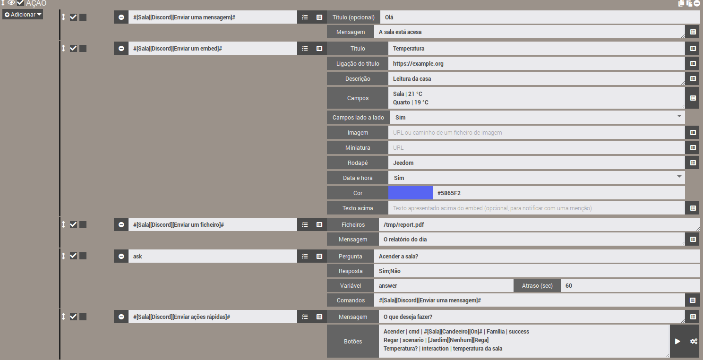
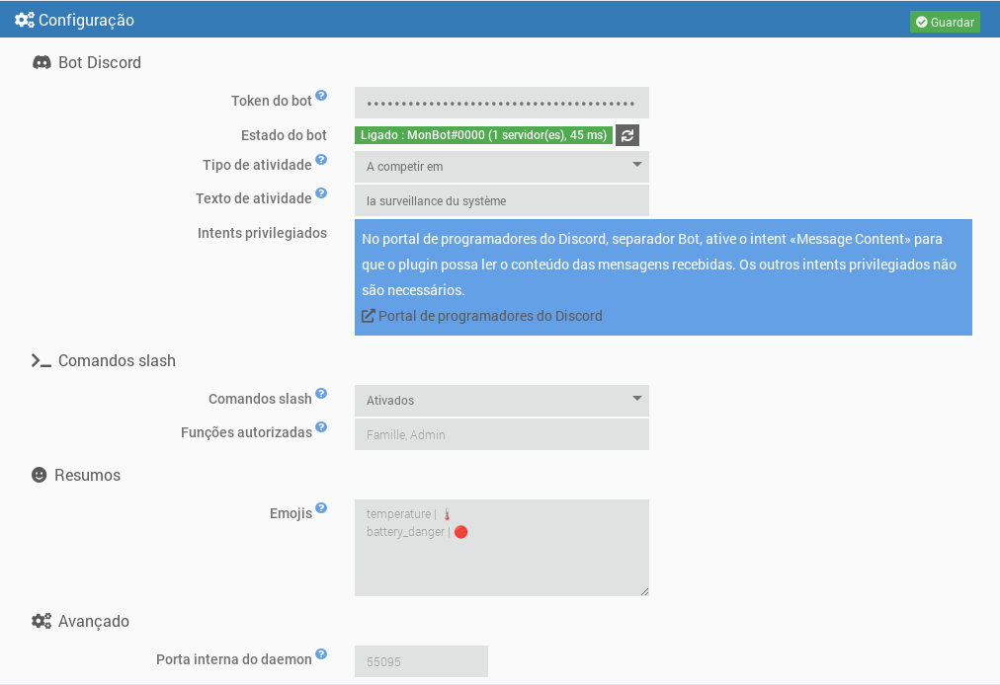
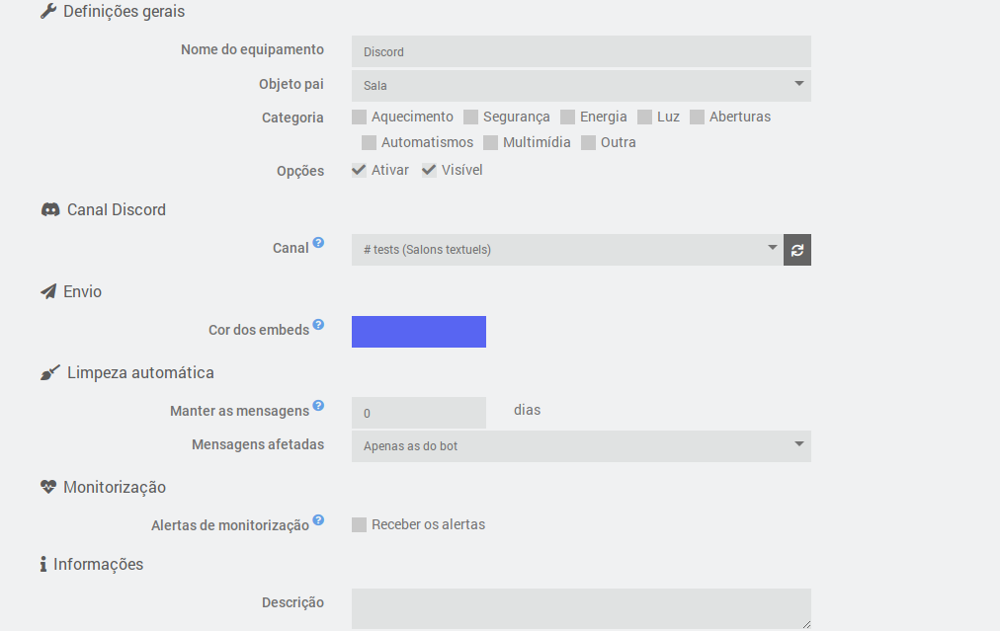
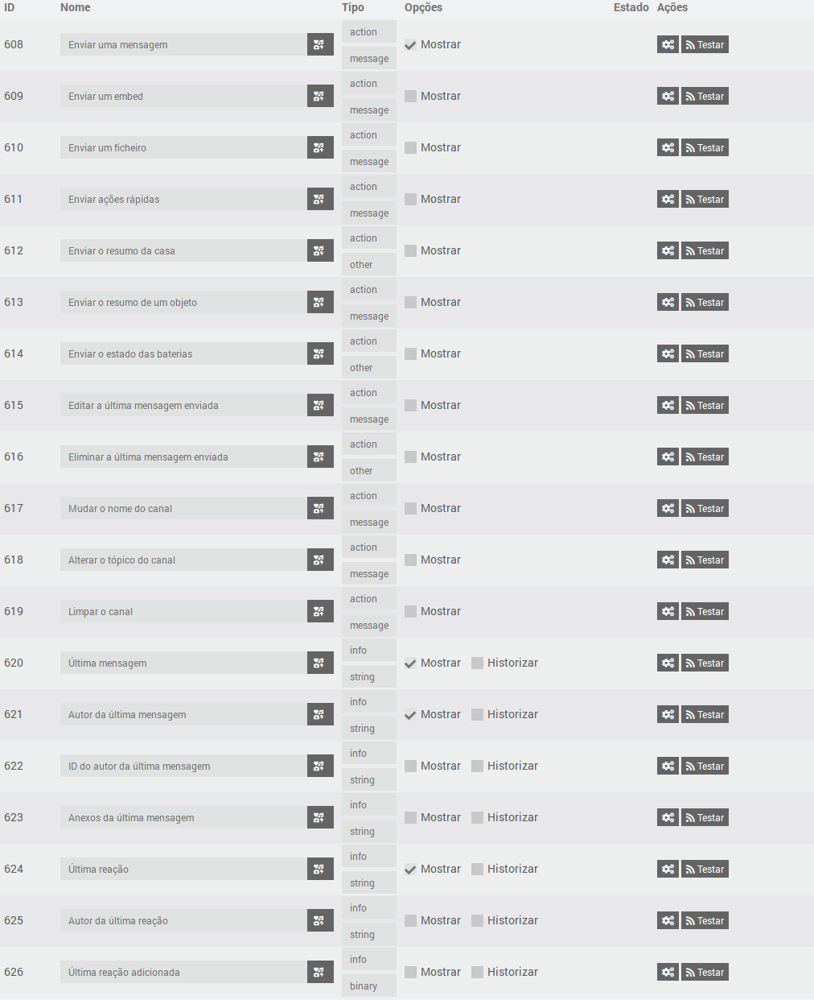
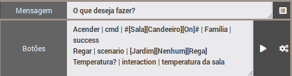

# Plugin JeeDiscord - STABLE


> [!warning]  
> O bot precisa do intent privilegiado **Message Content** (portal de programadores do Discord) para ler o conteúdo das mensagens. Sem ele, o Discord recusa a ligação e o daemon para: ver «Criar o bot Discord».  


O JeeDiscord liga o Jeedom a um servidor **[Discord](https://discord.com)** através de um bot. Cada equipamento corresponde a um canal, e o plugin permite:  

- **enviar** mensagens, embeds (mensagens enriquecidas) e ficheiros a partir dos cenários, com menções;
- **fazer perguntas** (ação «Ask» dos cenários) com botões ou um menu de respostas;
- **receber** as mensagens e as reações emoji do canal;
- oferecer **botões de ação rápida** e **comandos slash** (`/jeedom`, `/clean`) para controlar o Jeedom a partir do Discord;
- **editar ou eliminar** mensagens, **limpar** um canal, **mudar-lhe o nome** ou alterar o tópico (um canal de voz pode servir de ecrã);
- enviar **resumos** (casa, objeto, baterias) e **alertas de monitorização** dos daemons e das dependências.

Baseia-se na biblioteca [discord.js](https://discord.js.org/) v14 e na API do Discord v10.  

## Visão geral  

  

# Pré-requisitos  

- Jeedom 4.4 no mínimo
- Debian 12 no mínimo
- Node.js: instalado automaticamente pelo Jeedom durante a instalação das dependências

# Criar o bot Discord  

1. Aceda ao [portal de programadores do Discord](https://discord.com/developers/applications) e clique em **New Application**.
2. No separador **Bot**, clique em **Reset Token** e copie o token. Não voltará a ser apresentado: guarde-o num local seguro e nunca o partilhe.
3. Ainda no separador **Bot**, secção **Privileged Gateway Intents**, ative **Message Content Intent**. Os intents **Presence** e **Server Members** não são necessários.
4. No separador **OAuth2 > URL Generator**, marque os scopes `bot` e `applications.commands`, depois as permissões necessárias (ver abaixo). Abra o URL gerado para convidar o bot para o seu servidor.

Permissões recomendadas para o bot:

| Permissão | Utilização |
|---|---|
| View Channels | Ver os canais monitorizados |
| Send Messages | Enviar mensagens |
| Embed Links | Enviar mensagens enriquecidas (embeds) |
| Attach Files | Enviar ficheiros e capturas |
| Read Message History | Encontrar mensagens para as editar ou eliminar |
| Add Reactions | Reagir às mensagens |
| Manage Messages | Eliminar mensagens (limpeza) |
| Manage Channels | Mudar o nome de um canal ou alterar o seu tópico |

# Dependências  

O primeiro passo é instalar as dependências: depois de ativar o plugin, inicie a sua instalação a partir da página de configuração do plugin. O Jeedom instala ele próprio o Node.js e, em seguida, a biblioteca discord.js na pasta do plugin. O acompanhamento faz-se no log `jeediscord_packages`.  

# Configuração geral  

Depois de instaladas as dependências, preencha:

- **Token do bot**: o token copiado no passo 2 da criação do bot. Está cifrado na base de dados do Jeedom e ocultado nos logs.
- **Tipo de atividade** e **Texto de atividade**: texto apresentado sob o nome do bot no Discord (por exemplo «Personalizado» + «A vigiar a casa»). Deixe o texto vazio para não apresentar nada.
- **Comandos slash** e **Funções autorizadas**: ver «Comandos slash» mais abaixo.
- **Emojis**: emojis dos resumos e das baterias, ver «Resumos».
- **Porta interna do daemon** (avançado): porta local utilizada entre o Jeedom e o daemon. Só a altere em caso de conflito com outro plugin.

O **estado do bot** indica se o daemon está iniciado e ligado ao Discord, com o nome do bot, o número de servidores e a latência. A alteração da atividade é aplicada imediatamente, sem reiniciar o daemon. A introdução ou a alteração do token inicia ou reinicia o daemon (se a gestão automática do daemon estiver ativada), e o estado atualiza-se sozinho após a gravação.



## O daemon  

O daemon é um programa Node.js único que mantém a ligação ao Discord. Foi concebido para se manter leve:

- é iniciado com prioridade baixa (`nice`);
- só pede ao Discord os eventos úteis ao plugin (servidores, mensagens, reações);
- as suas caches são limitadas (mensagens recentes, membros) e esvaziadas regularmente.

**Respeito pelos limites do Discord**: os limites de débito da API (por rota e global) são geridos pelo discord.js, que coloca os pedidos em fila em vez de os perder. O plugin acrescenta uma fila por canal, que mantém a ordem das ações e junta as atualizações repetitivas (por exemplo, a mudança de nome de um canal: só o último valor é enviado).

**Ligação**: em caso de corte de rede no arranque, o daemon tenta de novo a ligação com um atraso crescente (de 15 segundos a 5 minutos). Depois de ligado, as religações são automáticas. Se o Discord recusar a ligação (token inválido, intent «Message Content» não ativado), o daemon para e deixa de ser reiniciado automaticamente, para não esgotar a quota diária de ligações do Discord. Surge uma mensagem no centro de mensagens: corrija o problema e depois grave a configuração do plugin.

## Logs  

O plugin utiliza três logs:

- `jeediscord`: ações do lado do Jeedom (arranque do daemon, eventos recebidos, erros);
- `jeediscord_daemon`: atividade do daemon e trocas com o Discord;
- `jeediscord_packages`: instalação das dependências.

Em nível **Debug**, o log do daemon detalha cada pedido enviado ao Discord (método, rota, código de retorno, quota restante), os limites de débito atingidos e as trocas com o Jeedom. As informações sensíveis são sempre ocultadas (`***`): token do bot, chave API do Jeedom, tokens de interação e de webhook. O token não aparece nem nos logs nem na lista de processos do sistema.

# Configuração de um equipamento  

Um equipamento corresponde a **um canal Discord**.

- **Canal**: lista dos canais visíveis para o bot, agrupados por servidor. Está disponível quando o daemon está ligado ao Discord e atualiza-se automaticamente quando um canal é criado, renomeado ou eliminado. O botão de atualização força a atualização. A menção «permissões insuficientes» assinala um canal onde o bot não pode enviar mensagens.
- **Cor dos embeds**: cor da borda das mensagens enriquecidas enviadas para este canal, utilizada quando o cenário não indica nenhuma.
- **Alertas de monitorização**: marque «Receber os alertas» para que este canal receba os alertas de avaria (ver «Monitorização»).
- **Limpeza automática**: número de dias durante os quais as mensagens do canal são mantidas (0: sem limpeza). As mais antigas são eliminadas automaticamente, uma vez por hora, quer apenas as do bot quer todas as mensagens (o bot precisa então da permissão «Manage Messages»). Ver «Limpar um canal».



## Comandos  

Cada equipamento dispõe dos seguintes comandos, utilizáveis nos cenários:

| Comando | Tipo | Função |
|---|---|---|
| Enviar uma mensagem | ação / mensagem | Envia um texto. O título, se preenchido, é apresentado a negrito na primeira linha. |
| Enviar um embed | ação / mensagem | Envia uma mensagem enriquecida (título, ligação, descrição, campos, imagem, cor, rodapé, data e hora). |
| Enviar um ficheiro | ação / mensagem | Envia um ou vários ficheiros (caminho local ou endereço web), com um texto opcional. |
| Enviar o resumo da casa | ação / outro | Envia um embed com os resumos globais do Jeedom (temperatura, humidade, aberturas...) e o estado das baterias. |
| Enviar o resumo de um objeto | ação / mensagem | Envia os resumos de um objeto do Jeedom, escolhido na lista de objetos. |
| Enviar o estado das baterias | ação / outro | Envia a lista dos equipamentos com a bateria fraca, com o número de baterias boas. |
| Editar a última mensagem enviada | ação / mensagem | Substitui o texto da última mensagem enviada pelo bot no canal. |
| Eliminar a última mensagem enviada | ação / outro | Elimina a última mensagem enviada pelo bot no canal (todas as suas partes se foi dividida). |
| Mudar o nome do canal | ação / mensagem | Altera o nome do canal. |
| Alterar o tópico do canal | ação / mensagem | Altera o tópico (a descrição apresentada no topo) de um canal de texto. |
| Limpar o canal | ação / mensagem | Elimina as mensagens mais antigas do que uma idade dada. |
| Enviar ações rápidas | ação / mensagem | Envia uma mensagem com botões que executam um comando, um cenário ou uma interação do Jeedom. |
| Última mensagem | info / outro | Conteúdo da última mensagem recebida no canal. |
| Autor da última mensagem | info / outro | Nome apresentado do seu autor (alcunha no servidor, caso contrário nome de apresentação). |
| ID do autor da última mensagem | info / outro | Identificador Discord do autor, fiável para as condições de cenário (um nome pode mudar). |
| Anexos da última mensagem | info / outro | Endereços dos anexos, um por linha. |
| Última reação | info / outro | Emoji da última reação adicionada ou removida. |
| Autor da última reação | info / outro | Nome apresentado da pessoa que reagiu. |
| Última reação adicionada | info / binário | 1 se a reação foi adicionada, 0 se foi removida. |



Os comandos de envio utilizam-se nas **ações dos cenários**: escolha o comando na lista e o formulário correspondente é apresentado. Apenas o comando «Enviar uma mensagem» é apresentado por omissão no dashboard; os outros estão ocultos, o que não impede de os utilizar nos cenários (podem ser tornados visíveis no separador Comandos do equipamento).

# Cenários  

## Enviar uma mensagem  

Os textos com mais de 2000 caracteres (limite do Discord) são divididos automaticamente em várias mensagens, de preferência nas quebras de linha.

Este comando aceita também os ficheiros transmitidos pelo Jeedom: relatórios gerados pela ação **Relatório** de um cenário, capturas enviadas por outros plugins, etc.

### Menções  

Nos textos, pode mencionar:

| Sintaxe | Resultado |
|---|---|
| `@{alcunha}` | um membro, procurado pelo nome de utilizador, nome de apresentação ou alcunha no servidor |
| `@&{função}` | uma função, procurada pelo nome |
| `#{canal}` | uma ligação para um canal |

A sintaxe nativa do Discord (`<@id>`, `<@&id>`) também funciona. Uma menção não encontrada permanece apresentada como texto simples. `@everyone` e `@here` não notificam ninguém.

A pesquisa de membros faz-se por nome e não requer o intent privilegiado «Server Members».

### Funcionamento do envio  

O envio é assíncrono: o cenário continua imediatamente e a mensagem é colocada na fila do canal. As mensagens de um mesmo canal partem sempre por ordem. Os ficheiros são lidos no momento da chamada: pode eliminar um ficheiro temporário logo a seguir ao comando.

Antes de enviar, o plugin verifica as permissões do bot no canal (ver, enviar mensagens, incorporar ligações, anexar ficheiros). Em caso de permissão em falta ou de falha, é registado um erro no log `jeediscord`.

## Enviar um embed  

Num cenário, o comando apresenta um formulário dedicado, com um campo por linha. O botão no fim da linha permite inserir o valor de um comando info do Jeedom (por exemplo uma temperatura) nos campos de texto:

- **Título** e **Ligação do título**: a ligação torna o título clicável;
- **Descrição**: texto principal (4096 caracteres no máximo);
- **Campos**: um campo por linha, sob a forma `Nome | Valor` (25 campos no máximo). **Campos lado a lado** (Sim ou Não) apresenta-os em colunas;
- **Imagem**: endereço web de uma imagem, ou caminho de um ficheiro de imagem no Jeedom, que é então anexado à mensagem. **Miniatura**: endereço web de uma pequena imagem apresentada no canto superior direito;
- **Rodapé**; **Data e hora** (Sim: data e hora de envio); **Cor** (o seletor ou um código `#RRGGBB`, caso contrário a cor do equipamento);
- **Texto acima**: texto apresentado acima do embed. As menções colocadas num embed não desencadeiam notificação: coloque-as aqui para avisar alguém.

Os textos demasiado longos são encurtados para respeitar os limites do Discord (6000 caracteres no total por embed).

## Enviar um ficheiro  

Indique o caminho completo de um ficheiro, **ou o seu endereço web** (`http://` ou `https://`), um por linha. O Discord aceita 10 ficheiros por mensagem: acima disso, são enviadas várias mensagens. O tamanho máximo de um ficheiro depende do nível de boost do servidor (10 MB sem boost, 50 MB no nível 2, 100 MB no nível 3). Os ficheiros demasiado grandes são ignorados e assinalados no log.

**Endereços web**: o ficheiro é primeiro descarregado pelo Jeedom para a sua pasta temporária (`/tmp/jeedom/jeediscord/download`), depois enviado como um ficheiro local e eliminado logo após o envio. O cenário espera pelo fim da transferência antes de continuar. O ficheiro chama-se `sendDiscord` seguido de uma extensão deduzida do tipo de conteúdo (por exemplo `sendDiscord.png`), seja qual for o nome no endereço; os redirecionamentos são seguidos, e a transferência é limitada a 60 segundos e 100 MB. Os endereços da rede local (por exemplo a imagem de uma câmara) são aceites. As credenciais e os parâmetros de um endereço nunca são escritos nos logs. Em caso de falha, é registado um aviso no log `jeediscord` e o ficheiro é ignorado. Um endereço pode conter vírgulas: apenas a quebra de linha separa dois ficheiros.

Por segurança, os ficheiros de configuração do Jeedom (`core/config`), as pastas do sistema (`/etc`, `/root`...) e os ficheiros ou pastas ocultos não podem ser enviados.

O campo «Ficheiros» aceita também variáveis e tags de cenário. Exemplo, com um gráfico gerado por um serviço web e enviado para o canal:

<details markdown='1'>
<summary>Clique para ver o exemplo de bloco de código</summary>

```php
// Exemplo: um gráfico construído pelo quickchart.io (serviço de terceiros), enviado depois para o canal
$valores = array(0, 0.2, 1.5, 0);                         // substitua pelas suas medições
$config = "{type:'bar',data:{labels:['1h','2h','3h','4h'],datasets:[{label:'mm',data:[" . implode(',', $valores) . "]}]}}";
$url = "https://quickchart.io/chart?format=png&c=" . urlencode($config);

// Guarda o endereço numa VARIÁVEL do cenário...
$scenario->setData("chartUrl", $url);
```

Na ação «Enviar um ficheiro» seguinte, introduza `variable(chartUrl)` no campo «Ficheiros». Atenção: `setData` cria uma variável, lida com `variable(...)`, ao passo que `tag(...)` lê os tags definidos com `$scenario->setTags(...)`.
</details>

## Fazer uma pergunta (ação «Ask» dos cenários)  

Os comandos «Enviar uma mensagem», «Enviar um embed» e «Enviar um ficheiro» podem ser escolhidos na ação **Ask** de um cenário (o campo «Comando» da ação).

- **Com respostas possíveis** (por exemplo `Sim;Não`): é apresentado um botão por resposta sob a pergunta. A partir de 10 respostas, um menu pendente substitui-as (25 respostas no máximo).
- **Sem resposta imposta** (`*`): nenhum botão é apresentado; a pergunta indica que se deve responder escrevendo uma mensagem, e a mensagem seguinte escrita no canal é a resposta.

Assim que uma resposta é dada, ou no fim do prazo, os botões são desativados e a mensagem indica quem respondeu e o quê (ou «Sem resposta»). A resposta é guardada na variável do cenário, como nos outros plugins de mensagens. Qualquer pessoa que possa escrever no canal pode responder.

Uma pergunta permanece válida enquanto o prazo não terminar e o daemon não for reiniciado: após um reinício, os seus botões são simplesmente desativados no clique seguinte.

## Resumos  

Três comandos enviam um embed de síntese, a lançar a partir de um cenário (por exemplo um disparo programado de manhã) ou de um botão de ação rápida:

- **Enviar o resumo da casa**: os resumos globais definidos no Jeedom (temperatura, humidade, luminosidade, potência, aberturas...), com no rodapé o número de baterias boas, fracas e críticas.
- **Enviar o resumo de um objeto**: os resumos do objeto cujo nome indicar no campo «Objeto». O botão no fim da linha (ícone de cubo) abre a lista de objetos do Jeedom; também pode escrever o nome à mão, ou uma variável de cenário.
- **Enviar o estado das baterias**: os equipamentos com bateria fraca (a laranja) ou crítica (a vermelho), da mais fraca à mais forte, com os limiares do Jeedom (os do equipamento, se os definir). A cor do embed segue o nível mais baixo. Se tudo estiver bem, a mensagem di-lo.

> [!warning]  
> Como na barra de menus do Jeedom, o resumo da casa só mostra os resumos «subidos». Na página do objeto (Ferramentas > Objetos, secção Resumos), defina o comando do resumo e marque depois **Voltar ao resumo geral** (assim aparece a etiqueta na interface do Jeedom) para esse resumo; sem esta caixa, só aparece em «Enviar o resumo de um objeto». Se nenhum resumo for subido, a mensagem indica-o.  

Os **emojis** à frente de cada resumo e de cada nível de bateria personalizam-se na configuração do plugin: uma linha `chave | emoji` por emoji (chaves: `temperature`, `humidity`, `luminosity`, `power`, `motion`, `security`, `door`, `windows`, `shutter`, `light`, `outlet`, `battery_ok`, `battery_warning`, `battery_danger`, `alert`, `recovery`). Uma chave ausente mantém o seu emoji por omissão.

## Capturas das câmaras  

É o plugin **Câmara** que tira as capturas e as envia: **não** se coloca, pois, nenhum comando de câmara no JeeDiscord, mas o contrário. Numa ação de cenário, escolha o comando **«Enregistrer»** da câmara (francês para «Gravar», por exemplo `#[Sala][A minha câmara][Enregistrer]#`, oculto do dashboard mas disponível nos cenários) e preencha os seus dois campos. Atenção: o comando «Capture» do plugin Câmara apenas guarda um ficheiro no Jeedom: não envia nada.

- **Número de capturas ou opções** (campo «Nombre captures ou options»): o número de capturas (por exemplo `1`), ou opções do plugin Câmara sob a forma `nbSnap=3 delay=2` (número de capturas e segundos entre duas capturas);
- **Comando que envia as capturas** (campo «Commande message d'envoi des captures»): o comando do JeeDiscord que receberá as imagens, por exemplo **[Sala][Discord][Enviar uma mensagem]** (ou «Enviar um ficheiro»). Utilize o seletor de comandos no fim da linha.

O plugin Câmara chama então este comando com os ficheiros das capturas, que são enviados para o canal do equipamento. O campo «Ficheiros» do comando do JeeDiscord não é utilizado neste caso: serve para os ficheiros cujo caminho indicar você próprio. As capturas são lidas no momento do envio, como os outros ficheiros (ver «Enviar um ficheiro» para os limites de tamanho e as pastas recusadas).

**Texto anexado às capturas**: é o plugin Câmara que fornece o texto transmitido ao JeeDiscord. Por omissão, envia um texto do tipo «Alerte sur la caméra *nome* à *data*» (em francês). Para o substituir, acrescente `message=` no campo de opções, com aspas se o texto contiver espaços: `nbSnap=1 message="Captura pedida:"`. O parâmetro `title=` não é tido em conta pelo plugin Câmara. Com «Enviar uma mensagem» como destino, o texto é apresentado acima das imagens; com «Enviar um ficheiro», acompanha-as.

## Editar ou eliminar a última mensagem  

Os comandos «Editar a última mensagem enviada» e «Eliminar a última mensagem enviada» atuam sobre o **último envio do bot no canal** (mensagem, embed, ficheiro, pergunta ou ações rápidas), incluindo quando um texto longo foi dividido em várias mensagens (a edição incide sobre a última parte, a eliminação sobre todas). São executados depois dos envios já em espera: um cenário pode, pois, enviar e depois editar ou eliminar logo a seguir.

- A edição substitui o **texto** da mensagem; os embeds, ficheiros e botões são mantidos. As menções `@{alcunha}` são resolvidas como no envio.
- A última mensagem é memorizada pelo daemon: após um reinício do daemon, deixa de haver mensagem a editar ou eliminar até ao envio seguinte (é então registado um erro no log).

## Mudar o nome de um canal, alterar o seu tópico  

Os comandos «Mudar o nome do canal» e «Alterar o tópico do canal» alteram o nome e o tópico do canal do equipamento. O bot deve ter a permissão **Manage Channels** (ou a função de administrador).

- Um canal **de texto** está sempre em minúsculas, com hífenes em vez de espaços («A Minha Casa» passa a `a-minha-casa`): é a regra do Discord.
- Um canal **de voz** aceita espaços, maiúsculas e emojis. Pode, pois, servir de **ecrã**: crie um equipamento ligado a um canal de voz e atualize o seu nome a partir de um cenário, por exemplo `🌡️ Sala: #[Sala][Sonda][Temperatura]# °C`. O nome está limitado a 100 caracteres, o tópico a 1024 (e só os canais de texto têm tópico).
- **O Discord limita estas alterações a 2 por cada 10 minutos por canal.** Para não bloquear, os pedidos que chegam durante a espera são juntados: só o último valor é enviado. Também nada é enviado quando o nome ou o tópico já é o do canal. Não chame, pois, estes comandos a cada variação rápida de um valor: a apresentação ficará simplesmente alguns minutos atrasada.

## Limpar um canal  

O comando «Limpar o canal» elimina as mensagens mais antigas do que uma idade (em horas ou dias; 0 para todas), à escolha **apenas as do bot** ou **todas as mensagens** (permissão «Manage Messages» necessária). As mensagens afixadas são sempre mantidas. A mesma limpeza é lançada de hora a hora para os equipamentos que têm uma duração de conservação (ver «Configuração de um equipamento»).

O Discord só permite a eliminação em massa para as mensagens com menos de 14 dias. As mensagens mais antigas são eliminadas uma a uma, ao ritmo imposto pelo Discord: 100 no máximo por passagem, o resto é tratado na passagem seguinte (uma linha do log `jeediscord` assinala-o). Cada passagem examina no máximo 1000 mensagens. O número de mensagens eliminadas é registado no log `jeediscord`.

## Ações rápidas  

O comando «Enviar ações rápidas» envia uma mensagem com botões **que permanecem ativos** (mesmo após um reinício do daemon). Utiliza-se num cenário: adicione uma ação e escolha depois **[Objeto][Equipamento][Enviar ações rápidas]** na lista de comandos. Preencha:

- **Mensagem**: o texto apresentado acima dos botões;
- **Botões**: um botão por linha, no formato `Etiqueta | tipo | destino | funções autorizadas | cor`.

| Campo | Conteúdo |
|---|---|
| Etiqueta | Texto do botão. |
| Tipo | `cmd` (comando de ação), `scenario` ou `interaction`. |
| Destino | O comando (`#[Objeto][Equipamento][Comando]#`), o cenário (ID, ou nome completo `[Grupo][Objeto][Nome]` com `Nenhum` se o cenário não tiver objeto, por exemplo `[Jardim][Nenhum][Rega]`; `[Jardim][Rega]` também é aceite) ou a frase da interação. |
| Funções autorizadas | Opcional: nomes ou IDs de funções Discord separados por vírgulas. Vazio = qualquer pessoa do canal. |
| Cor | Opcional: `primary` (azul, por omissão), `secondary`, `success` ou `danger`. |

Exemplo:

```
Acender a sala | cmd | #[Sala][Candeeiro][On]# | Família | success
Lançar a rega | scenario | [Jardim][Nenhum][Rega] | Família, Admin
Temperatura? | interaction | qual é a temperatura da sala
```

O resultado da ação é apresentado apenas à pessoa que clicou (✅ executado, ⛔ função não autorizada, ❌ erro: a causa está então no log `jeediscord`, ⚠️ botão que já não é válido, por exemplo porque o equipamento foi desativado ou movido para outro canal). Para uma interação, é apresentada a resposta da interação. O botão ▶ à direita do campo «Botões» insere um cenário escolhido na lista, o botão ao lado insere um comando de ação. Um cenário lançado por um botão recebe os tags `#jeediscord_user#` (nome da pessoa) e `#jeediscord_channel#` (ID do canal). Máximo: 25 botões por mensagem.



# Comandos slash  

O plugin regista em cada servidor do bot (disponíveis de imediato) dois comandos que se escrevem no Discord começando por `/`:

| Comando | Função |
|---|---|
| `/jeedom interaction text` | Envia uma frase às interações do Jeedom e apresenta a resposta. |
| `/jeedom scenario name [action]` | Inicia (por omissão), pára, ativa ou desativa um cenário. O nome completa-se automaticamente. |
| `/jeedom cmd command [value]` | Executa um comando do tipo ação. O valor serve para os comandos cursor, cor, lista ou mensagem. O nome completa-se automaticamente. |
| `/clean [days] [all]` | Elimina as mensagens do canal mais antigas do que o número de dias indicado (0: todas), as do bot ou, com `all`, as de toda a gente. Mesmo funcionamento que «Limpar o canal». |

As respostas só são visíveis para a pessoa que escreveu o comando. Os nomes dos comandos e dos parâmetros estão em inglês (regra do Discord para a escrita); as suas descrições são apresentadas na língua do Discord do utilizador (francês, inglês, espanhol, alemão, italiano, português, russo).

> [!warning]  
> Um comando slash pode controlar toda a casa. Só é, pois, executado se o canal estiver associado a um **equipamento JeeDiscord ativo** (noutro lado, o bot responde que não está disponível), e se a pessoa for **administradora do servidor** ou possuir uma das **funções autorizadas** da configuração do plugin (nomes ou IDs de funções separados por vírgulas). Enquanto a lista estiver vazia, só os administradores podem utilizar os comandos.  

O preenchimento automático dos cenários e dos comandos está sujeito aos mesmos direitos: uma pessoa não autorizada não vê nenhuma sugestão. A definição «Comandos slash» da configuração permite desativá-los: são então retirados dos servidores.

Se o bot não foi convidado com o scope `applications.commands` (ver «Criar o bot Discord»), o registo é recusado: o log `jeediscord_daemon` indica-o, e basta convidar de novo o bot com o URL corrigido. Os comandos `/jeedom` e `/clean` também são visíveis nas definições do servidor (Integrações), onde o Discord permite restringir a sua utilização a certos canais ou funções para além dos direitos do plugin.

# Monitorização  

De 5 em 5 minutos, o plugin verifica os plugins ativos: um **daemon parado** quando deveria estar a funcionar (gestão automática ativada e arranque possível), ou **dependências em erro**. Os canais dos equipamentos que marcaram «Receber os alertas» recebem então um alerta vermelho com a lista das avarias, depois uma mensagem verde quando tudo voltar à normalidade.

Para evitar falsos alertas, uma avaria só é assinalada se durar pelo menos duas verificações (o Jeedom reinicia ele próprio os daemons avariados), e uma única vez. O daemon do próprio JeeDiscord não é monitorizado: se estiver parado, não pode escrever no Discord.

# Receção de mensagens e reações  

Os comandos info são atualizados a cada mensagem ou reação recebida no canal, mesmo quando o valor não muda: uma mesma mensagem ou um mesmo emoji recebido duas vezes desencadeia duas vezes os cenários. O conteúdo da mensagem e o emoji são atualizados em último lugar: um cenário desencadeado por **Última mensagem** lê, pois, o autor e os anexos dessa mesma mensagem (mesmo princípio para **Última reação**).

Os emojis padrão são transmitidos tal como estão (por exemplo 👍), os emojis personalizados do servidor sob a forma `:nome:`. Exemplo de condição de cenário: `#[Casa][Discord][Última reação]# == "👍"`.

As mensagens do próprio bot e as mensagens do sistema do Discord (afixação, chegada de um membro...) são ignoradas. As mensagens de outros bots e de webhooks são transmitidas.

Os endereços dos anexos são fornecidos pelo Discord e expiram ao fim de cerca de 24 horas: utilize-os rapidamente.

Só os eventos dos canais associados a um equipamento ativo são transmitidos pelo daemon ao Jeedom.

# Scripts de terceiros  

O JeeDiscord baseia-se na biblioteca **discord.js** na versão *v14*.  
Pode encontrar o código github original aqui: [discordjs/discord.js](https://github.com/discordjs/discord.js)  

O plugin foi concebido e dirigido por **ddelec24** (maestro do projeto) e desenvolvido com **Claude** (Anthropic), coautor do código e da documentação.  

# Informações adicionais  

 - O plugin não foi testado em todas as configurações de servidores Discord, de funções e de permissões.  
 Abra uma Issue no [GitHub](https://github.com/ddelec24/jeediscord/issues) ou escreva uma mensagem no fórum [Community Jeedom](https://community.jeedom.com/tag/plugin-jeediscord) se detetar um mau funcionamento.  

## Ajuda - FAQ  

### O daemon não arranca, «O token do bot não está preenchido»  
Introduza o token na configuração do plugin e grave.  

### «Ligação recusada pelo Discord: token do bot inválido»  
O token foi reposto ou mal copiado: gere um novo (portal de programadores, separador Bot) e grave a configuração.  

### «Intent Message Content não ativado»  
Ative **Message Content Intent** no separador Bot do portal de programadores e grave depois a configuração do plugin.  

### «Dependências não instaladas»  
Inicie a instalação das dependências a partir da página do plugin e consulte o log `jeediscord_packages`.  

### Nenhum canal na lista do equipamento  
O daemon não está ligado, ou o bot não tem permissão para ver os canais: verifique o estado do bot na configuração e as permissões «View Channels».  

### Uma mensagem não é enviada  
Consulte o log `jeediscord`: uma permissão em falta (enviar mensagens, incorporar ligações, anexar ficheiros) é lá indicada.  

### As capturas da câmara não chegam  
Utilize o comando «Enregistrer» **da câmara** e indique o comando do JeeDiscord no seu campo de destino (ver «Capturas das câmaras»). Consulte o log `camera_record` do plugin Câmara e o log `jeediscord`.  

### O meu ficheiro enviado por endereço web não chega, o campo «Ficheiros» está vazio  
O campo é avaliado pelo Jeedom antes da chamada ao plugin: verifique no log do cenário a opção `files` da linha de execução do comando. Se estiver vazia, a variável ou o tag não existe nesse ponto: uma variável definida com `setData` lê-se com `variable(nome)`, um tag definido com `setTags` com `tag(nome)`. Um erro num bloco de código anterior (por exemplo um `array_merge()` sobre um valor `null`, que é um erro fatal em PHP 8) impede de definir o valor.  

### Os comandos slash não aparecem  
Convide de novo o bot com o scope `applications.commands` e reinicie depois o daemon. Verifique se «Comandos slash» está ativado na configuração.  

### «Este canal não está associado a nenhum equipamento JeeDiscord ativo»  
Os comandos slash e os botões só funcionam nos canais de um equipamento ativo.  

### O resumo da casa está vazio  
Marque «Voltar ao resumo geral» para os resumos pretendidos na página do objeto (ver «Resumos»).  

### O meu cenário inicia-se mesmo quando a mensagem não cumpre a minha condição (smiley, «?»)  
Com um disparador do tipo `#[Sala][Discord][Última mensagem]# matches "/^\s*!temperatura\s*$/u"`, o Jeedom só coloca o valor entre aspas se contiver uma letra ou um espaço, ou se estiver vazio. Uma mensagem feita apenas de smileys ou pontuação dá, pois, uma expressão inválida: o Jeedom considera-a então verdadeira e inicia o cenário. É um comportamento do núcleo do Jeedom, não do plugin. Para o evitar, coloque este bloco de código como primeira ação do cenário:

```php
$msg = cmd::byString('#[Sala][Discord][Última mensagem]#')->execCmd();
if (!preg_match('/^\s*!temperatura\s*$/u', (string) $msg)) {
  $scenario->setDo(false); // nenhum bloco é executado depois
  return;
}
```

### A mudança de nome de um canal está atrasada  
O Discord limita as mudanças de nome a 2 por cada 10 minutos por canal (ver «Mudar o nome de um canal, alterar o seu tópico»).  

## Problemas conhecidos  

- O Discord limita a mudança de nome de um canal a 2 alterações por cada 10 minutos: um ecrã que muda muito frequentemente ficará alguns minutos atrasado.
- A última mensagem enviada (para a editar ou eliminar) e as perguntas em espera são memorizadas pelo daemon: um reinício do daemon faz com que se percam.
- Os endereços dos anexos recebidos expiram ao fim de cerca de 24 horas.
- Um disparador de cenário com uma expressão `matches` inicia-se por engano com uma mensagem sem letras (ver a FAQ acima).

---------------------------------------------------------------
Para quaisquer outras questões, verifique se já existe uma resposta à sua dúvida; caso contrário, pergunte na [community jeedom](https://community.jeedom.com)
